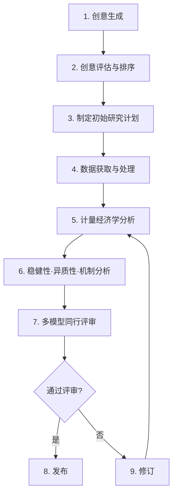

# AutoPaper 复现 — 端到端工作流程

## 完整流程图



---

## 阶段一：创意生成（ideas.md）

### 目标
生成 5 个具有**可信因果识别策略**的商业银行政策评估研究方向。

### 评估维度
- **原创性** — 是否填补了商业银行研究的文献空白？
- **可行性** — 数据变量是否存在于 data_schema.txt 中？
- **因果识别** — 是否可用 DiD/RDD 等方法？
- **政策相关性** — 对银行业监管决策者是否有参考价值？

### 输出文件
- `ideas.md` — 5 个候选研究方向
- `ideas_ranked.json` — 评分与排序

### 执行要点
1. 使用 LLM（推荐 Claude claude-opus-4-5）生成候选创意
2. 每个创意需包含：研究问题、识别策略（银行层面）、数据来源、预期贡献
3. 根据评估维度对创意打分排序
4. 选择得分最高的创意进入下一阶段

---

## 阶段二：制定研究计划

### 2.1 初始研究计划（initial_plan.md）

> ⚠️ **关键规则**：`initial_plan.md` 一旦提交到 Git，**永不修改**。Git 时间戳证明研究计划先于数据分析。

必须包含的内容：
1. **研究问题** — 清晰、可检验的因果命题（聚焦于商业银行）
2. **识别策略** — DiD / RDD / IV 等方法的详细描述
3. **数据来源** — 具体的 data.dta 变量列名和描述
4. **样本选择** — 银行类型范围、时间范围
5. **主要回归方程** — Markdown 数学公式（含银行固定效应和年份固定效应）
6. **预期结果** — 假设方向和理论依据
7. **稳健性检验** — PSM-DID、安慰剂检验、系统GMM、工具变量、替代度量

### 2.2 最终研究计划（research_plan.md）
在研究过程中可进化的版本，修改须留下变更记录。

---

## 阶段三：数据加载与预处理（code/01_fetch_data.do）

### 流程
```text
使用 `use` 命令加载 data/data.dta → 编码面板标识 (bankid, year) → 生成银行特征控制变量 (winsor2 缩尾) → 构造 DID 处理变量 → 生成交互固定效应 → 样本筛选 → 保存 clean_data.dta
```

### 关键步骤
1. **定义所需变量** — 根据研究计划确定因变量、银行特征控制变量
2. **定位本地数据** — 根据 07_data_source_guide.md 并在 data_schema.txt 中寻得所需变量
3. **读取并清洗** — 使用 `use "data/data.dta", clear` 加载数据，处理缺失值
4. **面板设定** — `xtset bankid year`，编码银行类型、地区等标识
5. **控制变量生成** — 银行规模(Ln_Assets)、资本充足率(CAR)、不良贷款率(NPL)、净利差(NIM)、成本收入比(CIR)、存贷比(LDR)等，含 winsor2 缩尾
6. **构造处理变量** — 定义 Treat、Post、DID 交互项
7. **保存处理后的面板数据** — 写入 `data/clean_data.dta`，供回归使用

### 数据质量检查
- 检查缺失值
- 验证时间覆盖范围
- 确认银行样本量充足

---

## 阶段四：计量分析

### 4.1 双重差分法（DiD）流程（code/03_main_analysis.do）

```stata
* 商业银行 DiD 分析框架
* 1. 基准 TWFE 回归（OLS）
reghdfe Y $Controls DID, absorb(bankid year) vce(cluster bankid)
est store twfe

* 2. 泊松伪极大似然估计（计数型因变量）
ppmlhdfe Y $Controls DID, absorb(bankid year) vce(cluster bankid)

* 3. 系统 GMM 动态面板（银行绩效变量常用）
xtabond2 Y L.Y $Controls DID, gmm(L.Y, lag(2 4)) iv($Controls DID) twostep robust small

* 4. Driscoll-Kraay 标准误（截面相关稳健）
xtscc Y $Controls DID, fe lag(2)
```

### 4.2 断点回归设计（RDD）流程（code/03_main_analysis_rdd.do）

```stata
* 商业银行 RDD 分析
* 1. 驱动变量（如资本充足率），断点 = 监管阈值
* 2. 局部多项式估计
rdrobust Y X, c(cutoff)
* 3. McCrary 密度检验（关注银行报表操纵）
rddensity X, c(cutoff)
* 4. 协变量平衡性检验
rdrobust Ln_Assets X, c(cutoff)
```

### 4.3 平行趋势 / 事件研究图提取

```stata
* 生成动态效应系数图
coefplot, vertical keep(pre3 pre2 pre1 current post1 post2 post3new) yline(0)
graph export "figures/parallel_trends.png", replace
```

### 4.4 必做检验清单
- [ ] 平行趋势检验（Pre-trends test / Dynamic Effects）
- [ ] 安慰剂检验（随机置换 Placebo tests）
- [ ] PSM-DID 倾向得分匹配
- [ ] 工具变量回归（IV）
- [ ] 系统 GMM 动态面板检验
- [ ] Driscoll-Kraay 标准误（截面相关稳健）
- [ ] 排除竞争性银行监管政策
- [ ] 排除特定银行样本（如五大行、金融危机年份）
- [ ] 替代度量检验（替换被解释变量）
- [ ] 缩尾敏感性检验

---

## 阶段五：异质性·机制·进一步分析

### 5.1 异质性分析（code/06_heterogeneity.do）
- 按**银行类型**分组：国有大行 / 股份制 / 城商行 / 农商行
- 按**银行规模**分组：大型 / 中小型
- 按**产权性质**分组：国有控股 / 非国有控股
- 按**上市状态**分组：上市银行 / 非上市银行
- 按**地区**分组：东部 / 中西部
- 使用 bdiff Bootstrap 组间系数差异检验

### 5.2 机制分析（code/07_mechanism.do）
- 风险管理渠道：NPL、拨备覆盖率、风险加权资产
- 信贷配置渠道：中小微贷款占比、绿色信贷占比、贷款集中度
- 金融创新渠道：非利息收入占比、金融科技指数

### 5.3 进一步研究（code/08_further_analysis.do）
- 交互项调节效应（DID × 监管压力 / 市场竞争 / 金融科技）
- 前瞻性经济后果（F1.NPL、F1.ROA、F1.LoanGrowth）
- 动态长期效应（F1 ~ F3）
- 同业溢出效应分析

---

## 阶段六：论文撰写（paper.md）

### 论文结构
1. **标题 / 摘要** — 题目和摘要
2. **引言** — 研究背景与贡献
3. **制度背景** — 银行业监管政策背景
4. **数据** — 银行数据描述
5. **实证策略** — 识别策略与模型
6. **主要结果** — 基准回归结果
7. **稳健性检验** — 全套稳健性检验
8. **异质性分析** — 按银行类型/规模/产权
9. **机制分析** — 风险管理/信贷配置/金融创新
10. **进一步研究** — 调节效应、前瞻后果
11. **结论** — 结论与政策建议
12. **参考文献** — 参考文献

### 图表标准
- 所有图表使用 Stata 代码 (`05_figures.do`) 自动生成
- 输出格式：PNG（图表）和 CSV（表格）
- 图表须有清晰的标题、标签和注释

---

## 阶段七：多模型同行评审

### 评审模型
1. **GPT-5-mini** — 生成 `review_gpt_*.md`
2. **Grok-4.1-Fast** — 生成 `review_cc_*.md`
3. **Gemini-3-Flash** — 评审
4. **Codex-Mini** — 评审

### 评审维度
- 研究问题的原创性（商业银行领域）
- 识别策略的可信度（银行层面因果推断）
- 银行数据质量与样本选择
- 统计分析的正确性（含 GMM 诊断）
- 结果的稳健性
- 写作质量

### 评审输出
每个评审模型生成独立的评审报告，格式为 Markdown。

---

## 阶段八：修订与迭代

### 修订流程
1. **汇总评审意见** — 整理所有模型的反馈
2. **制定修订计划** — `revision_plan_1.md`
3. **回复评审** — `reply_to_reviewers_1.md`
4. **执行修订** — 修改代码/分析/论文
5. **重新评审** — 如需要进入下一轮

### 常见修订要点
- 增加系统 GMM 动态面板稳健性检验
- 增加 Driscoll-Kraay 标准误处理截面相关
- 增加按银行类型的异质性分析
- 补充机制分析（风险管理/信贷配置渠道）
- 解释银行间溢出效应的可能影响

---

## 阶段九：发布

### 发布检查清单
- [ ] `metadata.json` 完整且正确
- [ ] `paper.md` 格式正确
- [ ] `REPLICATION.md` 包含复现步骤
- [ ] 所有 Stata 脚本可独立运行（00~08）
- [ ] 数据可通过本地 data.dta 获取
- [ ] 图表与论文中引用一致
- [ ] 版本号正确递增
