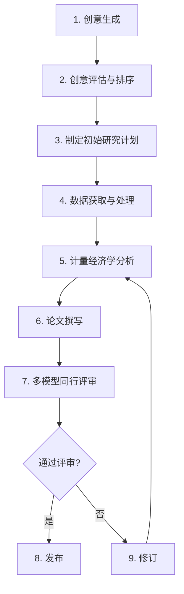

# APEP 复现 — 端到端工作流程

## 完整流程图



---

## 阶段一：创意生成（ideas.md）

### 目标
生成 5 个具有**可信因果识别策略**的政策评估研究方向。

### 评估维度
- **原创性** — 是否填补了文献空白？
- **可行性** — 数据是否可公开获取？
- **因果识别** — 是否可用 DiD/RDD 等方法？
- **政策相关性** — 对决策者是否有参考价值？

### 输出文件
- `ideas.md` — 5 个候选研究方向
- `ideas_ranked.json` — 评分与排序

### 执行要点
1. 使用 LLM（推荐 Claude claude-opus-4-5）生成候选创意
2. 每个创意需包含：研究问题、识别策略、数据来源、预期贡献
3. 根据评估维度对创意打分排序
4. 选择得分最高的创意进入下一阶段

---

## 阶段二：制定研究计划

### 2.1 初始研究计划（initial_plan.md）

> ⚠️ **关键规则**：`initial_plan.md` 一旦提交到 Git，**永不修改**。Git 时间戳证明研究计划先于数据分析。

必须包含的内容：
1. **研究问题** — 清晰、可检验的因果命题
2. **识别策略** — DiD / RDD / IV 等方法的详细描述
3. **数据来源** — 具体的 API 端点和变量描述
4. **样本选择** — 时间范围、人群筛选条件
5. **主要回归方程** — LaTeX 数学公式
6. **预期结果** — 假设方向和理论依据
7. **稳健性检验** — 安慰剂检验、子样本分析、替代度量

### 2.2 最终研究计划（research_plan.md）
在研究过程中可进化的版本，修改须留下变更记录。

---

## 阶段三：数据获取（code/01_fetch_data.R）

### 流程
```
Census/BLS/FRED API → 原始数据下载 → 数据清洗 → 面板数据构建 → 保存为 .rds
```

### 关键步骤
1. **配置 API 密钥**
2. **定义变量列表** — 就业率、失业率、收入、人口特征等
3. **循环获取多年数据** — 例如 ACS 2010-2023
4. **构造处理变量** — 定义政策实施时间、处理组/对照组
5. **生成面板数据** — State × Year 面板
6. **保存数据** — 写入 `output/` 或 `data/`

### 数据质量检查
- 检查缺失值
- 验证时间覆盖范围
- 确认样本量充足

---

## 阶段四：计量分析（code/03_main_analysis.R）

### 4.1 双重差分法（DiD）流程

```r
# 标准交错 DiD 框架
# 1. 基准 TWFE 回归
est_twfe <- feols(Y ~ treat | state + year, data = panel, cluster = ~state)

# 2. Sun-Abraham 交互加权估计
est_sa <- feols(Y ~ sunab(treat_year, year) | state + year,
                data = panel, cluster = ~state)

# 3. Callaway-Sant'Anna (2021)
library(did)
est_cs <- att_gt(yname = "Y", tname = "year", idname = "state",
                 gname = "treat_year", data = panel)

# 4. did2s 两步估计
library(did2s)
est_d2s <- did2s(panel, yname = "Y",
                 first_stage = ~ state + year,
                 second_stage = ~ treat, cluster_var = "state")
```

### 4.2 断点回归设计（RDD）流程

```r
library(rdrobust)
# 1. 运行变量（如年龄、收入等）
# 2. 局部多项式估计
rd_est <- rdrobust(Y, X, c = cutoff)
# 3. 密度检验
rdd_test <- rddensity(X, c = cutoff)
# 4. 安慰剂断点检验
```

### 4.3 事件研究图（Event Study）
```r
# 生成事件研究系数图
iplot(est_sa, main = "Event Study: Policy Effect",
      xlab = "Years Relative to Treatment",
      ylab = "Estimated Coefficient")
```

### 4.4 必做检验清单
- [ ] 平行趋势检验（Pre-trends test）
- [ ] 安慰剂检验（Placebo tests）
- [ ] 子样本分析（Subgroup analysis）
- [ ] 替代度量检验（Alternative outcome variables）
- [ ] 预趋势敏感性分析（Pre-trend sensitivity）

---

## 阶段五：论文撰写（paper.tex）

### 论文结构
1. **Title / Abstract** — 题目和摘要
2. **Introduction** — 研究背景与贡献
3. **Institutional Background** — 政策背景
4. **Data** — 数据描述
5. **Empirical Strategy** — 识别策略与模型
6. **Results** — 主要结果
7. **Robustness** — 稳健性检验
8. **Discussion** — 讨论与局限
9. **Conclusion** — 结论
10. **References** — 参考文献

### 图表标准
- 所有图表使用 R 代码 (`05_figures.R`) 自动生成
- 输出格式：PDF（图表）和 LaTeX tabular（表格）
- 图表须有清晰的标题、标签和注释

---

## 阶段六：多模型同行评审

### 评审模型
1. **GPT-5-mini** — 生成 `review_gpt_*.md`
2. **Grok-4.1-Fast** — 生成 `review_cc_*.md`
3. **Gemini-3-Flash** — 评审
4. **Codex-Mini** — 评审

### 评审维度
- 研究问题的原创性
- 识别策略的可信度
- 数据质量与样本选择
- 统计分析的正确性
- 结果的稳健性
- 写作质量

### 评审输出
每个评审模型生成独立的评审报告，格式为 Markdown。

---

## 阶段七：修订与迭代

### 修订流程
1. **汇总评审意见** — 整理所有模型的反馈
2. **制定修订计划** — `revision_plan_1.md`
3. **回复评审** — `reply_to_reviewers_1.md`
4. **执行修订** — 修改代码/分析/论文
5. **重新评审** — 如需要进入下一轮

### 常见修订要点
- 增加预趋势敏感性分析
- 解释反直觉的结果（如失业率上升→劳动力市场重新进入效应）
- 修复 LaTeX 引用和链接
- 增加子样本异质性分析

---

## 阶段八：发布

### 发布检查清单
- [ ] `metadata.json` 完整且正确
- [ ] `paper.pdf` 可正常打开
- [ ] `REPLICATION.md` 包含复现步骤
- [ ] 所有 R 脚本可独立运行
- [ ] 数据可通过 API 或本地文件获取
- [ ] 图表与论文中引用一致
- [ ] 版本号正确递增
