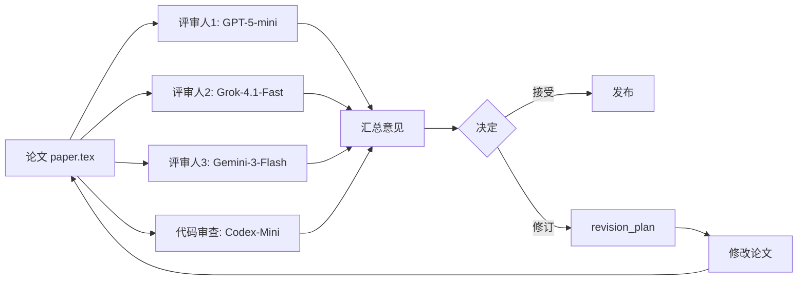

# APEP 复现 — 多模型同行评审系统

## 概述

APEP 的评审系统使用**多个 LLM 模型**独立审阅每篇论文，以模拟学术期刊的同行评审流程。

## 评审模型配置

| 模型           | 角色     | 文件前缀         | 特点               |
| -------------- | -------- | ---------------- | ------------------ |
| GPT-5-mini     | 评审人 1 | `review_gpt_`    | 注重方法论严谨性   |
| Grok-4.1-Fast  | 评审人 2 | `review_cc_`     | 注重创新性和实用性 |
| Gemini-3-Flash | 评审人 3 | `review_gemini_` | 综合评估           |
| Codex-Mini     | 代码审查 | `review_code_`   | 专注代码可复现性   |

## 评审流程



## 评审维度与评分标准

### 1. 研究问题质量（权重 15%）
- **10**: 全新的研究问题，填补重要文献空白
- **7-9**: 有意义的边际贡献
- **4-6**: 渐进式贡献，改进已有研究
- **1-3**: 缺乏新意或问题界定不清

### 2. 因果识别（权重 25%）
- **10**: 识别策略完美可信，满足所有假设
- **7-9**: 识别策略可信，小问题可修复
- **4-6**: 存在可识别的威胁但有缓解措施
- **1-3**: 严重的内生性/选择偏误问题

### 3. 数据与样本（权重 15%）
- **10**: 完美的数据覆盖和样本定义
- **7-9**: 数据充足，小问题可解释
- **4-6**: 数据有局限但可接受
- **1-3**: 数据问题严重影响结论

### 4. 统计分析（权重 20%）
- **10**: 使用最先进的方法，分析全面
- **7-9**: 方法恰当，稳健性检验充分
- **4-6**: 分析基本正确但不够全面
- **1-3**: 存在统计错误

### 5. 写作质量（权重 10%）
- **10**: AER/QJE 水平的写作
- **7-9**: 清晰流畅，结构合理
- **4-6**: 可读但有改进空间
- **1-3**: 写作不清晰或结构混乱

### 6. 可复现性（权重 15%）
- **10**: 代码完整、注释清晰、一键复现
- **7-9**: 基本可复现，需少量调整
- **4-6**: 可部分复现
- **1-3**: 无法复现

## 评审报告模板

```markdown
# Review Report

## Paper: apep_XXXX — {Title}
## Reviewer: {Model Name}
## Date: {Date}

## Overall Assessment
- **Recommendation**: [Accept / Minor Revision / Major Revision / Reject]
- **Overall Score**: X/10
- **Confidence**: [High / Medium / Low]

## Dimension Scores
| Dimension            | Score | Weight | Weighted |
| -------------------- | ----- | ------ | -------- |
| Research Question    | X/10  | 15%    | X.XX     |
| Identification       | X/10  | 25%    | X.XX     |
| Data & Sample        | X/10  | 15%    | X.XX     |
| Statistical Analysis | X/10  | 20%    | X.XX     |
| Writing Quality      | X/10  | 10%    | X.XX     |
| Reproducibility      | X/10  | 15%    | X.XX     |
| **Total**            |       |        | **X.XX** |

## Major Concerns
1. [详细描述]
2. [详细描述]

## Minor Concerns
1. [详细描述]

## Questions for Authors
1. [问题]

## Specific Suggestions
- [建议]

## Verdict
[最终总结性评价]
```

## 评审后处理

### 修订计划（revision_plan_N.md）
```markdown
# Revision Plan — Round N

## Summary of Reviews
- Reviewer 1 (GPT-5-mini): [建议/总分]
- Reviewer 2 (Grok-4.1-Fast): [建议/总分]
- ...

## Action Items

### Critical Fixes (必须修改)
| #   | Issue  | Source | Action | Status |
| --- | ------ | ------ | ------ | ------ |
| 1   | [问题] | R1,R2  | [方案] | [ ]    |

### Important Improvements (建议修改)
| #   | Issue  | Source | Action | Status |
| --- | ------ | ------ | ------ | ------ |
| 1   | [问题] | R1     | [方案] | [ ]    |

### Optional Enhancements (可选改进)
| #   | Issue  | Source | Action | Status |
| --- | ------ | ------ | ------ | ------ |
| 1   | [问题] | R3     | [方案] | [ ]    |
```

### 回复评审（reply_to_reviewers_N.md）
```markdown
# Reply to Reviewers — Round N

## Response to Reviewer 1 (GPT-5-mini)

### Major Concern 1: [标题]
**Reviewer's Comment**: [原文引用]
**Our Response**: [详细回复，解释如何修改或为何不修改]
**Changes Made**: [具体修改位置和内容]

### Minor Concern 1: [标题]
...

## Response to Reviewer 2 (Grok-4.1-Fast)
...
```

## 竞赛系统（Tournament）

> ⚠️ 竞赛系统代码不在公共仓库中，以下为根据 README 推断的机制。

- 每篇 APEP 论文与已发表的 AER/AEJ 研究进行**头对头 (head-to-head)** 比较
- LLM 评审作为"裁判"比较两篇论文质量
- 评分基于多轮比较的 ELO 积分系统
- 论文迭代版本（有 Parent ID）可继承并改进上一版本
