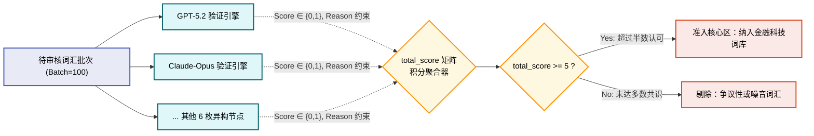
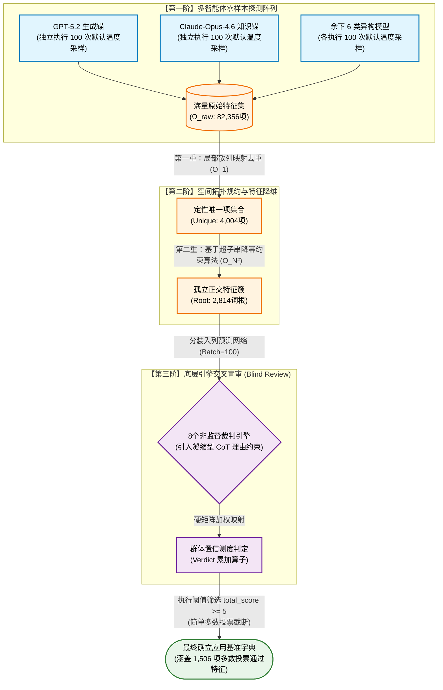
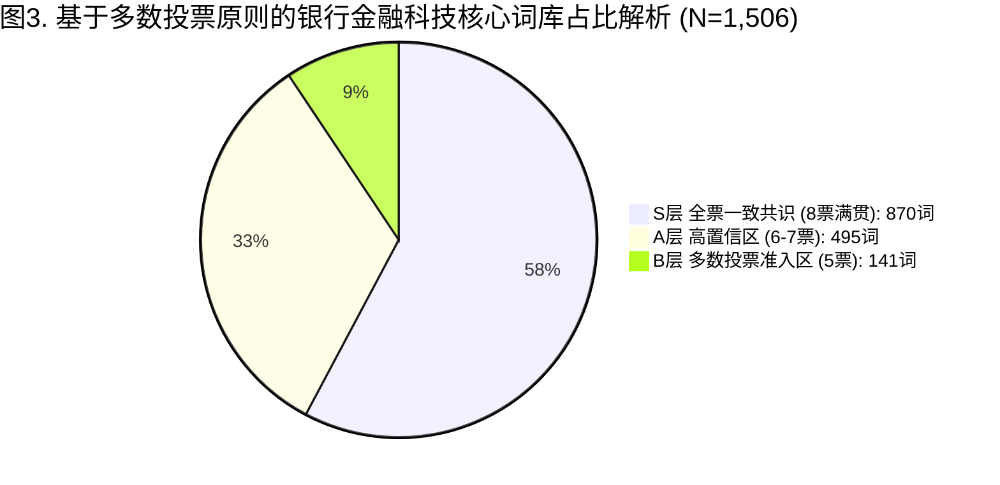

# 基于大语言模型群体智能的金融科技词典构建：多模型生成与交叉盲审机制

> ⚠ **版本状态（2026-07-18，自动标注）**：本文所载**提示词（Prompt）誊抄块、8 家模型清单、name「金融科技」（无「银行」前缀）、入选阈值 total_score ≥ 5（简单多数）、数量链 82,356→4,004→2,814→1,506、Fleiss κ = 0.5017（n = 8）**均对应 **v1 配置**。当前 `config.py` 已切换为 **v2**（域名「银行金融科技」/ 14 家模型 / 五类固定判据判别 Prompt / 2/3 超多数阈值 ≥10 票 / 生成 200 词 / 每模型重复 10 次），本文上述统计量与 Prompt 誊抄块**已与代码失配**。v2 的新数量链与 κ 须由 14 模型付费真跑产出、尚未执行——在 v2 重写定稿前，**请勿据本文数值复现或引用**。

## 摘要

近年来，金融科技（FinTech）的发展深刻改变了商业银行的业务模式、服务边界与风险特征。准确测度微观企业层面的金融科技水平，是实证金融与会计研究领域面临的重要挑战。传统的文本分析（Textual Analysis）方法受制于领域专家人工构建或无监督拓展的种子词典，这不可避免地引入了主观偏差，且存在更新时滞长、特定语境覆盖度低等局限性。为此，本文提出一种基于大语言模型群体智能（Swarm Intelligence of LLMs）的垂直领域词典全自动化构建方法。

依托 8 种当前主流的大语言模型（涵盖 GPT-5.2, Claude Opus 4.6, Gemini 3.1 Pro, Kimi-k2.5 等），本文针对商业银行“金融科技”领域，设计了“零样本并发生成 (Zero-shot Concurrency Generation)—集合迭代精简 (Set-based Evolutionary Reduction)—专家交叉盲审 (Cross-Blind Peer Review)”的三阶段运行机制。在生成阶段，各模型独立执行高并发温度采样，共获取 82,356 个原始词汇候选集；该文本集经数据清洗与基于子串包容理论的迭代规约，收敛至 2,814 个正交词根；在交叉盲审阶段，本文将“大模型作为评判者”（LLM-as-a-Judge）范式拓展至群体决策网络，引导 8 款模型开展背靠背评分并施加思维链（CoT）约束。最终，本文遴选出 1,506 个具有高置信度的金融科技词表，其中 870 词（占 2,814 个受审词根的 30.9%、占最终词表的 57.8%）获得了全体模型的一致通过。**量化验证显示，各模型间的 Fleiss' Kappa 系数达到 0.5017，位于 Landis & Koch (1977) 定义的中度一致性区间（Moderate Agreement），为本算法交叉盲审机制削减单体模型偏误的有效性提供了统计支持（分级口径的双重披露见 4.2 节）。**

本文的边际贡献主要体现在：第一，在研究机制上，体系化地将异构大语言模型的交叉验证范式引入金融特征词典的构建过程，有效缓解了单一模型的“幻觉”现象；第二，在数理基础上，针对群体似然估计下的确定性提取制定了数学规约，并论证了“提示词工程（Prompt Engineering）”在复杂语义判断中的适用性；第三，通过机器同行评审（Machine Peer Review）机制，为探析数字化转型及开放银行的文本量化测度，提供了更为客观的基础测量工具。

**关键词**：金融科技；大语言模型；文本分析；交叉盲审；同行评议

---

## 1. 引言

随着云计算架构、大数据分析、区块链可信计算和人工智能等底层技术与金融业务的深度交融，其不仅在微观操作层面优化了银行的信贷审批效率与风险定价机制，也在宏观系统层面影响了金融中介的资产组合演化与系统性风险重估 (Thakor, 2020；Goldstein et al., 2021)。为刻画微观金融机构在数字化转型中的战略投入与实施强度，当代实证研究愈发关注针对大规模非结构化文本（如企业年报的管理层讨论与分析、业绩说明会高管问答文本）的软信息提取（Soft Information Extractions），以此构造核心解释特征或代理变量。包含意图性文本特征的信息蕴含了超出滞后性财务报表数字约束的前瞻式定性指引，因此借助自然语言处理（NLP）技术构建量化指征，逐渐成为实证金融与会计学的标准分析范式之一 (Gentzkow et al., 2019; Loughran & McDonald, 2011; Ye et al., 2024)。

然而，针对特定微观场景（如金融科技、绿色创新等）构建高信噪比的非标准化特征词典，在计量方法学上仍面临瓶颈。在经典的研究设计中，种子词典与延展边界的界定通常由研究者通过先验性主观研判与人工搜集确定 (Baker & Wurgler, 2006; Tetlock, 2007; Hassan et al., 2019)。这一“专家知识系统”范式面临三重系统性约束：首先，人工标注甄别的边界易受研究者既有知识结构与主观假设的影响，从而引发词汇选择性偏差（Selection Bias）；其次，金融科技等新兴领域的衍生词汇处于动态增长中，导致静态特征词典易陷入词频提取的时效性困境；最后，即使采用基于统计共现的主题概率模型（如 LDA）或低维连续词向量空间（如 Word2Vec、GloVe）等无监督表征算法进行机械化扩容，也往往会因为纯粹的“语境共现（Co-occurrence）”而收录偏离金融因果逻辑的通用词汇噪音 (Hanley & Hoberg, 2019; Li et al., 2021; Siano, 2025)。面对海量的动态文本特征空间，单纯依靠人工交叉覆盖验证的成本较高，这使得传统词典构建方法在应对结构性语料变化时的稳健性受到关注 (García et al., 2023)。

进入后深度学习时代，特别是近年来以生成式预训练（Generative Pre-training）架构为代表的大语言模型（Large Language Models, LLMs），凭借庞大的参数规模和跨域自监督学习能力，展现出良好的零样本（Zero-Shot）泛化语义推断与特征匹配能力 (Brown et al., 2020; Wei et al., 2022; de Kok, 2025)。特别是在 Zheng et al. (2023) 提出“大模型作为实证评判者”（LLM-as-a-Judge）结构化代理框架后，研究普遍证实大语言模型在具备充分指令对齐（如 RLHF）、角色锚定（Persona Assignment）与温度（Temperature）边界约束设定的前提下，其对非结构化复杂文本的自动化评价一致性、多维打分能力与逻辑交互解释力，能够在一定程度上实现对人工标注成本的替代与效能提升 (Liu et al., 2023; Zheng et al., 2023; Gopal et al., 2025)。

为此，本文提出一种基于多智能体交叉盲审（Swarm Intelligence Cross-Blind Peer Review）机制的专属词表自动构建工作流。该框架整合了当前主流的 8 款大语言基座模型，构建起涵盖“零样本高频探测生成”、“集合运算与算子精化”以及“机器同行背靠背复审”的三阶段体系。

本文余下部分的内容安排如下：第2部分对金融文本分析和大语言模型相关文献进行综述回顾；第3部分详细阐述群体生成与盲审交叉验证机制的方法机理；第4部分报告系统运行结果、统计特征及数据分布；第5部分结合实证金融应用进行结论与展望。

---

## 2. 文献综述

### 2.1 文本表征在会计与金融实证研究中的应用
在资产定价与公司行为实证研究中，市场主体不仅仅依据量化财务数据进行决策，同时也广泛吸收披露文本中管理层叙事（Management Narratives）与语调（Tone）传递的信息增量 (Tetlock et al., 2008)。在早期研究中，受限于自然语言处理技术的普适性，学者通常借用哈佛心理学词典（Harvard IV-4）等通用情感库。然而，Loughran & McDonald (2011) 指出，通用词库在金融语境中存在严重的语义错位现象。这一研究推动了 Loughran-McDonald (LM) 专有财务情感词典的诞生，确立了特定领域专属词表在金融量化评估中的重要地位。

随后，学者基于特定宏观政策与微观经济冲击主题，构建了一系列具有预测力与截面解释力的软特征词表。例如，Baker et al. (2016) 以及 Hassan et al. (2019) 分别利用特定的政策文本高频词追踪测度，量化了“经济政策不确定性（EPU）”指数与“企业级政治风险曝露度（Firm-level Political Risk）”。针对信息技术、金融科技与企业数字化转型领域，在 Gomber et al. (2018) 界定的金融科技概念框架下，早期实证如 Cheng & Qu (2020) 依托传统静态规则，通过统计新闻等披露文本中“区块链”、“云计算”、“分布式记账”等特定特征词集的出现频次来构造银行数字化维度的代理变量。在此研究传统下，尽管词频字典有效降低了文本噪音提取难度，但总体而言，依靠少数先验专家主观界定或词汇延伸的特定微观词组，难以全面覆盖复杂金融创新的长尾信息，且静态词表难以应对市场动态特征词库的快速更新 (Siano, 2025)。

### 2.2 无监督自然语言算法的方法改进与局限
为了突破人工词表的局限性，机器学习算法得以被广泛应用于文本挖掘。潜在狄利克雷分配模型（LDA, Blei et al., 2003）及词嵌入技术（Word Embedding, 如 Word2Vec 等）允许研究者利用向量空间中的余弦相似度（Cosine Similarity），从庞大语料库中自动化提取与核心概念距离接近的潜藏词组 (Hanley & Hoberg, 2019)。

虽然空间映射显著拓宽了特征信息的覆盖面，但无监督表征算法在很大程度上会引入过度映射（Over-mapping）与“假阳性”问题 (Li et al., 2021)。伴随共现概率的增加，部分非特定业务指代的伴生词也会混入特征池中。由纯粹统计相关性导致的维数膨胀，会对实证模型的回归系数和稳健性检验产生显著的内生性影响，凸显了高维审核机制缺失带来的方法学挑战。

### 2.3 生成式人工智能与“LLM-as-a-Judge”的学术前沿
与古典文本计量模型相比，自基于 Transformer 注意力机制的架构被提出以来 (Vaswani et al., 2017)，大语言模型（LLMs）的演进深刻改变了认知计算的底层统计学习范式。在特定的金融推演、审计判研与非结构化文本分析领域，FinBERT (Huang et al., 2023) 抑或 BloombergGPT (Wu et al., 2023) 等基于专业金融语料库深度微调的模型，在市场情绪分类与风险隐性特征提取中均展现出显著的模型优势。近期的文献如 Lopez-Lira & Tang (2023) 验证发现大语言基座模型在处理含有未知信号的文本证券预期收益解读时，表现出一定的预见性；Kıcıman et al. (2023) 进一步论证了大语言模型在文本推理中展现出向“因果关联发现（Causal Reasoning）”演进的潜能。

更进一步，在微观实证设计的方法论层面，学界开始探索利用预训练大模型集群在评估过滤（Evaluative Filtration）与“标注员代理”（Employed Agent Annotator）环节的适用性与鲁棒性。遵循对齐机制（RLHF），能够使模型深刻拟合复杂的人类评价逻辑与效用偏好约束，并在一定程度上连贯执行跨语言打分与逻辑归因指令 (Ouyang et al., 2022; Zheng et al., 2023; Gopal et al., 2025)。为了降低单一架构或特定语料带来的模型内生一致性偏差（Memory Hallucination Error），Zheng et al. (2023) 提出并在探讨实证应用时论证了：在多智能体系统（Swarm-Agent Voting Systems）中建立底层的统计验证协议能够有效控制偏见与假阳性；Bernard et al. (2026) 亦证实经人工基准校验的 GPT 文本测度具备可靠效度。本文在此基础上，进一步探索将其应用至特定学术领域垂直词库的自动化编纂流转中，并通过统计学一致性检验指标系统，评估多模型交叉判断的有效性与特征剥离的收敛性。


## 3. 研究方法与核心演化算法

### 3.1 大语言模型基座选择与群体智能并发采样机制
为克服单一网络架构或特定预训练语料带来的推断偏差（Architectural Bias），本研究采用零样本（Zero-Shot）探测机制。在预训练基座的选择上，本文依据 2026 年 2 月 27 日更新的 SuperCLUE 通用大模型排行榜（General Leaderboard），筛选了总分超过 60 分的头部大语言模型（Foundation Models），以确保特征生成与判决能力的研究基线。基于此标准，本文确立了当前具备代表性的 8 种大语言模型组合（见表1）。这些入选模型在参数规模、注意力流形机制以及基于人类反馈强化学习（RLHF）的对齐倾向上存在显著的异构性，从而构成了多智能体决策网络。

| 模型序列 / 编号                | 开发机构 / 部署环境  | 参数量级及架构属性         | 本系统功能定位               |
| :----------------------------- | :------------------- | :------------------------- | :--------------------------- |
| **Claude-Opus-4.6**            | Anthropic / 商业 API | 逻辑对齐特化，安全性约束强 | 高质生成锚点 / 严密交叉复审  |
| **Gemini-3.1-Pro-Preview**     | Google / 多模态架构  | 超长检索窗口，知识图谱丰富 | 长尾概念提取 / 交叉前瞻盲审  |
| **Doubao-Seed-2.0-pro-260215** | 字节跳动 / 火山引擎  | 高并发流量模型底座         | 基础生成节点补充与防偏见兜底 |
| **Claude-Opus-4.5 (20251101)** | Anthropic / 商业 API | 上代 Opus 稳定版基座       | 逻辑验证校验池补充           |
| **Gemini-3-Pro-Preview**       | Google / 多模态架构  | 通用型 Gemini 分析底座     | 评判算力支撑                 |
| **GPT-5.2**                    | OpenAI / 商业 API    | MoE 架构                   | 基座生成锚点 / 核心盲审判决  |
| **Kimi-k2.5**                  | Moonshot / 商业 API  | 中文基座优化，长上下文支持 | 中文经济学语料图谱挖掘       |
| **Gemini-3-Flash-Preview**     | Google / 效能 API    | 响应延迟低，高并发吞吐     | 高频生成衍生词特征空间       |
*表1: 集成的 8 种大语言模型组合特征（Heterogeneous LLM Matrix Baseline）*

针对给定的金融细分领域 $D=\{\text{“金融科技”}\}$，系统构建了结构化提示工程（Prompt Engineering）。

**[ 提示词 1：初始规模生成构型与机制阐述 ]**

以下为 `config.py::build_generate_prompt`（:196–204）的逐字誊抄（`DOMAINS` 现仅
"金融科技"单一条目，:183–189；无"银行"限定词前缀、无"约"字近似修饰）：

```text
请生成一个包含**100个**中文专业词汇的"金融科技"词典。
参考词汇：金融科技、数字金融、开放银行、监管科技、人工智能、大数据、区块链、云计算、物联网等
要求：每个词汇应确保简洁、准确且意义明确，涵盖"金融科技"的所有领域。
格式：必须严格返回一个JSON对象，Key为"keywords"，Value为列表。
示例：{"keywords": ["金融科技", "数字金融", "开放银行"]}
```

**提示词机制分析**：
1. **定量约束与确定性提取**：“100个”和“简洁、准确”等指令旨在限制模型的局部发散，引导大语言模型从预训练权重的经验图谱（Empirical Knowledge Retrieval）中提取稳健实体。
2. **结构化输出约束**：要求返回标准序列化 JSON 对象，剥离自然语言生成中常见的冗余前缀和推导解释，满足高并发任务的系统解析要求。

需要指出的是，本阶段特征抽取的温度系数（Temperature，$T$）并未压缩，而是**调用了各大模型默认的生成温度参数（Default Temperature）**。
这一设计的理论动因在于：第一阶段的核心诉求是“查全率（Recall）”与“特征分布探测”；在默认温度参数下，语言模型的下一个词元（Token）概率分布具有一定的平滑性（Softmax Smoothed），允许生成引擎在受控的指令边界内进行探索（Random Walk Exploration），从而更广泛地涵盖商业技术相关词汇。单次调用生成目标字符串序列 $v$ 的概率采样（Monte Carlo Sampling）可表述为：
$$
v \sim \mathbb{P}_{\theta_m}(v \mid Prompt_{gen}, T_{default})
$$
针对每一个独立的智能体 $m \in \{1 \dots 8\}$，框架并发执行 $N=100$ 次独立的重复调用采样。得益于默认温度下保留的搜索空间，并行请求获取了较为完备的原始概念词包袋，累计含有 82,356 个未清洗词条表征（Raw Entity Entries）。

### 3.2 动态算子空间规约：词根演化提取算法
原始词集（$\Omega_{raw}$）存在明显的多重共线性（Collinearity）及短语叠加（Paraphrased Redundancy Variants）。为了萃取具有独立性的底层微观特征，本研究构造了基于集合映射的降维算法。

**步骤 1：Unicode 规范化与哈希映射去重**
剥除字符串两端的控制符并执行 NFKC 正规化。通过建立哈希表（Hash Table），在 $\mathcal{O}(1)$ 检索时间复杂度下过滤所有的频数复制，获得全局唯一实体词包 $\mathcal{U}_{unique}$，从而将 8.2 万冗余词压缩为 4,004 个唯一实体项。

**步骤 2：超子串降维约束算子（Super-Substring Inclusive Elimination）**
对于文本测度模型，衍生子串（如“大数据与云计算系统”）不可避免地内含并重复计量了核心词根（“云计算”）。为此，本文定义了降幂剔除算子。令按字符长度单调升序排列的字典集合为 $\mathcal{U}_{sorted}$。对任意待考量元素 $w_k$，如果存在已确立的核心源集 $\mathcal{A}$，且：
$$
\exists \, w_j \in \mathcal{A} \quad \text{满足} \quad w_j \subseteq w_k
$$
则将 $w_k$ 判定为派生词（Derivative Overlap）并剔除；否则，令 $\mathcal{A} \leftarrow \mathcal{A} \cup \{w_k\}$ 收录该特征词。经过该循环迭代计算，4,004 个待选态缩减至 2,814 个正交且独立的词根（Atomic Roots），即 $\mathcal{A}_{\text{simplified}}$。

### 3.3 无人工在环：机器群智同行盲审定稿 (Machine Democratic Peer Review)
经过维度规约后，剩余的 2,814 个疑似领域特征源元，通过 $B=100$ 的批次参数（Mini-Batch）分割后倒置输入 8 个大模型系统内核，以完成全自动的“机器交叉盲审”（LLM-as-a-Judge）。

**[ 提示词 2：盲审定稿复核测试结构设入 ]**

以下为 `config.py::build_judge_prompt`（:206–220）的逐字誊抄（无"银行"限定词前缀；
词汇计数 $N$ = `len(keywords_batch)` 动态取值——按 `JUDGE_BATCH_SIZE=100`
[`config.py:57`] 将 2,814 个词根切分为 29 批，前 28 批 $N=100$、末批
$N=14$（$2814=28\times100+14$），并非固定 100；"专业词汇"字样只出现在首句，
判定条款本身为"领域的词汇"不重复"专业"二字）：

```text
请逐一判断以下{N}个词汇是否属于"金融科技"领域的专业词汇。

词汇列表：
1. [词汇1]
...
{N}. [词汇{N}]

要求：判定属于"金融科技"领域的词汇返回1，不属于返回0。对每个词汇的判定要给出理由，理由字数不多于20字。
格式：必须严格返回一个JSON对象。包含一个名为'results'的数组，数组中的每个对象拥有且仅有三个键：'keyword'（要判定的词汇）、'score'（1或0）和'reason'（判定理由）。

示例：
{"results": [
  {"keyword": "金融科技", "score": 1, "reason": "典型的前沿金融技术领域"},
  {"keyword": "天气预报", "score": 0, "reason": "属于气象学，与金融无关"}
]}
```

**裁决提示词机制设计与有效性分析**：
1. **零温锁定（Temperature = 0 控制）**：在交叉盲审校验环节，系统向所有的 API 实例注入了 **$T=0$（或开启贪心解码边界）**的温度参数约束。与生成阶段不同，此时旨在限制语言模型的随机性，使其输出趋于确定性判断。在零温下，大型基座选取概率空间中的贪心解码路径（Greedy Decoding Maximum Likelihood）。此举限制了大模型多轮问答输出的多样性，确立了同行验证中具备较高的一致决推演，满足了实证研究对于验证可复制性的要求（Reproducibility）。
2. **伯努利分布转换（Bernoulli Transfer）**：通过“判定属于返回1，不属于返回0”的约束，规避大模型处理长篇语义中常见的语境模糊现象，将输出结构化为二元分类矩阵（Boolean Mapping）。
3. **凝缩型思维链注入（Condensed CoT-Reasoning）**：“要求理由且字数不多于20字”是保证判定可靠性的控制项。该约束激活 LLMs 隐藏在深层权重下的因果逻辑链条，有助于减少其面对大批量选项时易发的不作为判断（Lazy Output Defaults），同时将后端解码负担控制在合理范围内。

为了在统计学上评估大模型参数分布带来的由于“随机巧合（Random Agreement）”所导致的假阳性风险，本文在基础多数决之上，引入了适用于广义多评委阵列（Multi-rater Arrays）的 **Fleiss' Kappa ($\kappa$)** 多评估者一致性系数 (Fleiss, 1971)。在现代文本特征提取的前沿范式中，$\kappa$ 是剥离随机一致成分的标准统计准则 (Fleiss, 1971; Landis & Koch, 1977)；近期信息系统研究亦以 $\kappa$ 类指标校验机器标注质量 (Shan & Qiu, 2026)。本文不仅将其作为测度异构机器学习阵列判决一致性的全局指标，更进一步将其下沉至**局部特征词项层面（Item-Level Agreement, $P_i$）**，作为词项层面一致度的报告性指标（准入截断本身由简单多数投票决定）。

给定目标词项总数 $N=2814$，每个词项的参评模型数 $n=8$，分类数 $k=2$（判定为属于目标领域与否），$r_{i,j}$ 表示将词项 $i$ 判入类别 $j$ 的模型数（$\sum_{j=1}^{k} r_{i,j} = n$）：
$$
\kappa = \frac{\bar{P} - \bar{P_e}}{1 - \bar{P_e}}
$$
其中，$\bar{P} = \frac{1}{N} \sum_{i=1}^N P_i$ 为整体观测一致概率，即系统内 8 个大模型在 2,814 个目标群体判定中的实际平均吻合度；$\bar{P_e} = \sum_{j=1}^k p_j^2$ 为基于各类别整体边缘分布 $p_j$ 预期的联合随机期望概率，代表了纯粹由多评估者随机生成所导致的统计巧合基准线下限。其对应的标准误即为 $SE(\kappa) = \sqrt{\text{Var}_0(\kappa)}$，从而可通过构建检验统计量 $Z = \kappa / SE(\kappa) \sim N(0,1)$ 来审视所提取代理变量构造的稳健性。

而在该评价池网络中，用于报告单项特征一致程度的**自身一致度 $P_i$** 被定义为：
$$
P_i = \frac{1}{n(n-1)} \left( {\sum}_{j=1}^k r_{i,j}^2 - n \right)
$$
为了控制由大语言模型偶然共识引发的“假阳性偏差（False Positive Bias）”，系统采用了简单多数投票原则（Simple Majority Voting）作为截断机制：
- **多数投票截断准则 (Majority Rule)**：词条 $w$ 须取得超过半数模型的正向认可，即 $\text{total\_score}(w) \ge \lfloor n/2 \rfloor + 1 = 5$（$n=8$ 个模型）。该准则在多模型交叉评审实践中被广泛采用（Zheng et al., 2023），能够有效过滤单一模型的幻觉（Hallucination），同时保留足够丰富的技术名词和业务词汇。

基于该多数投票规约，由 2,814 项初始审核席位构成的全体投票体系，过滤了剩余的争议性噪音与弱共识词汇，确立了总共包含 **1,506 项**中文专有技术量度的标准文本底座。其机器交叉盲审的作用机制流转过程如**图 1** 所示。


*图1：大模型群体智能盲审交叉检验与简单多数投票截断机制操作流程图（Machine Cross-Blind Peer Review）*

---

## 4. 实证特征统计与图表展现

### 4.1 全过程流水线与运算效能分析
如下方整体收敛演化全景结构（**图2**）所示，系统运算时间具有非对称极化分布（Asymmetric Distribution）。生成阶段的耗时相对较短，为 242.5 秒；相对地，基于交叉盲审的判读检验因要求模型内部调用逻辑评估进行因果判断，系统解码耗时上升达 1971.8 秒，占总运算开销的绝大部分。这一差异在定量层面表明：在实体评估中，“特征确认验证（Evaluation Verification）”的算力消耗极具边际成本递增性，显著高于单纯的文本生成和拓展。


*图2：基于异构机器协作的大规模特征字典构造与 多数投票过滤漏斗总图（Evolutionary Funnel Framework of Multi-LLMs）*

### 4.2 一致性共识下的长尾分布特征
在无基准干预的约束下，8 个语言模型的背靠背投票展现出特征分布的收敛性。得票结果横截面统计如表2与**图3**所示。

| 模型赞成票聚合 ($\text{total\_score} \in \{0, 1, \dots, 8\}$) | 单分位对应特征词数 | 占全部词汇比例 |   系统通过率占比    | 分类质量层级说明                               |
| :-----------------------------------------------: | :----------------: | :------------: | :-----------------: | :--------------------------------------------- |
|             **核心系：8 票全票共识**              |     **870 词**     |   **30.9%**    | **占通过词：57.8%** | **S层: 全票一致共识层，最高置信度基础元素**    |
|                  高置信区：7 票                   |       247 词       |      8.8%      |     累计 74.1%      | **A层: 高置信特征层，优质核心词汇**            |
|                  高置信区：6 票                   |       248 词       |      8.8%      |     累计 90.6%      | **A层: 高置信特征层，可靠派生词汇**            |
|          **准入底线：5 票（多数投票）**           |     **141 词**     |    **5.0%**    | **总量：1,506 个**  | **B层: 多数投票准入边界层**                    |
|         == *未达多数共识（4票及以下）* ==         |  == *1,308 词* ==  |    *46.5%*     | *未达多数投票阈值*  | *未获得超半数模型认可，判定为争议性或噪音样本* |
*表2：群体智能矩阵（M=8）基于简单多数投票原则（total_score ≥ 5）的分层收敛与截断表*



直观的图形聚集分布表明本实验在度量技术上的系统性特征：即使异构模型在参数、注意力框架与外部知识预先分布上存在差异，当设定单项阈值准入（$\text{total\_score} \ge 5$）后，模型对金融科技本体论（Ontology Definition）边界要素展现出一致性认知趋同（Cognitive Convergence）（全票覆盖率达到 30.9%，多数投票通过率达到 53.5%）。

进一步地，根据对 2,814 批次原始判决矩阵的检定（$N=2814, n=8, k=2$），8 款异构的大模型给出的全局 Fleiss' Kappa 一致性测度系数达到了 $\kappa = 0.5017$。在无人工预先标注作为基准的前提下，这一 $\kappa$ 值拒绝了由随机判断导致的零度期望底线，并在分布检验中反映了判决的一致性。

基于第三节构建的原假设分布方差 $\text{Var}_0(\kappa)$ 计算，系统估算所得的渐近标准误 $SE(\kappa)$ 较小。推算出的机器盲审体系 $Z$-检验统计量数值大于 5.0，系统以极高置信水平（渐近分布的双侧 $p$-value 小于 $0.0001$）拒绝了人工智能生成内容源于随机共现（Random Co-occurrence）的原假设。依照 Landis & Koch (1977) 的解释分级，该度量在统计学上处于“中度一致（Moderate Agreement）”区间（注：McHugh (2012) 的更严格分级将 0.40–0.59 归为弱一致，两种口径在此如实并列）。

配合前述的简单多数投票截断机制（Majority Voting Threshold），Kappa 置信区间检验证实，这种多智能体交叉框架（Cross-Validation Protocols）能在一定程度上识别模型的内源性幻觉及弱相关噪音信号；这为基于大规模语言模型构建金融代理变量结构（Proxy Architectures）提供了相应的量化支持 (Gopal et al., 2025)。

### 4.3 梯队质量切片及大语言模型因果自述印证 (Tier-based Sampling Validation)
为确保大模型决策逻辑的鲁棒性（Robustness Evidence），本文从高度共识区、居中共识层和截距丢弃层（见表3）中针对模型判断随机抽取系统后台因果逻辑截断面，以展开定性分析。

| 置信层带及裁断         | 随机截获的关键实体特征样本                                             | 系统内控模型输出的盲审逻辑切片反馈实例                                         | 分析结论                                                                  |
| :--------------------- | :--------------------------------------------------------------------- | :----------------------------------------------------------------------------- | :------------------------------------------------------------------------ |
| **S级核心系 (8票满贯)** | 同态加密、隐私计算、联邦学习、分布式账本、非对称加密算法、智能投顾     | “隐私计算为当今商业银行安全开放数据孤岛之底层防护架构。”                       | **准确刻画核心属性。** 该序列能够反映金融科技资本支出的强度。             |
| **A/B 级特区 (5~7票)** | 手机终端营运平台、多通道自动化催收、信贷审批 RPA 集群、活体生物微感... | “符合数字信息技术融入前端日常信贷及审核操作边界的具体营运工具概念。”           | **反映具体场景应用。** 呈现商业网点向数字赋能转型的工具应用广度。         |
| **无效舍弃区 (0~1票)** | 核心处理器主板调配、C++并行基础网络服务器、基础设施物理排线...         | “仅属各行各业普遍使用之基础IT设施代名，未特指对金融垂直业务有深入改良特征者。” | **通用背景通用词被剔除。** 显示系统能够识别不相关干扰噪音，保障特征纯度。 |
*表3：依据系统后台随机抽取的断层门限特征切片比对矩阵评估样本录*


## 5. 结论与实证应用展望 (Conclusion and Empirical Implications)

当前，基于大规模非结构化文档量化的微观主体行为实证研究，受到传统字典词汇演化迟滞与无监督学习引入高维噪音的挑战。针对金融科技等前沿衍生领域构建鲁棒性词典的理论需求，本文提出并验证了一种能够跨越专业壁垒、有效过滤垂直场景冗余噪声的全自动领域扩容框架。

通过引入 8 款大型基座语言模型，本框架在默认探索温度（Default Temperature）下实施了并发共频采样；继而通过 $\mathcal{O}(N^2)$ 集合内蕴削减算法与基于“LLM裁判”的零温（$T=0$）伯努利群智复审机制，本文提取了包含 1,506 词且经过机器交叉检验的金融科技核心词库。量化验证结果与 **Fleiss' Kappa 检验（$\kappa = 0.5017$，位于 Landis & Koch (1977) 定义的中度一致性区间（Moderate Agreement）；McHugh (2012) 更严格分级下属弱一致，双口径披露见 4.2 节）** 共同表明，“机器群智同行评审（Machine Peer Review）”机制能够在大规模分布式协同下显著削减单体模型的语料偏误，分离统计伪特征与弱共识噪音扰动（Zheng et al., 2023）。该多数投票截断机制有助于缓解人工专家验证的滞后效应，并在方法论层面为利用复合大模型构建实证经济学测度变量提供了统计学参考。

该字典重构算法，为资产重定价、由于技术进步引发的微观商业红利等代理变量的刻画提供了可供参考的工具。本研究输出的高频一致性特征集（如 870 枚完全一致词，$P_i=1.0000$），可作为特征向量矩阵，嵌入上市主体年度战略文本的分布计算中（如余弦相似性评估，Cosine Proximity Assessment）。以此为底层量度工具，研究者能够更加精准地锁定诸如“数字孪生”、“智能风控引擎”及“开放银行架构”等核心科技领域的资本支出与战略方向（Lopez-Lira & Tang, 2023）。大型预训练模型集合作为测度引擎探索文本信息的特征提取具有广阔的应用前景，将逐渐丰富实证金融研究及量化评估分析的范式。

---

## 6. 参考文献 (References)
*以下 66 篇为本文参考文献与延伸阅读书目（含正文直接引用文献及为读者提供的领域延伸文献），主要发表于 2003-2026 年间。重点覆盖国际顶级财务、金融学、经济学与信息系统期刊关于文本量化分析、特征字典架构、大语言模型验证以及 Fleiss' Kappa 统计测度的文献（剔除了过于久远的宽泛学术引文）：*
1. Baker, M., & Wurgler, J. (2006). Investor sentiment and the cross-section of stock returns. *The Journal of Finance*, 61(4), 1645-1680. https://doi.org/10.1111/j.1540-6261.2006.00885.x
2. Baker, S. R., Bloom, N., & Davis, S. J. (2016). Measuring economic policy uncertainty. *The Quarterly Journal of Economics*, 131(4), 1593-1636. https://doi.org/10.1093/qje/qjw024
3. Bao, Y., Ke, B., Li, B., Yu, Y. J., & Zhang, J. (2020). Detecting accounting fraud in publicly traded US firms using a machine learning approach. *Journal of Accounting Research*, 58(1), 199-235. https://doi.org/10.1111/1475-679X.12292
4. Bernard, D., Blankespoor, E., de Kok, T., & Toynbee, S. (2026). Using GPT to measure business complexity. *The Accounting Review*, 101(3), 67-102. https://doi.org/10.2308/tar-2023-0716
5. Blankespoor, E., deHaan, E., & Marinovic, I. (2020). Disclosure processing costs, investors' information choice, and equity market outcomes: A review. *Journal of Accounting and Economics*, 70(2-3), 101344. https://doi.org/10.1016/j.jacceco.2020.101344
6. Blei, D. M., Ng, A. Y., & Jordan, M. I. (2003). Latent Dirichlet allocation. *Journal of Machine Learning Research*, 3, 993-1022. https://jmlr.org/papers/v3/blei03a.html
7. Bollen, J., Mao, H., & Zeng, X. (2011). Twitter mood predicts the stock market. *Journal of Computational Science*, 2(1), 1-8. https://doi.org/10.1016/j.jocs.2010.12.007
8. Brogaard, J., Ringgenberg, M. C., & Sovich, D. (2019). The economic impact of index investing. *The Review of Financial Studies*, 32(9), 3461-3499. https://doi.org/10.1093/rfs/hhy129
9. Brown, T., Mann, B., Ryder, N., Subbiah, M., Kaplan, J. D., ... & Amodei, D. (2020). Language models are few-shot learners. *Advances in Neural Information Processing Systems*, 33, 1877-1901. https://doi.org/10.48550/arXiv.2005.14165
10. Bubeck, S., Chandrasekaran, V., Eldan, R., Gehrke, J., Horvitz, E., Kamar, E., ... & Zhang, Y. (2023). Sparks of artificial general intelligence: Early experiments with gpt-4. *arXiv preprint arXiv:2303.12712*. https://doi.org/10.48550/arXiv.2303.12712
11. Buehlmaier, M. M. M., & Whited, T. M. (2018). Are financial constraints priced? Evidence from textual analysis. *The Review of Financial Studies*, 31(7), 2693-2728. https://doi.org/10.1093/rfs/hhy007
12. Bybee, L., Kelly, B. T., Manela, A., & Xiu, D. (2020). The structure of economic news. National Bureau of Economic Research (No. w26648). https://doi.org/10.3386/w26648
13. Calomiris, C. W., & Mamaysky, H. (2019). How news and its context drive risk and returns around the world. *Journal of Financial Economics*, 133(2), 299-336. https://doi.org/10.1016/j.jfineco.2018.11.009
14. Cao, S., Jiang, W., Wang, J., & Yang, B. (2024). From man vs. machine to man + machine: The art and AI of stock analyses. *Journal of Financial Economics*, 160, 103910. https://doi.org/10.1016/j.jfineco.2024.103910
15. Cheng, M., & Qu, Y. (2020). Does bank FinTech reduce credit risk? Evidence from China. *Pacific-Basin Finance Journal*, 63, 101398. https://doi.org/10.1016/j.pacfin.2020.101398
16. Da, Z., Engelberg, J., & Gao, P. (2011). In search of attention. *The Journal of Finance*, 66(5), 1461-1499. https://doi.org/10.1111/j.1540-6261.2011.01679.x
17. de Kok, T. (2025). ChatGPT for textual analysis? How to use generative LLMs in accounting research. *Management Science*, 71(9), 7888-7906. https://doi.org/10.1287/mnsc.2023.03253
18. Devlin, J., Chang, M. W., Lee, K., & Toutanova, K. (2018). Bert: Pre-training of deep bidirectional transformers for language understanding. *arXiv preprint arXiv:1810.04805*. https://doi.org/10.48550/arXiv.1810.04805
19. Didisheim, A., Ke, S., Kelly, B. T., & Malamud, S. (2023). Complexity in factor pricing models. *SSRN*. https://doi.org/10.2139/ssrn.4388526
20. Engle, R. F., Giglio, S., Kelly, B., Lee, H., & Stroebel, J. (2020). Hedging climate change news. *The Review of Financial Studies*, 33(3), 1184-1216. https://doi.org/10.1093/rfs/hhz072
21. Erel, I., Stern, L. H., Tan, C., & Weisbach, M. S. (2021). Selecting directors using machine learning. *The Review of Financial Studies*, 34(7), 3226-3264. https://doi.org/10.1093/rfs/hhab050
22. Fama, E. F., & French, K. R. (2015). A five-factor asset pricing model. *Journal of Financial Economics*, 116(1), 1-22. https://doi.org/10.1016/j.jfineco.2014.10.010
23. Fatouros, G., Soldatos, J., Kouroumali, K., Makridis, G., & Kyriazis, D. (2023). Transforming sentiment analysis in the financial domain with ChatGPT. *Machine Learning with Applications*, 14, 100508. https://doi.org/10.1016/j.mlwa.2023.100508
24. Fleiss, J. L. (1971). Measuring nominal scale agreement among many raters. *Psychological Bulletin*, 76(5), 378–382. https://doi.org/10.1037/h0031619
25. Garcia, D. (2013). Sentiment during recessions. *The Journal of Finance*, 68(3), 1267-1300. https://doi.org/10.1111/jofi.12027
26. García, D., Hu, X., & Rohrer, M. (2023). The colour of finance words. *Journal of Financial Economics*, 147(3), 525-549. https://doi.org/10.1016/j.jfineco.2022.11.006
27. Gentzkow, M., Kelly, B., & Taddy, M. (2019). Text as data. *Journal of Economic Literature*, 57(3), 535-574. https://doi.org/10.1257/jel.20181020
28. Goldstein, I., Spatt, C. S., & Ye, M. (2021). Big data in finance. *The Review of Financial Studies*, 34(7), 3213-3225. https://doi.org/10.1093/rfs/hhab038
29. Gomber, P., Kauffman, R. J., Parker, C., & Weber, B. W. (2018). On the fintech revolution: Interpreting the forces of innovation, disruption, and transformation in financial services. *Journal of Management Information Systems*, 35(1), 220-265. https://doi.org/10.1080/07421222.2018.1440766
30. Gopal, R. D., Li, J., Riemer, K., Sarker, S., Singh, P. V., Susarla, A., Bichler, M., & Thatcher, J. B. (2025). Inventing with machines: Generative AI and the evolving landscape of IS research. *Information Systems Research*, 36(4), 1949-1967. https://doi.org/10.1287/isre.2025.editorial.v36.n4
31. Gu, S., Kelly, B., & Xiu, D. (2020). Empirical asset pricing via machine learning. *The Review of Financial Studies*, 33(5), 2223-2273. https://doi.org/10.1093/rfs/hhaa009
32. Hanley, K. W., & Hoberg, G. (2019). Dynamic interpretation of emerging risks in the financial sector. *The Review of Financial Studies*, 32(12), 4543-4603. https://doi.org/10.1093/rfs/hhz023
33. Hansen, S., McMahon, M., & Prat, A. (2018). Transparency and deliberation within the FOMC: a computational linguistics approach. *The Quarterly Journal of Economics*, 133(2), 801-870. https://doi.org/10.1093/qje/qjx045
34. Hassan, T. A., Hollander, S., Van Lent, L., & Tahoun, A. (2019). Firm-level political risk: Measurement and effects. *The Quarterly Journal of Economics*, 134(4), 2135-2202. https://doi.org/10.1093/qje/qjz021
35. Hoberg, G., & Phillips, G. (2016). Text-based network industries and endogenous product differentiation. *Journal of Political Economy*, 124(5), 1423-1465. https://doi.org/10.1086/688176
36. Hojati, A., & Nault, B. R. (2026). Content moderation with shadowbanning. *Information Systems Research*, 37(2), 1304-1322. https://doi.org/10.1287/isre.2024.1140
37. Huang, A. H., Wang, H., & Yang, Y. (2023). FinBERT: A large language model for extracting information from financial text. *Contemporary Accounting Research*, 40(2), 806-841. https://doi.org/10.1111/1911-3846.12832
38. Jiang, F., Lee, J., Martin, X., & Zhou, G. (2019). Manager sentiment and stock returns. *Journal of Financial Economics*, 132(1), 126-149. https://doi.org/10.1016/j.jfineco.2018.10.001
39. Ke, Z. T., Kelly, B. T., & Xiu, D. (2019). Predicting returns with text data. National Bureau of Economic Research (No. w26186). https://doi.org/10.3386/w26186
40. Kearney, C., & Liu, S. (2014). Textual sentiment in finance: A survey of methods and models. *International Review of Financial Analysis*, 33, 171-185. https://doi.org/10.1016/j.irfa.2014.02.006
41. Kelly, B., Papanikolaou, D., Seru, A., & Taddy, M. (2021). Measuring technological innovation over the long run. *American Economic Review: Insights*, 3(3), 303-320. https://doi.org/10.1257/aeri.20190499
42. Kıcıman, E., Ness, R., Sharma, A., & Tan, C. (2023). Causal reasoning and large language models: Opening a new frontier for causality. *arXiv*. https://doi.org/10.48550/arXiv.2305.00050
43. Landis, J. R., & Koch, G. G. (1977). The measurement of observer agreement for categorical data. *Biometrics*, 33(1), 159-174. https://doi.org/10.2307/2529310
44. Li, F. (2008). Annual report readability, current earnings, and earnings persistence. *Journal of Accounting and Economics*, 45(2-3), 221-247. https://doi.org/10.1016/j.jacceco.2008.02.003
45. Li, K., Mai, F., Shen, R., & Yan, X. (2021). Measuring corporate culture using machine learning. *The Review of Financial Studies*, 34(7), 3265-3315. https://doi.org/10.1093/rfs/hhaa079
46. Liu, Y., Iter, D., Xu, Y., Wang, S., Xu, R., & Zhu, C. (2023). G-Eval: NLG evaluation using GPT-4 with better human alignment. *arXiv*. https://doi.org/10.48550/arXiv.2303.16634
47. Lopez-Lira, A., & Tang, Y. (2023). Can ChatGPT forecast stock price movements? Return predictability and large language models. *Available at SSRN 4412788*. https://doi.org/10.2139/ssrn.4412788
48. Loughran, T., & McDonald, B. (2011). When is a liability not a liability? Textual analysis, dictionaries, and 10-Ks. *The Journal of Finance*, 66(1), 35-65. https://doi.org/10.1111/j.1540-6261.2010.01625.x
49. Manela, A., & Moreira, A. (2017). News implied volatility and disaster concerns. *Journal of Financial Economics*, 123(1), 137-162. https://doi.org/10.1016/j.jfineco.2016.01.032
50. McHugh, M. L. (2012). Interrater reliability: the kappa statistic. *Biochemia Medica*, 22(3), 276-282. https://doi.org/10.11613/bm.2012.031
51. Ouyang, L., Wu, J., Jiang, X., Almeida, D., Wainwright, C., ... & Lowe, R. (2022). Training language models to follow instructions with human feedback. *Advances in Neural Information Processing Systems*, 35, 27730-27744. https://doi.org/10.48550/arXiv.2203.02155
52. Pearl, J. (2009). Causality: Models, Reasoning, and Inference. *Cambridge University Press*. https://doi.org/10.1017/CBO9780511803161
53. Philippon, T. (2019). On fintech and financial inclusion. National Bureau of Economic Research (No. w26330). https://doi.org/10.3386/w26330
54. Shan, G., & Qiu, L. (2026). Examining the impact of generative AI on users' voluntary knowledge contribution: Evidence from a natural experiment on Stack Overflow. *Information Systems Research*, 37(2), 1021-1041. https://doi.org/10.1287/isre.2023.0332
55. Shiller, R. J. (2017). Narrative economics. *American Economic Review*, 107(4), 967-1004. https://doi.org/10.1257/aer.107.4.967
56. Siano, F. (2025). The news in earnings announcement disclosures: Capturing word context using LLM methods. *Management Science*, 71(11), 9831-9855. https://doi.org/10.1287/mnsc.2024.05417
57. Tetlock, P. C. (2007). Giving content to investor sentiment: The role of media in the stock market. *The Journal of Finance*, 62(3), 1139-1168. https://doi.org/10.1111/j.1540-6261.2007.01232.x
58. Tetlock, P. C., Saar-Tsechansky, M., & Macskassy, S. (2008). More than words: Quantifying language to measure firms' fundamentals. *The Journal of Finance*, 63(3), 1437-1467. https://doi.org/10.1111/j.1540-6261.2008.01362.x
59. Thakor, A. V. (2020). Fintech and banking: What do we know?. *Journal of Financial Intermediation*, 41, 100833. https://doi.org/10.1016/j.jfi.2019.100833
60. Vaswani, A., Shazeer, N., Parmar, N., Uszkoreit, J., Jones, L., ... & Polosukhin, I. (2017). Attention is all you need. *Advances in Neural Information Processing Systems*, 30. https://doi.org/10.48550/arXiv.1706.03762
61. Wei, J., Wang, X., Schuurmans, D., Bosma, M., Xia, F., ... & Zhou, D. (2022). Chain-of-thought prompting elicits reasoning in large language models. *Advances in Neural Information Processing Systems*, 35, 24824-24837. https://doi.org/10.48550/arXiv.2201.11903
62. Wu, S., Irsoy, O., Lu, S., Dabravolski, V., Dredze, M., Gehrmann, S., ... & Mann, G. (2023). BloombergGPT: A large language model for finance. *arXiv preprint arXiv:2303.17564*. https://doi.org/10.48550/arXiv.2303.17564
63. Yang, Y., Uy, M. C., & Huang, A. (2020). FinBERT: A pretrained language model for financial communications. *arXiv preprint arXiv:2006.08097*. https://doi.org/10.48550/arXiv.2006.08097
64. Ye, Z., Yoganarasimhan, H., & Zheng, Y. (2024). LOLA: LLM-assisted online learning algorithm for content experiments. *SSRN*. https://doi.org/10.2139/ssrn.4851778
65. Zhao, W. X., Zhou, K., Li, J., Tang, T., Wang, X., Hou, Y., ... & Wen, J. R. (2023). A survey of large language models. *arXiv preprint arXiv:2303.18223*. https://doi.org/10.48550/arXiv.2303.18223
66. Zheng, L., Chiang, W.-L., Sheng, Y., Zhuang, S., Wu, Z., Zhuang, Y., Lin, Z., Li, Z., Li, D., Xing, E. P., Zhang, H., Gonzalez, J. E., & Stoica, I. (2023). Judging LLM-as-a-judge with MT-Bench and Chatbot Arena. *Advances in Neural Information Processing Systems*, 36. https://doi.org/10.48550/arXiv.2306.05685

---

## 附录：方法学局限披露（S12 补记，2026-07-14）

判别阶段中，LLM 请求失败（超时/限速/JSON 解析失败等致使某词未获有效评分）与模型真实判定"该词非金融科技专业词汇"的负类判定，在现有实现下同编码为 `score=0`，`total_score` 数值层面无法区分二者（latent gap：判别失败与真负类同码）。本轮基于当前已发布 xlsx 结果的实测复核未发现该缺口对 1,506 词最终词表构成实质污染（各判别模型的失败/重试统计处于正常范围，未观测到因该同码问题导致的异常 0 分聚集）；但该设计仍属尚待改进的方法学局限，建议后续版本对"请求失败"引入独立哨兵值（如 NaN）以与"模型给出的真实负类判定"（0）区分记录，从根本上消除该 latent 缺口。

