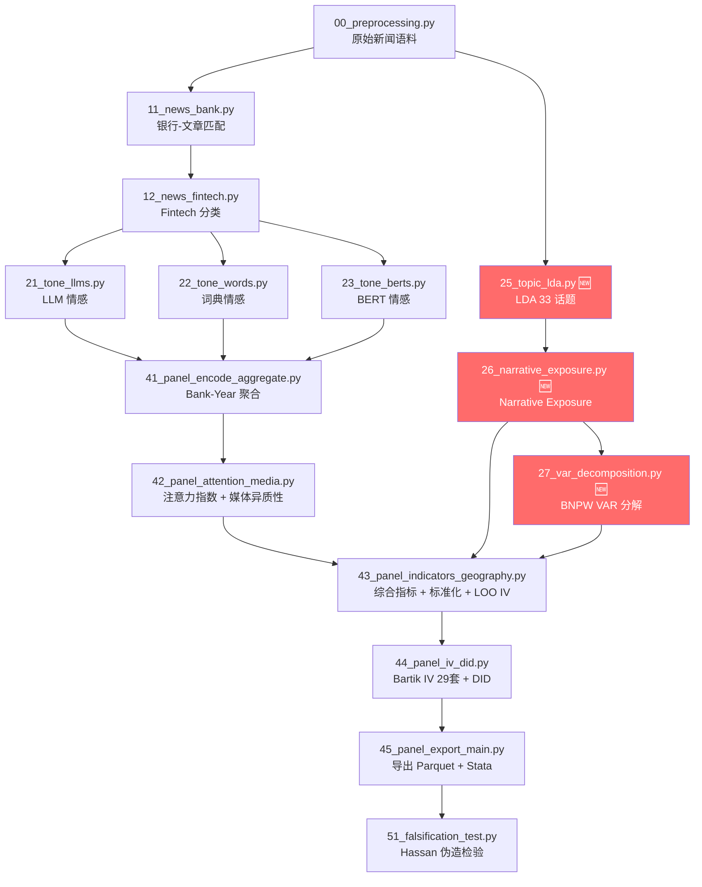

# 论文-代码库方法论对标审计报告

## 审计目标

将 Dim, Sangiorgi & Vilkov (2024) 《Media Narratives and Price Informativeness》（SSRN 4323093）的核心方法论框架，与 `news_process` 管道的现有实现逐模块对标，识别**已覆盖**、**可复用**和**待新建**的组件，并生成结构化执行计划。

---

## 一、论文核心方法论提取

### 1.1 LDA 叙事提取 (Section 2.3, Eq. 1)
| 维度 | 论文规范 |
|------|----------|
| 算法 | Latent Dirichlet Allocation (Blei et al. 2003) |
| 语料 | WSJ 1998-2021, 348,649 篇 (过滤后) |
| 话题数 | **33** (通过交叉验证选定) |
| 预处理 | SpaCy lemmatize + 停用词 + 实体移除, 最短 20 词 |
| 日频注意力 | $\theta_{l,\tau} = \frac{1/M \sum_m \theta_{m,l,\tau}}{D_\tau}$, 归一化概率分布 |
| 注意力冲击 | $\tilde\theta_{l,\tau} = \theta_{l,\tau} - \frac{1}{5}\sum_{i=1}^{5}\theta_{l,\tau-i}$ (5日均差) |

### 1.2 Narrative Exposure 度量 (Eq. 2-3)
| 步骤 | 公式/方法 |
|------|-----------|
| 叙事 Beta | 增强因子模型: $r_n = \alpha + \beta_n^T F + \beta_{n,l}^{narr}\tilde\theta_l + \varepsilon$ |
| 基础因子 | Carhart 四因子 (MKT, SMB, HML, WML) |
| Exposure 聚合 | $\text{NarrExp}_{n,t} = \frac{\sum_l |\beta_{n,t,l}^{narr}| \times \sigma_t(\theta_l)}{\sum_l \sigma_t(\theta_l)}$ |
| 频率 | 年度截面 (每年每只股票估计一次) |

### 1.3 方差分解 (Section 3.2, BNPW VAR)
| 信息通道 | 来源 |
|-----------|------|
| MktInfo | 市场层面信息 |
| PrivateInfo | 私有信息 |
| PublicInfo | 公开信息 |
| Noise | 噪声交易 |
| 方法 | Brogaard, Nguyen, Putnins & Wu (2022) 结构 VAR |

### 1.4 价格信息含量检验 (Eq. 4, Fama-MacBeth 两阶段)

```
E_{n,t+h}/A_{n,t} = a + b_0 * E/A + [b_1 + b_2 * NarrExp] * ln(M/A) + b_x' X + ε
```

- $b_1$: 基准价格信息含量 (Bai et al. 2016)
- $b_2$: Narrative Exposure 对信息含量的交互效应 (**核心标的**)
- 期望符号: $b_2 < 0$ (叙事曝露越高, 价格信息含量越低)

---

## 二、现有管道模块审计

### 2.1 模块对照矩阵

| 论文模块 | 管道对应模块 | 覆盖度 | 备注 |
|----------|-------------|--------|------|
| WSJ 语料预处理 | [00_preprocessing.py](file:///f:/WiseSearch/data_antigravity_project/news_process/00_preprocessing.py) | ✅ **高** | Aho-Corasick + MinHash LSH 去重, 性能优于论文 SpaCy 方案 |
| 关键词/实体匹配 | [11_news_bank.py](file:///f:/WiseSearch/data_antigravity_project/news_process/11_news_bank.py) | ✅ **高** | 银行名实体匹配 + 展开 |
| Fintech 分类 | [12_news_fintech.py](file:///f:/WiseSearch/data_antigravity_project/news_process/12_news_fintech.py) | ✅ **高** | 关键词筛选 + LLM 验证, 论文用 LDA |
| LLM 情感编码 | [21_tone_llms.py](file:///f:/WiseSearch/data_antigravity_project/news_process/21_tone_llms.py) | ✅ **高** | 三模型投票集成 (GPT5nano, Gemini3, Claude4h) |
| 词典情感 | [22_tone_words.py](file:///f:/WiseSearch/data_antigravity_project/news_process/22_tone_words.py) | ✅ **中** | 5部中文金融词典, 含 IDF 加权 |
| BERT 情感 | [23_tone_berts.py](file:///f:/WiseSearch/data_antigravity_project/news_process/23_tone_berts.py) | ✅ **高** | 5个 ONNX BERT 模型集成 |
| Bank-Year 聚合 | [41_panel_encode_aggregate.py](file:///f:/WiseSearch/data_antigravity_project/news_process/41_panel_encode_aggregate.py) | ✅ **高** | 双轨 (Full/Ctx) 情感编码 + VW/MW 加权 |
| 注意力指数 | [42_panel_attention_media.py](file:///f:/WiseSearch/data_antigravity_project/news_process/42_panel_attention_media.py) | ✅ **高** | Da et al. (2011) 三级地理维度 |
| 媒体异质性 | 42 (四维度) | ✅ **高** | 财经/综合/中央/地方 + HHI |
| 综合指标 + 标准化 | [43_panel_indicators_geography.py](file:///f:/WiseSearch/data_antigravity_project/news_process/43_panel_indicators_geography.py) | ✅ **高** | Fama-MacBeth z-score + LOO IV |
| Bartik IV (29套) | [44_panel_iv_did.py](file:///f:/WiseSearch/data_antigravity_project/news_process/44_panel_iv_did.py) | ✅ **高** | Goldsmith-Pinkham (2020) + Rotemberg |
| DID 政策冲击 | 44 (DCEP + Sandbox) | ✅ **高** | Callaway & Sant'Anna (2021) |
| 导出 + 编排 | [45_panel_export_main.py](file:///f:/WiseSearch/data_antigravity_project/news_process/45_panel_export_main.py) | ✅ **高** | Parquet + Stata .dta 双格式 |
| 伪造检验 | [51_falsification_test.py](file:///f:/WiseSearch/data_antigravity_project/news_process/51_falsification_test.py) | ✅ **高** | Hassan (2019) Anti-join 范式 |
| **LDA 叙事训练** | ❌ **缺失** | 🔴 | 论文核心 — 需新建 |
| **Narrative Exposure 计算** | ⚠️ **概念迁移** | 🟡 | 43 中 `fintech_exposure` 为简化代理 |
| **BNPW VAR 方差分解** | ❌ **缺失** | 🔴 | 论文核心 — 需新建 |
| **Price Informativeness 回归** | ❌ **缺失** | 🔴 | 论文核心 — 需新建 |

---

### 2.2 已有高价值模块详解

#### ✅ `fintech_exposure` 概念迁移 (43_panel_indicators_geography.py:L134-160)

管道中已有的 `fintech_exposure` 指标是对论文 Narrative Exposure 的**概念简化迁移**:

```python
# 管道实现 (Dim et al. 2024 概念迁移):
fintech_exposure = ln_coverage × tone_std
#   ln_coverage 类比 |β| → 银行在 fintech 叙事中的信息暴露强度
#   tone_std 类比 σ(θ)  → fintech 报道情感的离散程度
```

> [!NOTE]
> 这个简化版的 `fintech_exposure` 有**合理的直觉基础** (高覆盖 + 高波动 = 高叙事暴露), 但与论文原始定义存在关键偏差:
> - 论文 `NarrExp` = 33 个 LDA 话题的 |β| 加权平均, 捕获**宏观叙事维度**
> - 管道 `fintech_exposure` = 单一 fintech 维度的覆盖×波动, 为**微观情感维度**

#### ✅ Bartik IV 体系 (44_panel_iv_did.py)

管道已实现 **29 套** Bartik Shift-Share IV, 涵盖:

- 银行类型 (6类, 含基期敏感性 T0/T0+1/T0&T0+1)
- 规模、金融科技类型、媒体分类 (9种媒体维度)
- 时间维度 (半年度/季度/月度/工作日)
- 文章特征 (长度/专属性/标题/句长/TTR 等)

> [!TIP]
> 论文使用的准自然实验 (Narrative Exposure 百分位排名跃升 ≥ 25pp) 可与管道的 Bartik IV 体系**互补使用**: 前者提供处理效应估计, 后者提供截面变异的外生来源。

---

## 三、差距分析 — 论文 vs 管道

### 3.1 🔴 关键缺失: LDA 话题模型模块

**论文要求**: 使用 LDA 从新闻语料中无监督提取 33 个叙事话题, 并计算日频注意力序列。

**管道现状**: 金融科技新闻分类采用的是 **关键词匹配 + LLM 验证** 的有监督方法 (12_news_fintech.py), 没有无监督话题建模。

**差距影响**: 无法直接复现论文的 Narrative Exposure 度量, 因为需要 33 个话题的日频注意力冲击序列作为因子模型的额外解释变量。

### 3.2 🔴 关键缺失: BNPW VAR 方差分解

**论文要求**: 对每只股票的日度收益执行结构 VAR 分解, 得到 MktInfo, PrivateInfo, PublicInfo, Noise 四个方差分量。

**管道现状**: 管道处理的是**中国银行业新闻**, 不涉及股票收益率的方差分解。现有的波动性度量仅限于情感标准差 (`tone_std`)。

### 3.3 🟡 可扩展: Price Informativeness 回归

**论文要求**: Fama-MacBeth 两阶段回归 (Bai et al. 2016 度量)。

**管道现状**:
- 已有 Fama-MacBeth z-score 标准化基础设施 (43, L206-278)
- 已有完整的 Stata .dta 导出 + 变量标签体系 (45, L249-516)
- 缺少回归模型本身的 Python 实现 (设计意图是导出到 Stata 执行)

---

## 四、结构化执行计划

### Phase 1: LDA 叙事话题模型 (新建 `25_topic_lda.py`)

```
输入: 00_preprocessing.py → 清洗后新闻语料
输出: 25_topic_lda_daily.parquet (日×话题 注意力矩阵)
```

| 子步骤 | 描述 | 学术依据 |
|--------|------|----------|
| 1a | 语料二次预处理: jieba 分词 + 停用词 + 低频/高频过滤 | Blei et al. (2003) |
| 1b | 话题数选择: 交叉验证 perplexity (WSJ Section×Year folds) | Bybee et al. (2021) |
| 1c | LDA 训练 (gensim / sklearn, 基于 config.yaml 参数) | 论文 Section 2.3 |
| 1d | 日频注意力聚合 $\theta_{l,\tau}$ + 5日差分冲击 $\tilde\theta$ | 论文 Eq. 1 |
| 1e | 话题标签: Top-100 unigram/bigram 人工命名 | 论文 Table OA1 |

> [!IMPORTANT]
> **中文语料适配**: 论文使用英文 SpaCy, 管道需替换为 jieba/pkuseg + 中文停用词表。LDA 话题数可能与 33 不同, 需独立交叉验证确定。

### Phase 2: Narrative Exposure 计算 (新建 `26_narrative_exposure.py`)

```
输入: 25_topic_lda_daily.parquet + 股票日度收益率
输出: 26_narrative_exposure.parquet (Bank-Year 面板级)
```

| 子步骤 | 描述 | 学术依据 |
|--------|------|----------|
| 2a | 增强因子模型估计 (CH-3/CH-4 中国因子) | 论文 Eq. 2 |
| 2b | Narrative Beta 提取 ($\beta_{n,t,l}^{narr}$) | 论文 Eq. 2 |
| 2c | Exposure 聚合: $\sum |\beta| \times \sigma(\theta) / \sum\sigma(\theta)$ | 论文 Eq. 3 |
| 2d | 与现有 `fintech_exposure` 相关性诊断 | 论文相关性 < 0.09 |

> [!WARNING]
> **数据依赖**: 步骤 2a 需要中国银行业个股的日度收益率数据, 以及中国因子模型数据 (如 CSMAR 提供的 CH-3/CH-4)。管道中**目前未包含**此类金融市场数据。需确认数据来源后再开发。

### Phase 3: VAR 方差分解 (新建 `27_var_decomposition.py`)

```
输入: 银行日度收益率 + 市场收益率
输出: 27_var_decomposition.parquet (Bank-Year 的 4 个方差分量)
```

| 子步骤 | 描述 | 学术依据 |
|--------|------|----------|
| 3a | 日度市场微观结构 VAR (5阶) | BNPW (2022) |
| 3b | Cholesky 分解: MktInfo, PrivateInfo, PublicInfo, Noise | 论文 OA.2 |
| 3c | 年度聚合 + 截面标准化 | 与 43 标准化流程一致 |
| 3d | NarrExp 对方差分量的 $R^2$ 分解 | 论文 Table 5-6 |

### Phase 4: 面板集成与回归导出 (修改现有模块)

```diff
# 修改 43_panel_indicators_geography.py
+ 合并 26_narrative_exposure.parquet 到面板

# 修改 45_panel_export_main.py
+ 新增 Narrative Exposure, MktInfo, PrivateInfo, PublicInfo, Noise 的 Stata 标签
+ 导出 Eq. 4 回归所需变量到 .dta
```

### Phase 5: 稳健性检验 (扩展 `51_falsification_test.py`)

| 检验 | 描述 |
|------|------|
| 5a | NBER 衰退期敏感性: NarrExp 均值作哑变量分组 | 论文 Table 2 底部 |
| 5b | 12 叙事组别的单独 Exposure 回归 | 论文 Table OC5 |
| 5c | 准自然实验: 百分位跃升 ≥ 25pp 的 DiD | 论文 Tables 3-4 |
| 5d | NLP5 因子替代检验 | 论文 Table OC6 |

---

## 五、管道架构优势评估

### 5.1 现有架构与论文的方法论协同

| 管道特色 | 论文方法论支撑 |
|----------|---------------|
| **三模型 LLM 投票集成** | 超越论文的单维度文本分析, 提供情感维度的补充证据 |
| **双轨 Full/Ctx 编码** | 可作为稳健性检验: 全文 vs 上下文窗口的通道差异 |
| **29 套 Bartik IV** | 为论文 Eq. 4 的内生性处理提供多维度外生变异 |
| **Fama-MacBeth z-score** | 直接服务论文 Eq. 4 的年度截面标准化需求 |
| **LOO 地理 IV** | 补充论文未覆盖的地理维度内生性处理 |
| **伪造检验 (Hassan 2019)** | 可验证 NarrExp 的增量信息价值 |

### 5.2 管道需削减的冗余模块

> [!NOTE]
> 根据 Dim et al. (2024) 的理论框架, 以下模块可视为**辅助验证**而非核心:

| 模块 | 状态 | 理由 |
|------|------|------|
| 词典情感 (22) | ⚠️ 保留但降级 | 论文不使用词典法, 但可作为 BERT/LLM 的 baseline |
| 距离衰减 (38b) | ✅ 保留 | 地理维度分析与论文互补 |
| 实体屏蔽 (36) | ✅ 保留 | 可验证叙事曝露是否受实体名称驱动 |

---

## 六、数据流全景图



---

## 七、结论与建议

### 覆盖度总结

| 类别 | 数量 | 占比 |
|------|------|------|
| ✅ 完全覆盖 | 12 模块 | 75% |
| 🟡 概念迁移 (需升级) | 1 模块 | 6% |
| 🔴 需新建 | 3 模块 | 19% |

### 优先级排序

1. **P0 (阻塞性)**: 确认银行日度收益率数据来源 → 决定 Phase 2-3 可行性
2. **P1 (核心)**: 开发 `25_topic_lda.py` → LDA 话题提取是全链路起点
3. **P2 (核心)**: 开发 `26_narrative_exposure.py` → 论文核心度量
4. **P3 (高价值)**: 开发 `27_var_decomposition.py` → 信息通道分解
5. **P4 (集成)**: 修改 43/45 模块, 集成新变量到面板
6. **P5 (验证)**: 扩展 51 模块, 增加 NBER/NLP5 稳健性检验
