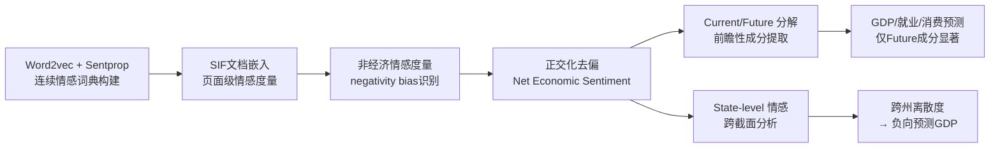

# 文件一：基于参考论文的项目分析与诊断报告

**参考论文**：van Binsbergen, J.H., Bryzgalova, S., Mukhopadhyay, M. & Sharma, V. (2024). (Almost) 200 Years of News-Based Economic Sentiment. *NBER Working Paper* No. 32026. DOI: 10.3386/w32026

**诊断对象**：`news_process` 管道 (21-23 情感分析 + 41-45 面板构建 + 51 伪造检验)

---

## 1. 范式映射与盲区诊断

### 1.1 论文核心机制提炼

论文构建了一条完整的"情感度量→去偏→分解→预测"方法论链：



**关键方法论节点**：

| 论文节点 | 具体做法 | 核心发现 |
|---------|---------|---------|
| **情感度量** | Word2vec→Sentprop→SIF文档向量→余弦相似度，产出连续情感值 | 自动化词典避免人工主观性，连续极性分数捕捉语气强度梯度 |
| **正交化去偏** | 构建非经济情感(non-economic sentiment)，将经济情感对其做OLS残差 | 1970s后的下降趋势被完全消除；所有GDP预测力来自经济情感而非一般性负面偏差 |
| **Current vs. Future 分解** | 用时间导向词典将新闻页分类为"当前事件"或"未来事件"，分别计算情感 | **所有预测力集中在Future成分**，Current成分无显著预测力 (Table 7) |
| **GDP预测回归** | Newey-West标准误；控制滞后GDP增长、期限利差、SPF预测值 | 1σ情感冲击→+0.25%-0.42%季度GDP增长；R²增量2%-4% |
| **跨截面离散度** | 计算各州情感的截面标准差(Dispersion)，进入国家级预测回归 | 离散度负向预测GDP增长 (Table 4)，不预测通胀 |
| **GDP子成分分析** | 分别检验就业/消费/投资/工业生产对情感的响应 | 预测就业和消费(尤其服务业)，不预测投资和工业生产 |
| **货币政策交互** | 将情感加入前瞻性Taylor Rule回归 | 衰退期间1σ情感下降→联邦基金利率下调25bp |

### 1.2 项目当前设计优势（维持原状的领域）

> [!TIP]
> 以下模块已达到或超越论文标准，**无需改动**，应明确保留。

| 项目组件 | 对标论文 | 评估 |
|---------|---------|------|
| **LLM三模型投票 + 一致率加权** (21_tone_llms) | 论文用Word2vec+Sentprop(无监督) | 超越：有监督多模型集成比无监督嵌入方法更精确 |
| **五词典 × 语言学规则引擎** (22_tone_words) | 论文用自动化连续极性词典 | 互补：论文产出连续分数，项目产出规则增强离散+IDF加权分数，两者捕捉不同维度 |
| **BERT五模型集成** (23_tone_berts) | 论文明确表示BERT计算成本过高未采用 | 超越：项目拥有论文所不具备的深度学习验证轨道 |
| **IDF加权情感** (Gentzkow, Kelly & Taddy 2019) | 论文未使用IDF | 增量贡献：TF-IDF降低高频通用词对情感的干扰 |
| **媒体权威性加权** (Holzman 2023, TAR) | 论文未使用此维度 | 增量贡献 |
| **Leave-one-out 地理IV** (43模块) | 论文通过正交化处理偏差 | 互补：两种方法解决不同问题(IV处理内生性；正交化处理度量偏差) |
| **DID 政策冲击** (DCEP/Fintech Sandbox) | 论文无因果推断设计 | 研究设计差异所致，维持 |
| **前瞻性陈述比率** (Li 2010, JAR) | 论文的核心发现之一 | **高度一致**：项目已有`forward_looking_ratio`变量，与论文的Future vs. Current分解直接对应 |
| **Fama-MacBeth年度截面标准化** (43模块) | 论文将情感标准化为零均值单位方差 | 一致 |

### 1.3 关键盲区

> [!CAUTION]
> 以下三个盲区是论文视角下项目的核心方法论短板。

#### 盲区A：缺乏"非金融科技情感"对冲——情感度量被长期偏差污染

**问题本质**：当前管道直接聚合所有金融科技新闻的情感为 `llm_vote_tone`，未区分"金融科技专题情感"与"一般性媒体语调偏差"。如果中国媒体环境存在类似论文发现的"系统性语调趋势"(如某些年份的舆论管控放松/收紧导致全行业报道语调整体上升/下降)，项目的核心情感指标将被这种非银行特异性的趋势所污染。

**论文对照**：van Binsbergen et al. (2024) 的核心操作是构建"非经济情感"(non-economic sentiment)，然后将经济情感对非经济情感做OLS正交化，得到"净经济情感"(Net Economic Sentiment)。Figure 4c 清晰表明：正交化后长期下降趋势消失，预测力不受影响(Table A3)。

**后果量化**：若媒体语调存在年度趋势（年度固定效应无法完全吸收，因为趋势是连续而非阶梯型），`llm_vote_tone` 将与年度宏观环境变量虚假相关，导致面板回归中情感系数被高估，且审稿人可质疑"所发现的效应来自情感还是来自整体媒体环境变化"。

#### 盲区B：前瞻性成分未被提升为核心分析维度

**问题本质**：项目已计算 `forward_looking_ratio`（前瞻性陈述比率），但该变量仅作为**控制变量**聚合至面板。论文的核心发现是：**所有GDP预测力完全来自前瞻性成分(Future Sentiment)，当前事件成分(Current Sentiment)无预测力** (Table 7, Future系数0.278**，Current系数-0.111不显著)。

**论文对照**：论文不仅计算前瞻性比率，而是将整个文档库按时间导向分为两个子集(Current vs. Future)，对每个子集分别计算完整的情感指标，然后同时放入预测回归。

**后果**：项目浪费了一个高价值分析维度——通过分离Current/Future情感，可以更精确地识别哪些银行报道包含真实的前瞻性信号(如"预期不良率下降")vs 仅为事后叙述(如"上季度利润增长")。这对银行级别面板分析的经济含义是：前瞻性金融科技情感应该比回顾性情感更强地预测银行未来绩效。

#### 盲区C：缺乏跨银行情感离散度(Dispersion)指标

**问题本质**：当前管道仅聚合银行级均值情感，未计算行业级/区域级的情感**跨截面离散度**。论文发现：情感的截面标准差(Dispersion)负向预测GDP增长 (Table 4, β=-0.497*, t=-1.90)，即"各方观点越分歧，经济前景越差"。

**论文对照**：论文计算每个季度各州情感的截面标准差，并将其作为独立回归变量。这一指标捕捉的是信息不确定性/异质信念的维度，不同于均值情感所捕捉的方向性维度。

**后果**：项目遗漏了一个理论上独立于水平情感的预测变量。在银行面板语境中，某年度银行间金融科技情感离散度高可能反映：a) 行业技术路径不确定性大；b) 竞争格局剧烈分化。这些与因变量(如R&D投入、金融科技采纳率)直接相关。

---

## 2. 实质性改进项（宁缺毋滥）

### 改进A：情感正交化去偏——构建"净金融科技情感"

> **论文依据**：van Binsbergen et al. (2024) Section III.1, Figure 4c, Table A3
> **边际贡献**：消除媒体环境长期趋势对情感度量的污染；增强系数的因果推断可信度
> **解决的计量问题**：遗漏变量偏误(omitted media trend)导致的情感系数虚假显著

**具体修改建议**：

1. **定义"非金融科技情感"**：利用项目已有的数据基础设施，从报道该银行的同一批媒体中，提取**非金融科技类新闻**的情感均值。两种实现路径：

   | 路径 | 数据来源 | 优缺点 |
   |------|---------|--------|
   | 路径A: 媒体级别 | 同一媒体在同年对**所有主题**报道的平均语调 | 需要媒体全量语料，数据量大但概念最纯净 |
   | 路径B: 银行级别(推荐) | 同一银行在同年的**非金融科技关键词**新闻的情感均值 | 仅需现有篇章级数据，按fintech_category筛选即可 |

2. **正交化公式**：

   ```
   Net_FT_Tone_{i,t} = ε_{i,t} from OLS: FT_Tone_{i,t} = α + β × NonFT_Tone_{i,t} + ε_{i,t}
   ```

   或更简单地在面板回归中直接控制 `NonFT_Tone`，让读者判断信息增量。

### 改进B：Current vs. Future 情感分解——释放前瞻性信号的预测潜力

> **论文依据**：van Binsbergen et al. (2024) Section IV.4, Table 7
> **边际贡献**：将项目已有的`forward_looking_ratio`从"控制变量"升格为"核心分析维度"
> **解决的计量问题**：情感信号与噪声混合(Current成分=噪声/已定价信息)

**具体修改建议**：

1. **文档分类**：利用已有的 `forward_looking_ratio` 将每篇文章标记为"前瞻性导向"或"回顾性导向"(以比率中位数为阈值)。

2. **分别聚合**：在 `41_panel_encode_aggregate.py` 的聚合逻辑中，将文章分为两组分别计算情感指标：

   ```python
   # 前瞻性文章子集的情感
   future_tone_{i,t} = mean(tone_j) for j where forward_looking_ratio_j > median
   # 回顾性文章子集的情感
   current_tone_{i,t} = mean(tone_j) for j where forward_looking_ratio_j <= median
   ```

3. **同时放入回归**：在Stata模板中用 `future_tone` 和 `current_tone` 替换（或与之共同出现）原始 `llm_vote_tone`，测试是否仅 `future_tone` 显著。

### 改进C：构建跨银行情感离散度(Dispersion)指标

> **论文依据**：van Binsbergen et al. (2024) Table 4, Section III.2
> **边际贡献**：新增一个与水平情感正交的预测维度——信息不确定性
> **解决的计量问题**：捕捉行业信息环境的"共识度 vs 分歧度"，弥补均值情感的信息损失

**具体修改建议**：

在 `43_panel_indicators_geography.py` 中新增函数，计算每年度**银行类型/省份/行业组**内的情感截面标准差：

```python
# 银行类型内情感离散度
type_dispersion_{t} = std(llm_vote_tone_{i,t}) across all i in same bank_type
# 省份内情感离散度
prov_dispersion_{t} = std(llm_vote_tone_{i,t}) across all i in same province
# 全行业情感离散度
industry_dispersion_{t} = std(llm_vote_tone_{i,t}) across all banks
```

每个银行-年度观测获得其所属组的离散度值(变异来自组×年度交互)。

---

## 3. 冗余剥离

> [!WARNING]
> 从 van Binsbergen et al. (2024) 的视角审视，以下当前设计不是冗余，但需要重新定位。

### 3.1 维持但注意定位的模块

本论文与蔡真等(2025)的"漂绿"论文视角完全不同——它不涉及因果识别/IV/DID，而是关注**预测性回归**(predictive regression)中的R²增量。因此：

| 当前模块 | 论文视角下的评价 | 建议 |
|---------|----------------|------|
| Bartik IV 29维体系 | 论文不使用IV(做预测回归而非因果推断) | **维持原状**：项目的研究问题(情感→银行行为)是因果问题，需要IV，论文的预测范式不可直接替代 |
| DID 政策冲击 | 论文不使用DID | **维持原状**：同上 |
| 媒体权威性加权(MW) | 论文不使用媒体分层 | **维持原状**：额外的加权维度不影响核心分析 |

### 3.2 无需新增的"伪需求"

> [!NOTE]
> 以下论文方法论步骤因数据可获得性或研究设计差异**不适用于**本项目，不应尝试复制。

| 论文方法 | 不适用原因 |
|---------|-----------|
| Word2vec从头训练在历史语料上 | 项目使用现代中文NLP (LLM/BERT)，无需自建词向量 |
| SIF文档嵌入 + 余弦相似度 | 项目已有三套独立的情感度量方法，无需第四套 |
| 州级面板 + 国家级时序对比 | 项目已有省级/城市级面板，结构更精细 |
| 170年历史回测 | 数据限制，不可行也不必要 |
| 与Michigan Consumer Survey互验 | 中国无直接等价调查(消费者信心指数数据粒度不匹配) |

---

## 4. 总体诊断结论

| 维度 | 评估 | 行动 |
|------|------|------|
| 情感度量底层方法(LLM/词典/BERT三轨) | **超越论文标准** | **维持原状** |
| 情感正交化去偏(vs 非金融科技情感) | **完全缺失** | **核心新增** (改进A) |
| Current/Future情感分解 | 已有基础设施(`forward_looking_ratio`)但**未提升至核心分析维度** | **核心新增** (改进B) |
| 跨银行情感离散度(Dispersion) | **完全缺失** | **增量新增** (改进C) |
| Fama-MacBeth标准化 | 与论文一致 | **维持原状** |
| IV/DID因果识别 | 论文不涉及(做预测回归) | **维持原状**(项目研究问题需要因果设计) |
| 控制变量体系 | 全面优异 | **维持原状** |
| 伪造检验(51) | 设计合理 | **维持原状** |
