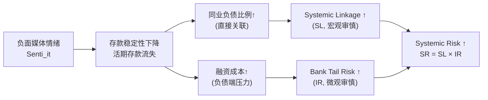

# 媒体情绪、存款稳定性与银行系统性风险：来自中国的证据
## — 项目分析诊断报告 & 重构执行计划书

> **参考论文**: Fang, Y., Wang, Q., Wang, Y., & Yuan, Y. (2026). Media sentiment, deposit stability and bank systemic risk: Evidence from China. *International Review of Financial Analysis*, 101, 104001.
>
> **对标项目**: `F:\WiseSearch\data_antigravity_project\news_process`
>
> **生成时间**: 2026-04-07

---

# 第一部分：基于参考论文的项目分析与诊断报告

## 1. 范式映射与盲区诊断

### 1.1 论文核心机制提炼

Fang et al. (2026) 构建了一条完整的 **"媒体情绪 → 存款稳定性 → 银行系统性风险"** 传导链：



**核心方法论要素**：

| 维度 | 论文方法 | 论文依据 |
|------|---------|---------|
| **被解释变量** | Van Oordt & Zhou (2019) 极值理论分解: `ln SR = ln SL + ln IR` | Eq.(3)-(6), Table 1 |
| **解释变量** | 银行级媒体情感指数 `Senti_it`，基于姜富伟等(2019)词典 + 否定词处理 | Eq.(1)-(2), §3.1 |
| **传导机制** | 存款稳定性(活期存款占比) → 同业负债 → 资产端风险承担 | §2, §6 (Table 8-9) |
| **内生性处理** | (a) 残差情感法 (b) Heckman-Robb 两阶段 (c) Baker-Wurgler IV (d) Lewbel (2012) 异方差IV | Table 5 Panel A-D |
| **异质性分析** | 活期存款余额/机构持股/负面情绪突增 三维分组回归 | Table 7 Panel A-C |
| **制度冲击** | 存款保险制度(2015Q2)交互项 `Senti × Deposit_insurance` | Table 6 Panel D |
| **动态分析** | 月度频率 VAR/脉冲响应: SL先升→IR后升的时序演化 | §7, Fig.4-5 |

### 1.2 项目现状与落差诊断

#### ✅ 项目已具备的能力（维持原状）

| 模块 | 当前实现 | 评估 |
|------|---------|------|
| `21_tone_llms.py` | LLM 三模型投票情感分析（GPT-5 Nano / Gemini 3 / Claude Haiku） | **优于论文**。论文仅用单一词典法，项目的 LLM 三角验证在语义理解深度上远超词典匹配 |
| `22_tone_words.py` | 5 部中文金融词典 + 否定/程度/转折规则引擎 + IDF 加权 | **对标论文**。论文用姜富伟(2019)词典 + 否定词处理，项目实现已覆盖并扩展 |
| `41_panel_encode_aggregate.py` | Tetlock 范式聚合（mean/sum/std/count）+ 媒体权威加权 | **对标论文** Eq.(2) 的银行-时期均值聚合，且增加了 Holzman et al. (2023) 权重 |
| `44_panel_iv_did.py` | Bartik Shift-Share IV + DID 政策冲击（DCEP/沙箱） | **部分对标**。Bartik IV 是项目特有的补充维度；DID 框架可直接复用于存款保险制度冲击 |
| `45_panel_export_main.py` | 面板平衡化 + Stata 导出 + 变量标签 | **基础就绪**。仅需在导出阶段增加新变量列 |

#### ❌ 关键落差（Critical Gaps）

| 编号 | 落差描述 | 严重程度 | 对应论文位置 |
|------|---------|---------|-------------|
| **G-01** | **缺失 SR/SL/IR 系统性风险因变量构建**：项目当前仅构建了情感自变量，完全没有基于市场数据（银行股票收益率）计算 Van Oordt & Zhou (2019) 的系统性风险分解。这是论文的**核心被解释变量**，缺失即无法复现基准回归。 | 🔴 **致命** | Eq.(3)-(5), Table 1 |
| **G-02** | **缺失存款稳定性机制变量**：论文第6节的平衡表机制分析依赖 `存款增长率`、`活期存款占比`、`同业负债比`、`风险加权资产比` 等银行财务指标。项目未从 WIND/CSMAR 数据库整合这些变量。 | 🔴 **致命** | §6, Table 8-9 |
| **G-03** | **面板频率不匹配**：论文使用**季度**面板（基准回归）和**月度**数据（动态分析），项目当前为**年度** Bank-Year 面板。年度频率无法捕捉论文强调的 "先SL后IR" 的季度/月度时序演化。 | 🟡 **重要** | §4 Eq.(7), §7 |
| **G-04** | **缺失论文特有的内生性处理工具**：(a) 残差情感法（剥离银行基本面）、(b) Baker-Wurgler 美国投资者情绪 IV、(c) Lewbel (2012) 异方差 IV。项目现有的 Bartik IV 和 DID 是有价值的补充，但不能替代论文的核心识别策略。 | 🟡 **重要** | Table 5 |
| **G-05** | **缺失存款保险制度 DID 交互项**：论文 Table 6 Panel D 的 `Senti × Deposit_insurance` 交互项是验证机制的关键一环。项目 DID 框架已支持政策冲击，但未配置 2015Q2 存款保险制度这一事件。 | 🟢 **速赢** | Table 6 Panel D |

### 1.3 优势溢出（项目优于论文之处）

> **判定：以下模块维持原状，不做降级。**

1. **LLM 情感分析 vs 词典法**：论文使用姜富伟(2019)单一词典 + 否定词处理。项目的 LLM 三模型投票方案在语义消歧（如反讽、条件句、行业术语）上具有显著优势。**建议**：在论文框架下，LLM 情感得分作为主回归变量，词典法得分作为稳健性检验（对标 Fang et al. Step 2 的 "Relative Sentiment Shifts"）。

2. **多维 Bartik IV**：项目的 Bartik Shift-Share IV（按银行类型/规模/金融科技类别分组）提供了论文未涵盖的截面识别维度。可与论文的 Baker-Wurgler IV（时间维度识别）互补，构建更完善的识别策略矩阵。

3. **媒体权威加权**：项目的 `compute_media_authority_weights()` 实现了 Holzman et al. (2023) 的媒体影响力差异化权重。论文对所有新闻等权处理（Eq.2 简单均值），项目在此维度上更为精细。

---

## 2. 实质性改进项（宁缺毋滥）

### 改进 A：构建 Van Oordt & Zhou (2019) 系统性风险分解变量 (SR/SL/IR)

- **具体修改**：新增独立模块 `46_systemic_risk_evd.py`，从 WIND 数据库获取上市银行日度股票收益率和银行指数收益率，使用极值理论（EVT）估计每家银行每年/每季度的 `β_i^T`，并分解为 `Systemic Linkage` 和 `Bank Tail Risk`。
- **论文依据**：Eq.(3)-(5)，Van Oordt & Zhou (2019), Hill (1975) 尾部指数, Embrechts et al. (2000) 尾部相依性。参数设定 `k=30` 和 `k=50`（论文 §3.2 脚注10-11）。
- **边际贡献**：这是复现论文基准回归（Table 3）的**必要条件**。没有 SR/SL/IR，整个 "媒体情绪→系统性风险" 的因果链条无法检验。项目当前仅有自变量（情感指数），完全缺失因变量。
- **预期产出**：Bank-Quarter 或 Bank-Year 面板中新增 6 列：`ln_SR_k30`, `ln_SL_k30`, `ln_IR_k30`, `ln_SR_k50`, `ln_SL_k50`, `ln_IR_k50`。

### 改进 B：构建存款稳定性与资产负债表机制变量

- **具体修改**：在 `45_panel_export_main.py` 的 `merge_bank_geography()` 后新增 `merge_balance_sheet_vars()` 函数，从外部数据源合并以下银行财务指标变量。
- **论文依据**：§6, Table 8 (存款机制) & Table 9 (资产端传导)。
- **边际贡献**：验证传导机制是论文的第二大贡献（"perception changes reality of balance sheet"）。没有这些中介变量，无法区分 "情绪直接影响风险" 还是 "情绪通过存款渠道间接影响风险"。
- **所需变量**：

| 变量名 | 定义 | 对应论文 |
|--------|------|---------|
| `deposit_growth` | 存款同比增长率 | Table 8 Panel A |
| `demand_deposit_ratio` | 活期存款 / 总存款 | Table 7 Panel A 分组依据 |
| `interbank_liability_ratio` | 同业负债 / 总负债 | Table 8 Panel B (直接关联机制) |
| `rwa_ratio` | 风险加权资产 / 总资产 | Table 9 (风险承担机制) |
| `loan_to_asset` | 贷款 / 总资产 | Table 1 控制变量 |
| `noninterest_income_ratio` | 非利息收入 / 营业收入 | Table 1 控制变量 |
| `cost_income_ratio` | 成本收入比 | Table 1 控制变量 |
| `leverage` | 权益 / 总资产 | Table 1 控制变量 |
| `roa` | 资产收益率 | Table 1 控制变量 |
| `liquidity_ratio` | 流动资产 / 总资产 | Table 1 控制变量 |
| `book_to_market` | 市净率倒数 | Table 1 控制变量 |

### 改进 C：新增论文特有的内生性处理策略

- **具体修改**：在 `44_panel_iv_did.py` 中新增三个函数。
- **论文依据**：Table 5 Panel A-D 四种内生性检验。
- **边际贡献**：项目现有的 Bartik IV 提供了截面维度的识别，但缺少论文核心的时间维度识别工具（Baker-Wurgler IV）和残差情感法（剥离基本面反映效应)。这是审稿人最可能质疑的方法论缺口。

| 策略 | 实现 | 论文对标 |
|------|------|---------|
| **残差情感法** | `compute_residual_sentiment()`: 将 Senti 回归银行特征，取残差 | Table 5 Panel A |
| **Heckman-Robb 两阶段** | `compute_heckman_robb_control()`: 第一阶段残差作为第二阶段控制变量 | Table 5 Panel B |
| **Baker-Wurgler IV** | `merge_bw_sentiment_iv()`: 合并美国投资者情绪指数作为工具变量 | Table 5 Panel C |
| **Lewbel (2012) 异方差 IV** | Stata do-file 中实现 `ivreg2h` 命令 | Table 5 Panel D |

### 改进 D：存款保险制度 DID 交互项

- **具体修改**：在 `config/policy_shocks.json` 中新增 `deposit_insurance` 政策事件（处理年份 = 2015，全国统一处理无城市维度），在面板中生成 `depins_treated`, `depins_post`, `depins_treat_year` 以及交互项 `senti_x_depins`。
- **论文依据**：Table 6 Panel D。`Senti × Deposit_insurance` 交互项显著为正但系数小于 Senti 系数，说明存款保险制度不能完全抵消负面情绪对系统性风险的影响。
- **边际贡献**：这是一个**速赢项**——项目 DID 框架已完整支持政策冲击变量生成，只需新增配置即可。

---

## 3. 冗余剥离

| 模块 | 评估 | 建议 |
|------|------|------|
| `22_tone_words.py` 的 5 部词典法情感分析 | 作为 LLM 主回归的稳健性检验保留，但**降级为可选模块**。论文本身也仅用单一词典（姜富伟2019）。项目的 5 部词典冗余度过高。 | **保留但精简**：主流程仅运行 `jiang_2021` 词典（对标论文），其余 4 部词典仅在 `--robustness` 模式下运行 |
| `22_tone_words.py` 的 IDF 加权稳健性 | 论文未使用 TF-IDF 加权情感，且 LLM 已天然包含词频重要性判断 | **维持原状**。IDF 加权作为额外稳健性维度有学术价值，不影响主流程 |
| `44_panel_iv_did.py` 的多维 Bartik IV | 论文未使用 Bartik IV，但 Goldsmith-Pinkham et al. (2020, AER) 框架在识别策略上有独立学术价值 | **维持原状**。与论文的 Baker-Wurgler IV / Lewbel IV 形成互补识别矩阵 |
| 可读性指标 (`avg_sentence_len`, `type_token_ratio`, `char_per_word`) | 论文未使用文本可读性作为控制变量 | **维持原状**。Loughran & McDonald (2014) 可读性指标在金融文本分析中有独立学术价值 |

---

# 第二部分：项目重构与优化执行计划书

## 1. 优先级排布

### 🏃 速赢项（Quick Wins）— 1-2天

| 序号 | 任务 | 成本 | 收益 |
|------|------|------|------|
| QW-1 | 在 `config/policy_shocks.json` 新增存款保险制度事件 | 低（纯配置） | 直接产出 Table 6 Panel D 的 DID 交互项变量 |
| QW-2 | 在 `45_panel_export_main.py` 导出变量列表中预留 SR/SL/IR 和资产负债表变量的占位列 | 低（增加列名映射） | 为后续数据合并奠定接口 |
| QW-3 | 在 Stata do-file 模板中增加论文基准回归命令 | 低（命令行脚本） | 数据就绪后可一键复现 Table 3 |

### 🔧 核心攻坚项 — 1-2周

| 序号 | 任务 | 成本 | 收益 |
|------|------|------|------|
| CA-1 | 构建 `46_systemic_risk_evd.py` 计算 SR/SL/IR | 高（需 EVT 估计器 + 市场数据） | **论文因变量**，不可跳过 |
| CA-2 | 整合银行财务数据（存款/同业负债/风险资产等） | 中（外部数据清洗合并） | 验证传导机制 (Table 8-9) |
| CA-3 | 实现残差情感法 + Baker-Wurgler IV | 中（统计方法实现） | 核心内生性检验 (Table 5) |

---

## 2. 阶段化执行指令 (SOP)

### 阶段一：数据基础设施（机制重塑/数据清洗）

#### 任务 1.1：新增存款保险制度 DID 配置 [QW-1]

**动作指令**：在 `config/policy_shocks.json` 中新增 `deposit_insurance` 条目。

```json
{
  "deposit_insurance": {
    "prefix": "depins",
    "description": "存款保险制度实施 (2015年5月1日)",
    "academic_ref": "Fang et al. (2026), Table 6 Panel D",
    "groups": [
      {
        "year": 2015,
        "full_province": ["全国"],
        "note": "2015年5月1日起全国统一实施，面板为季度/年度时 2015年即为处理期"
      }
    ]
  }
}
```

**特殊处理**：存款保险是全国性政策，所有银行同时被处理，因此 `treated=1` 对全部银行，`post` 由年份判定。交互项 `senti_x_depins = Senti × depins_post` 需在面板导出时额外生成。

**交付物标准**：面板中新增 `depins_treated`, `depins_post`, `depins_treat_year`, `depins_rel_year` 以及 Event Study lead/lag 变量。

#### 任务 1.2：银行市场数据获取与预处理 [CA-1 前置]

**动作指令**：

1. 从 WIND 数据库导出 36 家上市银行的日度股票收益率数据（2007-01-01 至样本终止日）
2. 导出同期银行板块指数（如申万银行指数 `801780.SI`）日度收益率
3. 数据存储为 `data/market/bank_daily_returns.parquet`，字段：`bank_code`, `date`, `return_daily`, `index_return_daily`

**交付物标准**：
- 覆盖率 ≥ 95%（36家银行 × 交易日）
- 无超过 5 个连续交易日的缺失
- 收益率已做 P1/P99 Winsorization

#### 任务 1.3：银行财务数据获取与预处理 [CA-2 前置]

**动作指令**：

1. 从 WIND/CSMAR 导出 36 家上市银行的季度/年度财务数据
2. 所需字段：

| WIND 字段 | 变量名 | 定义 |
|-----------|--------|------|
| `TOT_DEPO` | `total_deposit` | 总存款 |
| `DEMAND_DEPO` | `demand_deposit` | 活期存款 |
| `INTERBANK_LIAB` | `interbank_liab` | 同业负债 |
| `TOT_LIAB` | `total_liab` | 总负债 |
| `TOT_ASSETS` | `total_assets` | 总资产 |
| `RWA` | `rwa` | 风险加权资产 |
| `EQUITY` | `equity` | 所有者权益 |
| `NET_INCOME` | `net_income` | 净利润 |
| `LIQ_ASSETS` | `liquid_assets` | 流动资产 |
| `TOT_LOANS` | `total_loans` | 贷款总额 |
| `OPER_COST` | `oper_cost` | 营业成本 |
| `OPER_REVENUE` | `oper_revenue` | 营业收入 |
| `NONINT_INCOME` | `nonint_income` | 非利息收入 |
| `MKT_CAP` | `mkt_cap` | 总市值 |
| `INST_HOLDING` | `inst_holding` | 机构持股数 |

3. 数据存储为 `data/financial/bank_quarterly_financials.parquet`

**交付物标准**：
- 所有 36 家银行覆盖
- 缺失值做线性插值处理（论文 §3 明确说明 "We interpolate a few missing bank characteristics"）
- 连续变量 P1/P99 Winsorization

#### 任务 1.4：宏观经济数据获取 [CA-2 补充]

**动作指令**：获取季度/年度宏观变量：`gdp_growth`（实际GDP增长率）、`inflation`（CPI增长率）、`m2_growth`（M2增长率）。存储为 `data/macro/macro_quarterly.parquet`。

---

### 阶段二：核心模型构建（实证/模型重构与检验）

#### 任务 2.1：新建 `46_systemic_risk_evd.py` — Van Oordt & Zhou (2019) 分解 [CA-1]

**动作指令**：创建独立模块，实现以下逻辑。

**算法步骤**（严格对标论文 Eq.3-5）：

```
输入: bank_daily_returns.parquet (bank_code, date, R_i, R_s)
参数: k = [30, 50], rolling_window = [252, 504]  # 1年/2年交易日

对每家银行 i、每个滚动窗口终止日 t:
    1. 取窗口内 n 个观测 (R_i, R_s)
    2. Hill估计器: ζ_s = (1/k) × Σ_{j=1}^{k} ln(R_s_{(j)} / R_s_{(k+1)})
       其中 R_s_{(j)} 为第 j 大损失（负收益取绝对值排序）
    3. VaR_i(k/n) = |R_i| 的第 (k+1) 大值
       VaR_s(k/n) = |R_s| 的第 (k+1) 大值
    4. 尾部相依性 τ_i(k/n): 非参数估计
       τ_i = (1/k) × Σ_{j=1}^{n} 1{R_i < -VaR_i(k/n) AND R_s < -VaR_s(k/n)}
    5. Bank Tail Risk: IR_i = VaR_i / VaR_s
    6. Systemic Linkage: SL_i = τ_i^{1/ζ_s}
    7. Systemic Risk: SR_i = SL_i × IR_i (即 β_i^T)
    
输出: bank_code, year (or quarter), ln_SR, ln_SL, ln_IR
```

**稳健性参数矩阵**：

| 配置 | k值 | 窗口 | 对标论文 |
|------|-----|------|---------|
| 基准 | k=30 | 1年 | Table 3 |
| 稳健1 | k=50 | 1年 | 论文脚注11 |
| 稳健2 | k=30 | 2年 | Table 4 Panel A |
| 稳健3 | k=50 (20%分位) | 1年 | Table 4 Panel B |

**交付物标准**：
- 输出 Bank-Quarter/Year 面板，含 `ln_SR_k30`, `ln_SL_k30`, `ln_IR_k30` 及 k=50 对应列
- 验证：`ln_SR ≈ ln_SL + ln_IR`（对数可加性，容差 < 0.01）
- 描述性统计应与论文 Table 2 量级一致（SR mean ≈ 0.965, SL mean ≈ 0.810, IR mean ≈ 1.210）

#### 任务 2.2：面板合并与导出增强 [QW-2]

**动作指令**：在 `45_panel_export_main.py` 中增加以下合并步骤：

```python
# --- 步骤 N+1: 合并系统性风险变量 ---
def merge_systemic_risk_vars(panel, sr_path):
    """合并 Van Oordt & Zhou (2019) 系统性风险分解变量。
    
    对标: Fang et al. (2026), Table 1 & Eq.(5)-(6)
    """
    sr_df = pd.read_parquet(sr_path)
    for k in [30, 50]:
        for var in ['SR', 'SL', 'IR']:
            col = f'ln_{var}_k{k}'
            # merge on bank_code + year (or quarter)
    return panel

# --- 步骤 N+2: 合并资产负债表变量 ---
def merge_balance_sheet_vars(panel, fin_path):
    """合并银行财务指标用于传导机制分析。
    
    对标: Fang et al. (2026), Table 8-9
    """
    # 计算派生变量
    # deposit_growth = (deposit_t - deposit_{t-1}) / deposit_{t-1}
    # demand_deposit_ratio = demand_deposit / total_deposit
    # interbank_liability_ratio = interbank_liab / total_liab
    # rwa_ratio = rwa / total_assets
    # leverage = equity / total_assets
    # roa = net_income / total_assets
    # ...
    return panel

# --- 步骤 N+3: 合并宏观控制变量 ---
def merge_macro_controls(panel, macro_path):
    """合并宏观经济控制变量。
    
    对标: Fang et al. (2026), Table 1
    """
    # gdp_growth, inflation, m2_growth
    return panel
```

**Stata 变量标签**（追加到 `VARIABLE_LABELS`）：

```python
SYSTEMIC_RISK_LABELS = {
    'ln_SR_k30': 'ln(Systemic Risk), k=30, Van Oordt & Zhou (2019)',
    'ln_SL_k30': 'ln(Systemic Linkage), k=30',
    'ln_IR_k30': 'ln(Bank Tail Risk), k=30',
    'ln_SR_k50': 'ln(Systemic Risk), k=50 (robustness)',
    'ln_SL_k50': 'ln(Systemic Linkage), k=50 (robustness)',
    'ln_IR_k50': 'ln(Bank Tail Risk), k=50 (robustness)',
    'deposit_growth': 'Deposit growth rate (YoY)',
    'demand_deposit_ratio': 'Demand deposit / Total deposit',
    'interbank_liab_ratio': 'Interbank liability / Total liability',
    'rwa_ratio': 'Risk-weighted assets / Total assets',
    'depins_post': 'Post deposit insurance (2015Q2+)',
    'senti_x_depins': 'Senti × Deposit insurance interaction',
}
```

#### 任务 2.3：内生性处理策略实现 [CA-3]

**动作指令**：在 `44_panel_iv_did.py` 中新增以下函数。

**2.3a: 残差情感法**（Table 5 Panel A）

```python
def compute_residual_sentiment(panel, senti_col='llm_vote_score_mean_full'):
    """剥离银行基本面后的残差情感。
    
    学术依据: Fang et al. (2026), Table 5 Panel A
    Senti_it = α + Σ β_j × BankChar_{j,it} + ε_it
    residual_sentiment = ε_it
    """
    controls = ['size', 'leverage', 'roa', 'liquidity_ratio', 
                'cost_income_ratio', 'noninterest_income_ratio',
                'loan_to_asset', 'book_to_market', 'depins_post']
    # OLS 回归 → 取残差
    # 输出: panel['residual_sentiment'] = ε_it
```

**2.3b: Baker-Wurgler 美国投资者情绪 IV**（Table 5 Panel C）

```python
def merge_bw_sentiment_iv(panel, bw_path):
    """合并 Baker & Wurgler (2006) 美国投资者情绪指数作为 IV。
    
    学术依据: Fang et al. (2026), Table 5 Panel C
    排他性约束: 美国投资者情绪影响全球舆论氛围→中国银行媒体报道基调,
                但不直接影响中国单家银行的资产负债表行为。
    """
    # 数据源: Jeffrey Wurgler 个人主页 或 FRED
    # 变量: bw_sentiment (月度/季度)
    # merge on year/quarter
```

**2.3c: Stata do-file 模板（输出到 `stata/do/`）**

```stata
* ============================================================
* 基准回归 (Table 3)
* ============================================================
* 注意: 参照 Van Oordt & Zhou (2019), 基准不含银行固定效应
* 原因: SL 在时间维度上高度持续, 固定效应会吸收大部分变异

reg ln_SR_k30 llm_sentiment_mean c.size c.leverage c.roa ///
    c.liquidity c.inefficiency c.income_div c.loan_ratio c.btm ///
    c.gdp_growth c.inflation c.m2_growth, ///
    vce(cluster bank_id)

reg ln_SL_k30 llm_sentiment_mean $controls, vce(cluster bank_id)
reg ln_IR_k30 llm_sentiment_mean $controls, vce(cluster bank_id)

* ============================================================
* 内生性: 残差情感法 (Table 5 Panel A) 
* ============================================================
reg llm_sentiment_mean $bank_chars depins_post
predict resid_sentiment, residual
reg ln_SR_k30 resid_sentiment $controls, vce(cluster bank_id)

* ============================================================
* 内生性: Baker-Wurgler IV (Table 5 Panel C)
* ============================================================
ivregress 2sls ln_SR_k30 $controls ///
    (llm_sentiment_mean = bw_sentiment), ///
    vce(cluster bank_id)
estat firststage

* ============================================================
* 内生性: Lewbel (2012) 异方差 IV (Table 5 Panel D)
* ============================================================
ssc install ivreg2h
ivreg2h ln_SR_k30 $controls (llm_sentiment_mean = bw_sentiment), ///
    cluster(bank_id)

* ============================================================
* 存款保险制度交互项 (Table 6 Panel D)
* ============================================================
gen senti_x_depins = llm_sentiment_mean * depins_post
reg ln_SR_k30 llm_sentiment_mean depins_post senti_x_depins ///
    $controls, vce(cluster bank_id)

* ============================================================
* 异质性: 按活期存款分组 (Table 7 Panel A)
* ============================================================
xtile demand_grp = demand_deposit_ratio, nq(2)
reg ln_SR_k30 llm_sentiment_mean $controls ///
    if demand_grp == 2, vce(cluster bank_id)  // 高活期
reg ln_SR_k30 llm_sentiment_mean $controls ///
    if demand_grp == 1, vce(cluster bank_id)  // 低活期
```

**稳健性检验标准**（必须通过，否则需回溯数据质量）：

| 检验 | 标准 | 对标 |
|------|------|------|
| Senti → ln_SR 系数符号 | 显著为负 (p < 0.05) | Table 3 Col.(2) |
| Senti → ln_SL 系数符号 | 为负 (p < 0.10) | Table 3 Col.(4) |
| Senti → ln_IR 系数符号 | 显著为负 (p < 0.05) | Table 3 Col.(6) |
| `ln_SR ≈ ln_SL + ln_IR` | 对数可加性成立 | Eq.(6) |
| 残差情感法系数方向 | 与基准一致 | Table 5 Panel A |
| Baker-Wurgler IV F统计量 | Kleibergen-Paap Wald F > 10 | Table 5 Panel C |

---

### 阶段三：结论重构与边际贡献固化

#### 任务 3.1：传导机制分析（中介效应检验）

**动作指令**：在 Stata 中执行 Baron & Kenny (1986) 逐步回归法或 Sobel 检验：

```
路径1: Senti → deposit_growth → ln_SR  (存款渠道)
路径2: Senti → interbank_liab_ratio → ln_SL  (同业关联渠道)
路径3: Senti → rwa_ratio → ln_IR  (风险承担渠道)
```

#### 任务 3.2：动态效应分析（月度脉冲响应）

**动作指令**：若具备月度面板数据，估计 Panel VAR 模型：

```
变量: [Senti_it, ln_SL_it, ln_IR_it]
滞后阶数: BIC/AIC 选择
输出: 正交化脉冲响应函数 (OIRF)
预期结论: 负面情绪冲击后, SL 先上升 (1-3月), IR 后上升 (3-6月)
```

对标论文 §7 和 Fig.4-5 的核心发现：**"in the initial period after the negative shock of media sentiment, the systemic linkage increases significantly while bank tail risk changes insignificantly. However, in the latter period, bank tail risk gradually becomes the dominant factor."**

#### 任务 3.3：异质性分析复现

**动作指令**（Stata 命令）：

| 分组维度 | 分组方法 | 对标论文 |
|---------|---------|---------|
| 活期存款余额 | 中位数分组 | Table 7 Panel A |
| 机构持股 | 中位数分组 | Table 7 Panel B |
| 负面情绪突增 | 情绪指数季度环比下降 > 1σ | Table 7 Panel C |

---

## 3. 风险预案 (Plan B)

### 风险 1：银行日度股票收益率数据不可得或覆盖不全

- **概率**：中（部分中小银行上市时间短，早期数据缺失）
- **Plan B**：
  - (a) 将样本限制为上市满 3 年的银行，并在论文中报告样本筛选标准
  - (b) 使用 **常规** β 分解替代 EVT 分解（论文 Table 4 Panel C 已提供先例：`β = ρ × σ_i/σ_s`），降低对尾部观测数量的要求
  - (c) 仅使用 MES (Acharya et al., 2017) 或 ΔCoVaR (Adrian & Brunnermeier, 2016) 作为替代系统性风险度量（论文 Table 4 Panel D）

### 风险 2：Baker-Wurgler 美国投资者情绪指数数据不可得

- **概率**：低（数据公开可获取）
- **Plan B**：
  - (a) 使用 VIX 指数的季度均值作为全球风险情绪的替代 IV
  - (b) 使用项目已有的 Bartik IV 作为主要识别策略（Goldsmith-Pinkham et al. 2020），Lewbel (2012) 异方差 IV 作为补充
  - (c) 若工具变量均不可行，使用 GMM 差分/系统估计量（Arellano & Bond, 1991）

### 风险 3：季度频率面板样本量不足

- **概率**：中（36家银行 × ~58个季度 ≈ 2088 obs，论文报告 1133 obs 含缺失）
- **Plan B**：
  - (a) 维持年度面板作为基准回归，季度面板作为稳健性检验
  - (b) 参照论文做法：对缺失值做线性插值，并在稳健性检验中报告删除插值样本后的结果
  - (c) 若季度频率下 SL 系数不显著（论文本身 SL 系数仅 10% 显著），在论文中讨论 "系统性关联的时间持续性吸收了截面变异"（Van Oordt & Zhou 2019 原文论证）

### 风险 4：词典法 vs LLM 法情感得分回归结果差异大

- **概率**：中
- **Plan B**：
  - (a) 在论文中将此差异作为 "方法论贡献" 讨论：LLM 捕获了词典法遗漏的语义信息
  - (b) 报告两种方法的相关矩阵
  - (c) 使用 Oster (2019) 的 δ 检验评估遗漏变量偏误的上界

---

## 附录：被解释变量对照总表

| 变量 | 类型 | 来源 | 对标论文 | 项目模块 |
|------|------|------|---------|---------|
| `ln_SR_k30` | 因变量 | 银行日度收益率 (WIND) | Table 3–6 | `46_systemic_risk_evd.py` [新建] |
| `ln_SL_k30` | 因变量 | 同上 | Table 3–7 | 同上 |
| `ln_IR_k30` | 因变量 | 同上 | Table 3–7 | 同上 |
| `llm_vote_score_mean_full` | 自变量 | 新闻文本 (LLM) | 对标 Eq.(1)-(2) | `21_tone_llms.py` [已有] |
| `jiang_2021_score` | 稳健性 | 新闻文本 (词典) | 严格对标论文方法 | `22_tone_words.py` [已有] |
| `residual_sentiment` | 稳健性 | 剥离基本面后残差 | Table 5 Panel A | `44_panel_iv_did.py` [新增] |
| `deposit_growth` | 机制 | 银行财报 (WIND) | Table 8 | `45_panel_export_main.py` [新增] |
| `interbank_liab_ratio` | 机制 | 同上 | Table 8 | 同上 |
| `rwa_ratio` | 机制 | 同上 | Table 9 | 同上 |
| `senti_x_depins` | DID | 面板内计算 | Table 6 Panel D | `44_panel_iv_did.py` [新增] |
| `bw_sentiment` | IV | Wurgler 网站 | Table 5 Panel C | `44_panel_iv_did.py` [新增] |
