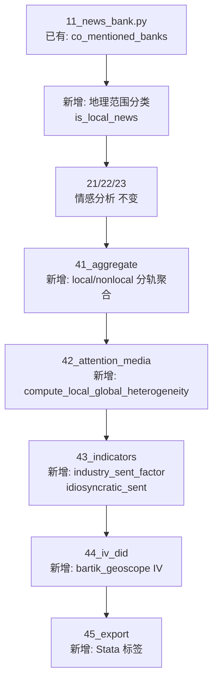

# Media Sentiment and International Asset Prices — 管线审计与执行计划

> **参考论文**: Fraiberger, S. P., Lee, D., Puy, D., & Rancière, R. (2021). Media sentiment and international asset prices. *Journal of International Economics*, 133, 103526.
> DOI: 10.1016/j.jinteco.2021.103526
>
> **审计对象**: `news_process` 金融科技银行新闻情感分析管线
> **生成日期**: 2026-04-06

---

## 一、论文核心方法论提取

### 1.1 研究问题与核心发现

| 维度 | 论文框架 | 关键数值 |
|------|----------|----------|
| **数据规模** | 400万篇 Reuters 英文新闻 (1991–2015), 25个国家 | 日频面板, 102,665 观测 |
| **情感度量** | Bag-of-Words (LM + Young & Soroka 词表), TF-IDF 加权稳健性 | s_j = (Σw·p − Σw·n) / Σw·t |
| **核心分解** | Local News vs. Global News Sentiment | 58% 本地新闻 vs. 42% 多国新闻 |
| **全球因子提取** | Kalman Filter 潜在单因子模型 (Stock & Watson 2016) | S_{i,t} = P_i·F_t + u_{i,t} |
| **因果识别** | Jordà (2005) Local Projection | h = 0..20 天脉冲响应 |
| **核心效应** | Local: 短暂 ~4.5 bps, 1周内反转; Global: 持久 ~45 bps, 不反转 | 10:1 幅度差异 |
| **渠道机制** | 外国基金 (ETF) vs. 本地基金, 投资者情绪 vs. 基本面 | ETF 响应 ≈ 3× 主动基金 |

### 1.2 方法论四大支柱

```
┌─────────────────────────────────────────────────────────────┐
│ 支柱 I: 情感度量 (Bag-of-Words)                             │
│   · LM (2011) + Young & Soroka (2012) 合并词表              │
│   · 词频扩展 (inflections): 7,217 负面 + 3,250 正面          │
│   · TF-IDF 稳健性: w_ij = log(N / N_i)                     │
│   · 日频 z-score 标准化                                      │
├─────────────────────────────────────────────────────────────┤
│ 支柱 II: Local vs. Global 分解                              │
│   · Local: 排除所有提及其他国家的文章 → 纯本地情感             │
│   · Global: Kalman Filter 从全样本情感序列提取潜在公因子       │
│   · 关键操作: "highly restrictive filter" 移除 180万篇       │
├─────────────────────────────────────────────────────────────┤
│ 支柱 III: Jordà Local Projection (脉冲响应)                 │
│   · CumR_{i,t,t+h} = α + μ_i + Σβ·GoodNews + Σγ·Controls  │
│   · 控制: 滞后收益率, 交易量, 波动率, VIX, 大宗商品价格      │
│   · 标准误: Driscoll-Kraay (跨截面+时间序列依赖)             │
│   · 截断滞后 = 投影期 h (Jordà 2005; Kilian & Kim 2011)     │
├─────────────────────────────────────────────────────────────┤
│ 支柱 IV: 渠道机制检验                                       │
│   · 外资 vs. 内资基金分拆 (EPFR 日频资金流)                  │
│   · ETF vs. Active Fund 异质性检验                          │
│   · Bull vs. Bear 市场状态交互 (Garcia 2013)                │
│   · 宏观惊喜 (CESI) 正交化, EPU 控制                         │
└─────────────────────────────────────────────────────────────┘
```

---

## 二、管线现状诊断 — 逐模块对标

### 2.1 能力矩阵: 论文需求 vs. 管线现状

| 论文需求 | 管线模块 | 对标状态 | 差距诊断 |
|----------|----------|----------|----------|
| **Bag-of-Words 情感** | `22_tone_words.py` | ✅ 完全覆盖 | 已含 5 部中文金融词典 + 语言学规则引擎 + IDF 加权 |
| **LLM 情感 (超越论文)** | `21_tone_llms.py` | ✅ 领先论文 | 多模型集成投票 (GPT-5nano/Gemini-3/Claude-4h) |
| **BERT 情感** | `23_bert_tone.py` | ✅ 补充维度 | FinBERT 中文模型, 三分类概率 |
| **Local 新闻分类** | ❌ **不存在** | 🔴 关键缺口 | 无地理范围分类 (单银行 vs. 多银行 ≠ 本地 vs. 全局) |
| **Global 因子提取** | ❌ **不存在** | 🔴 关键缺口 | 无 Kalman Filter / PCA 公因子模块 |
| **Jordà Local Projection** | ❌ **不存在** | 🟡 可映射 | 现有 DID Event Study 结构 (`44_panel_iv_did.py`) 可扩展 |
| **Bank-Year 面板聚合** | `41_panel_encode_aggregate.py` | ✅ 高度对齐 | 支持 mean/sum/std/VW 多维聚合 |
| **媒体权威性加权** | `42_panel_attention_media.py` | ✅ 超越论文 | Holzman et al. (2023) 权威性加权 |
| **Bartik IV** | `44_panel_iv_did.py` | ✅ 高度成熟 | 29 套 Bartik IV + Rotemberg 诊断 |
| **Leave-One-Out IV** | `43_panel_indicators_geography.py` | ✅ 完全覆盖 | 省/城市/经济圈三级 LOO |
| **截面标准化 (z-score)** | `43_panel_indicators_geography.py` | ✅ 完全覆盖 | Fama-MacBeth 年度 z-score |
| **Stata 导出** | `45_panel_export_main.py` | ✅ 完全覆盖 | .dta + variable labels + 完整标签体系 |

### 2.2 关键差距详解

#### 🔴 差距 1: 缺少 Local vs. Global 新闻地理范围分类

**论文做法**: 基于 Factiva 地理标签, 排除提及多国的文章 → 纯本地情感
**管线现状**: 
- 已有 `co_mentioned_banks` (多银行关联), 但这衡量的是 **多银行提及** 而非 **多地理区域提及**
- 已有 `国家地区/省份` 和 `城市` 地理列, 但未用于区分报道的 **地理范围**
- 已有 `_media_central` / `_media_type` 分类, 但这是 **媒体属性** 而非 **新闻内容的地理覆盖**

**概念迁移**: 
- 论文: Local = 仅提及 1 个国家; Global = 提及多国
- 本项目: **Local** = 仅涉及 1 家银行且与单一省份关联; **Global** = 涉及多家银行/多省份/行业性报道

#### 🔴 差距 2: 缺少 Global Sentiment Factor 提取模块

**论文做法**: Kalman Filter 单因子模型从 25 国日频情感序列提取公因子
**管线现状**: 无任何潜在因子模型或 PCA 模块
**概念迁移**: 从 Bank×Year 情感面板中, 使用 PCA/Kalman Filter 提取跨银行公共情感因子 → 行业系统性情绪指标

#### 🟡 差距 3: 缺少 Jordà Local Projection 脉冲响应估计

**论文做法**: CumR_{i,t,t+h} 对情感冲击的 h-step-ahead 响应
**管线现状**: `44_panel_iv_did.py` 已有 Event Study lead/lag 结构, 但面向 DID 而非连续变量脉冲响应
**概念迁移**: LP-IV 框架可作为现有 Bartik IV 的补充因果识别策略

---

## 三、结构优化方案 — 与现有管线的高效整合

### 3.1 词典模块定位重估

> [!IMPORTANT]
> **本论文使用 Bag-of-Words 作为主方法**, 但其时代背景 (2021年JIE发表, 数据截至2015年) 决定了这一选择。本项目的 LLM 集成投票管线已技术性超越论文度量。

**处置方案**:
- `22_tone_words.py`: 保留为 **稳健性对照** (Robustness Track), 非主指标
- 主回归使用 `llm_vote_tone_full/ctx` (三模型集成)
- 论文的 TF-IDF 加权已在管线中实现 → `dict_avg_idf_tone` 系列

### 3.2 新增模块设计

```
 现有管线                               新增模块 (论文驱动)
┌──────────────┐                    ┌──────────────────────────────┐
│ 11_news_bank │ ─── target_bank ──→│ 11b. 地理范围分类器          │
│              │     co_mentioned   │   · is_local_news (bool)     │
│              │     国家地区/省份   │   · geo_scope_count (int)    │
└──────────────┘                    │   · news_geographic_type     │
                                    │     ('local'/'regional'/     │
                                    │      'national'/'global')    │
                                    └──────────────┬───────────────┘
                                                   │
┌──────────────┐                    ┌──────────────▼───────────────┐
│ 41_aggregate │ ─── Bank-Year ────→│ 41b. Local/Global 情感分拆   │
│              │     面板           │   · local_tone_full/ctx      │
│              │                    │   · nonlocal_tone_full/ctx   │
│              │                    │   · tone_gap_local_nonlocal  │
└──────────────┘                    └──────────────┬───────────────┘
                                                   │
┌──────────────┐                    ┌──────────────▼───────────────┐
│ 43_indicators│ ─── 综合指标 ─────→│ 43b. Global Sentiment Factor │
│              │                    │   · PCA / Kalman Filter      │
│              │                    │   · global_sent_factor       │
│              │                    │   · bank_factor_loading      │
└──────────────┘                    └──────────────────────────────┘
```

---

## 四、三阶段执行计划

### Phase I: 机制重塑 — Local/Global 新闻分类 (核心增量)

#### 任务 I-1: 地理范围分类器设计

**目标**: 将每篇文章标记为 Local / Non-Local 新闻

**分类规则** (概念迁移自论文 §2.1.3):

| 分类 | 论文原始定义 | 本项目迁移定义 | 判定条件 |
|------|-------------|---------------|----------|
| **Local** | 仅标注 1 国地理标签 | 仅涉及 1 家银行 + 单一省份 | `bank_count == 1` AND `geo_scope <= 1` |
| **Regional** | N/A (论文无此级) | 涉及同省/同经济圈多银行 | `bank_count > 1` AND `banks_in_same_zone` |
| **National** | N/A | 涉及跨省/跨经济圈多银行 | `bank_count > 1` AND `!banks_in_same_zone` |
| **Global** | 标注多国标签 | 行业性/全国性政策报道 | 基于关键词规则或 LLM 分类 |

**实现位置**: 在 `45_panel_export_main.py` 的步骤 3 (多银行特征提取) 之后新增

**核心代码逻辑** (伪代码):
```python
# 1. 利用已有 co_mentioned_banks 计算地理范围
def classify_news_geographic_scope(row):
    """基于 co_mentioned_banks 和 地理列 判定报道地理范围"""
    if row['bank_count'] == 1:
        return 'local'
    # 检查所有涉及银行是否在同一省份/经济圈
    co_banks = parse_co_mentioned(row['co_mentioned_banks'])
    provinces = set(bank_province_map.get(b) for b in co_banks)
    provinces.discard(None)
    if len(provinces) <= 1:
        return 'regional'
    zones = set(PROVINCE_TO_ZONE.get(p) for p in provinces)
    zones.discard(None)
    if len(zones) <= 1:
        return 'regional'
    return 'national'
```

**config.yaml 新增配置**:
```yaml
panel_construction:
  # Fraiberger et al. (2021, JIE) Local vs. Global 分解
  compute_local_global_sentiment: true
  local_news_criteria: "bank_count_1_single_province"
  global_factor_method: "pca"  # 'pca' | 'kalman'
  global_factor_n_components: 1
```

#### 任务 I-2: 分轨情感聚合

**目标**: 在 Bank-Year 面板中生成 Local 和 Non-Local 分轨情感指标

**新增面板列**:

| 列名 | 定义 | 学术对标 |
|------|------|----------|
| `n_articles_local` | 本地新闻文章数 | Fraiberger (2021) Fig. A1: 58% local |
| `n_articles_nonlocal` | 非本地新闻文章数 | 同上: 42% multi-country |
| `local_tone_full` / `_ctx` | 本地新闻 LLM 投票情感均值 | Eq. (3): Local_GoodNews |
| `nonlocal_tone_full` / `_ctx` | 非本地新闻 LLM 投票情感均值 | Eq. (3): Global_GoodNews |
| `local_tone_std_full` / `_ctx` | 本地新闻情感标准差 | 波动性控制 |
| `nonlocal_tone_std_full` / `_ctx` | 非本地新闻情感标准差 | 同上 |
| `tone_gap_local_nonlocal_full` / `_ctx` | 情感缺口 = local − nonlocal | 类似 `tone_gap_fin_other` |
| `local_frac` | 本地新闻占比 | 信息结构变量 |

**实现位置**: `41_panel_encode_aggregate.py` → `aggregate_panel()` 扩展, 或在 `42_panel_attention_media.py` 中新增 `compute_local_global_heterogeneity()` 函数

**聚合公式** (与 `compute_media_heterogeneity` 完全同构):
```python
# 类比 42_panel_attention_media.py 的 compute_media_heterogeneity()
for track in ['_full', '_ctx']:
    src = f'llm_vote_score{track}'
    for scope, col_suffix in [('local', 'local'), 
                                ('regional', 'regional'),
                                ('national', 'national')]:
        tone = (df[df['_geo_scope'] == scope]
                .groupby(['target_bank', 'year'])[src]
                .mean().reset_index(name=f'tone_{col_suffix}{track}'))
        panel = panel.merge(tone, on=['target_bank', 'year'], how='left')
```

### Phase II: 重构层 — Global Sentiment Factor 提取

#### 任务 II-1: 跨银行公共情感因子

**论文方法**: Kalman Filter 单因子模型 (Stock & Watson 2016)
**本项目映射**: 从 Bank×Year LLM 情感面板提取主成分

**设计选择**:

> [!NOTE]
> 论文使用日频 × 25国 面板, 适合 Kalman Filter 动态因子。
> 本项目为年频 × ~1768 银行, 截面远大于时间维度 (N >> T)。
> 因此改用 **PCA** 或 **截面等权平均** 提取公因子更为稳健。

**方案 A (推荐): 截面等权平均 + LOO**
```python
# 全样本年度平均情感 (排除自身) → 类比论文的 Global Factor
# 与 43_panel_indicators_geography.py 的 LOO IV 同构
def compute_industry_sentiment_factor(panel):
    for track in ['_full', '_ctx']:
        tone_col = f'llm_vote_tone{track}'
        grp_sum = panel.groupby('year')[tone_col].transform('sum')
        grp_cnt = panel.groupby('year')[tone_col].transform('count')
        panel[f'industry_sent_factor{track}'] = (
            (grp_sum - panel[tone_col]) / (grp_cnt - 1)
        )
    return panel
```

**方案 B (高级): PCA 提取**
```python
# 将 Bank×Year 面板 pivot 为 宽表, 取第一主成分
from sklearn.decomposition import PCA
wide = panel.pivot(index='year', columns='target_bank', 
                   values='llm_vote_tone_full')
wide_filled = wide.fillna(wide.mean())
pca = PCA(n_components=1)
panel_factor = pca.fit_transform(wide_filled)
# factor_loading = pca.components_[0]  → 各银行载荷
```

**新增面板列**:

| 列名 | 定义 | 学术对标 |
|------|------|----------|
| `industry_sent_factor_full` / `_ctx` | 行业公共情感因子 (LOO) | Eq. (2): F_t |
| `idiosyncratic_sent_full` / `_ctx` | 特质情感 = 个体 − 公因子 | Eq. (2): u_{i,t} |
| `factor_loading` | 银行对公因子的载荷 (PCA方案) | Eq. (2): P_i |

#### 任务 II-2: Bartik IV 扩展 — Local/Global 维度

**新增 Bartik IV** (第 30 套, 补充现有 29 套):

| 维度 | share (基期) | shift (年度) | 前缀 |
|------|-------------|-------------|------|
| Local/Non-Local | bank i 在 T0 的 local_frac | LOO 年度 local/nonlocal 平均情感 | `bartik_geoscope` |

**实现**: 复用 `compute_bartik_iv_fintech()` 接口
```python
# 文章级: 标记 _geo_scope_binary = 'local' | 'nonlocal'
geoscope_map = {'local': 'local', 'nonlocal': 'nonlocal'}
panel = compute_bartik_iv_fintech(
    panel, df_exploded, geoscope_map, 'geoscope',
    category_col='_geo_scope_binary'
)
```

### Phase III: 实证验证 — 异质性分析与稳健性检验

#### 任务 III-1: 核心回归模型 (Stata .do 文件模板)

```stata
* =================================================================
* Fraiberger et al. (2021, JIE) — 概念迁移回归
* =================================================================

* --- 基准: 总体情感 → 银行绩效 ---
reghdfe Y llm_vote_tone_full_z Controls, ///
    absorb(target_bank year) vce(cluster target_bank)

* --- 分拆: Local vs. Non-Local 情感 ---
reghdfe Y tone_local_z tone_nonlocal_z Controls, ///
    absorb(target_bank year) vce(cluster target_bank)
* 预期: β_local 小且 t+1 反转; β_nonlocal 大且持续

* --- 公因子正交化: 特质情感 ---
reghdfe Y idiosyncratic_sent_full_z industry_sent_factor_full_z Controls, ///
    absorb(target_bank year) vce(cluster target_bank)
* 预期: β_industry (公共因子) > β_idiosyncratic (特质)

* --- IV 因果识别: Local/Global Bartik ---
ivreghdfe Y (llm_vote_tone_full = bartik_geoscope_iv_full) Controls, ///
    absorb(target_bank year) cluster(target_bank)
estat firststage  // F ≥ 10 检验
```

#### 任务 III-2: 渠道机制检验 (概念迁移)

| 论文渠道 | 本项目迁移 | 交互变量 | 预期效应 |
|----------|-----------|----------|----------|
| **Foreign vs. Local Fund** | 中央级 vs. 地方媒体 | `central_media_frac × tone` | 中央级媒体情感效应更强 |
| **ETF vs. Active Fund** | 财经 vs. 综合媒体 | `fin_media_frac × tone` | 财经媒体情感更持久 |
| **Bear vs. Bull Market** | 高波动 vs. 低波动年份 | `high_vol_year × tone` | 高波动年份效应更强 |
| **Macro Surprises 控制** | 行业景气指数 | 外部控制变量 | 控制后效应仍显著 |

#### 任务 III-3: 稳健性检验清单

| 编号 | 检验内容 | 论文对标 | 管线实现 |
|------|----------|----------|----------|
| R-1 | 排除 GFC 年份 (2008-2009) 子样本 | Fig. 3b | 时间窗口子集回归 |
| R-2 | 词典法 vs. LLM vs. BERT 交叉验证 | §5: TF-IDF 稳健性 | 已有 `dict_avg_tone` / `bert_avg_pos` |
| R-3 | 仅负面词 (Negative Only) | Appendix | `neg_ratio` or `is_negative` 频次 |
| R-4 | 提及密度加权 (VW) | Hassan (2019, QJE) | 已有 `_vw` 系列 |
| R-5 | 媒体权威性加权 (MW) | Holzman (2023, TAR) | 已有 `_mw` 系列 |
| R-6 | EPU 控制 | Baker et al. (2016) | 需外接中国 EPU 数据 |
| R-7 | 排除极端值 (Winsorize 1/99) | §3 注释 | 标准 Stata 操作 |
| R-8 | 聚类层级递进 (银行 → 城市 → 省级) | 稳健性标准 | 已有 `bank_province` / `bank_city` |
| R-9 | Bartik IV 基期敏感性 (T0, T0+1, T0&T0+1) | Goldsmith-Pinkham (2020) | 已有 `_t0` / `_t1` / `_t01` |
| R-10 | Rotemberg 权重诊断 | 同上 §5 | 已有 `diagnose_rotemberg_weights()` |

---

## 五、Stata 变量标签补充 (45_panel_export_main.py)

```python
# 新增 STATA_LABELS 条目
'n_articles_local':              'Local News Article Count',
'n_articles_nonlocal':           'Non-Local News Article Count',
'local_tone_full':               'Local News Sentiment (Full)',
'local_tone_ctx':                'Local News Sentiment (Ctx)',
'nonlocal_tone_full':            'Non-Local News Sentiment (Full)',
'nonlocal_tone_ctx':             'Non-Local News Sentiment (Ctx)',
'tone_gap_local_nonlocal_full':  'Tone Gap: Local - Non-Local (Full)',
'tone_gap_local_nonlocal_ctx':   'Tone Gap: Local - Non-Local (Ctx)',
'local_frac':                    'Local News Fraction',
'industry_sent_factor_full':     'Industry Sentiment Factor LOO (Full)',
'industry_sent_factor_ctx':      'Industry Sentiment Factor LOO (Ctx)',
'idiosyncratic_sent_full':       'Idiosyncratic Sentiment (Full)',
'idiosyncratic_sent_ctx':        'Idiosyncratic Sentiment (Ctx)',
'bartik_geoscope_iv_full':       'Bartik IV: Geo-Scope (Full)',
'bartik_geoscope_iv_ctx':        'Bartik IV: Geo-Scope (Ctx)',
'bartik_geoscope_share_local':   'Bartik Share: Local News',
'bartik_geoscope_share_nonlocal':'Bartik Share: Non-Local News',
```

---

## 六、模块依赖与执行序列



**不受影响的模块**: `01_preprocessing`, `12_fintech_news`, `21_tone_llms`, `22_tone_words`, `23_bert_tone`, `39_prompt_sensitivity`

---

## 七、风险评估与设计决策

### 7.1 已知风险

| 风险 | 严重度 | 缓解策略 |
|------|--------|----------|
| 年频面板无法复现日频脉冲响应 | 中 | 改用年度截面回归 + 分轨情感系数比较 |
| Local/Nonlocal 二分法信息损失 | 低 | 补充 Regional/National 四级分类 |
| PCA 因子在 N>>T 面板中可能退化 | 低 | 优先使用 LOO 截面均值方案 |
| EPU 外部数据缺失 | 低 | 可选: Baker et al. (2014) 中国 EPU 公开数据 |

### 7.2 与既有审计报告的整合关系

本执行计划新增的 Local/Global 分解框架与以下已有模块 **完全正交**, 可独立实施:

- **Luo & Li (2025)** Leave-One-Out IV → 本方案新增的 `industry_sent_factor` 提供互补性 IV
- **Holzman et al. (2023)** 媒体权威性加权 → 可对 local/nonlocal 分轨分别计算 MW 指标
- **He et al. (2024)** MSENT 计数型情感 → 可对 local/nonlocal 分轨分别计算 MSENT
- **Goldsmith-Pinkham (2020)** Bartik IV → 新增第 30 套 `bartik_geoscope` IV

---

## 八、实施优先级与工作量估算

| 优先级 | 任务 | 模块修改 | 预估工时 |
|--------|------|----------|----------|
| P0 (必需) | I-1: 地理范围分类器 | `45_panel_export_main.py` 步骤 3 后 | 2h |
| P0 (必需) | I-2: 分轨情感聚合 | `42_panel_attention_media.py` | 3h |
| P1 (核心) | II-1: 公因子提取 (LOO方案) | `43_panel_indicators_geography.py` | 2h |
| P1 (核心) | II-2: Bartik IV 扩展 | `44_panel_iv_did.py` / `45_panel_export_main.py` | 1h |
| P2 (增值) | III-1: Stata .do 模板 | `docs/stata/` 新增 | 1h |
| P2 (增值) | III-2-3: 渠道/稳健性设计 | 文档层面 | 1h |

**总计**: ~10 小时 (代码 8h + 文档 2h)

---

> [!CAUTION]
> **执行约束**: 本计划生成的所有代码修改须经用户审批后方可执行。
> 当前状态: **计划审阅阶段** — 等待用户确认后进入 Phase I 实施。
