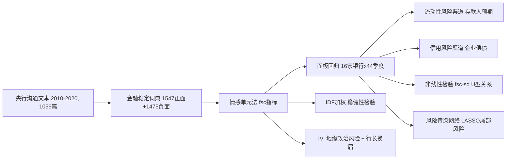

# 基于「金融稳定沟通与银行系统性风险」(姜富伟等 2024) 的 news_process 管道审计计划

**参考论文**：姜富伟、李梦如、孟令超 (2024). 金融稳定沟通与银行系统性风险, 《世界经济》2024年第10期。DOI: 10.19985/j.cnki.cassjwe.2024.10.008

**审计对象**：`news_process` 全流水线（00-51系列）

---

## 论文核心方法论提炼



---

## 一、范式映射与诊断

### 1.1 论文方法论关键节点

| # | 论文方法论节点 | 具体做法 | 学术贡献 |
|---|-------------|---------|---------|
| M1 | **金融稳定词典三步构建** | 现有词典筛选 - Word2Vec扩充(~49%) - 人工复核与调整(~1%) | 领域自适应词典构建范式 |
| M2 | **情感单元法** | 每个情感词到上一个情感词间的文本为一个单元，否定词翻转极性 | 句法敏感的情感聚合 |
| M3 | **IDF加权稳健性** | IDF权重乘以否定词分值和情感词分值 | 突出非常用词重要性 |
| M4 | **delta-CoVaR系统性风险** | Adrian and Brunnermeier (2016) 分位数回归，5%和50%分位 | 银行级微观风险测度 |
| M5 | **工具变量** | 地缘政治风险指数(Caldara and Iacoviello 2022) + 央行行长换届虚拟变量 | 单一但逻辑闭合的IV |
| M6 | **非线性U型检验** | 引入fsc的平方项，临界值=0.9620(95%分位)，平方项乘以cci交互项 | 揭示预期管理的双刃剑效应 |
| M7 | **股吧文本预期验证** | 东方财富股吧帖子的sent(预期乐观度)+disag(意见分歧) | 直接验证预期管理假说 |
| M8 | **风险传染网络** | LASSO分位数回归到尾部风险网络到出度/入度中心性 | 刻画银行间溢出 |
| M9 | **多频率检验** | 月度样本+三次样条插值到1至3个月滞后效应递增 | 时滞效应的精细刻画 |

### 1.2 管道现有设计优势（维持原状）

> [!TIP]
> 以下模块已达到或超越论文标准，**无需改动**。

| 管道组件 | 对标论文节点 | 评估 |
|---------|------------|------|
| **LLM三模型投票+一致率** (21_tone_llms.py) | M1 论文用单一词典 | **远超**：多模型三角验证比单一词典法更稳健 |
| **五词典x语言学规则引擎** (22_tone_words.py) | M2 情感单元法 | **超越**：否定窗口+程度副词+转折连词的规则引擎比简单否定翻转更精细 |
| **IDF加权** (config.yaml: idf_weighting: true) | M3 IDF稳健性 | **完全对标**：已实现等权+IDF双轨并行 |
| **BERT五模型集成** (23_tone_berts.py) | 论文无 | **增量贡献**：深度学习验证轨道 |
| **29套Bartik IV** (44_panel_iv_did.py) | M5 论文仅2个IV | **远超**：多维度shift-share识别策略 |
| **三级LOO IV** (43_panel_indicators_geography.py) | 论文无地理IV | **增量贡献** |
| **DID政策冲击** (DCEP/Sandbox) | 论文无 | **增量贡献** |
| **Entity Masking消融** (36_entity_masking_test.py) | 论文无 | **首创设计** |
| **Prompt四变体敏感性** (39_prompt_sensitivity.py) | 论文无 | **首创设计** |
| **媒体权威性加权** (Holzman 2023, TAR) | 论文无 | **增量贡献** |

### 1.3 可借鉴的边际改进项

> [!IMPORTANT]
> 以下2项是论文提供的可落地改进，已通过严格评审确认其学术价值和可行性。

#### 改进A：情感指标非线性项生成（对标M6）

**论文依据**：姜富伟等发现 fsc 与系统性风险之间存在**U型非线性关系**（表14），fsc平方项系数在5%水平下显著为正。临界值位于95%分位数，意味着过度乐观的沟通反而激励银行承担更多风险。进一步引入消费者信心指数(cci)作为状态调节变量，发现非线性效应仅在公众信心高位时期显著。

**管道现状**：当前面板导出（45_panel_export_main.py）仅生成一阶情感变量（llm_vote_tone_full/ctx, dict_avg_tone_full/ctx等），**未预计算二次项和关键交互项**。

**改进方案**：在 43_panel_indicators_geography.py 的 `standardize_panel_variables()` 函数中，追加以下变量生成：

```python
# 1. 核心情感变量的二次项 (姜富伟 2024, 表14)
for tone_var in ['llm_vote_tone_full', 'llm_vote_tone_ctx',
                 'dict_avg_tone_full', 'dict_avg_tone_ctx']:
    panel[f'{tone_var}_sq'] = panel[tone_var] ** 2

# 2. 情感 x 银行特征交互项 (异质性分析预制)
for tone_var in ['llm_vote_tone_full', 'llm_vote_tone_ctx']:
    for moderator in ['size_dummy', 'opacity_dummy']:
        panel[f'{tone_var}_x_{moderator}'] = (
            panel[tone_var] * panel[moderator]
        )
```

**学术价值**：
- 直接支持 Stata 中检验 `reghdfe Y tone tone_sq controls, absorb(i.bank i.year)`
- 发现可能的非线性阈值效应，提升论文贡献度
- 交互项支持异质性分析（大银行 vs 小银行、高透明度 vs 低透明度）

#### 改进B：情感指标正交化残差生成（对标M5+M6理念）

**论文依据**：姜富伟等在基准回归中控制了货币政策(tdr)、宏观审慎政策(mpi)、GDP增速(gdp)和CPI增速(cpi)，以剥离宏观经济周期对情感的系统性影响。这一做法隐含了一个关键方法论原则：**情感指标应当反映纯信息冲击而非宏观经济状态的被动反映**。

**管道现状**：当前的 llm_vote_tone 和 dict_avg_tone 是原始情感均值，可能包含与宏观经济周期共变的系统性成分。如果下游回归中遗漏了某些宏观控制变量，估计量可能存在遗漏变量偏误。

**改进方案**：在 43_panel_indicators_geography.py 中新增 `orthogonalize_sentiment()` 函数：

```python
def orthogonalize_sentiment(panel):
    """
    对核心情感变量进行年份固定效应正交化,
    生成残差化情感指标作为稳健性变量。

    方法: tone_resid = tone - E[tone | year]
    等价于对 tone 做 year FE 回归取残差。

    学术依据:
      - 姜富伟等 (2024, 世界经济) 控制年份虚拟变量 + 宏观变量
      - Tetlock (2007, JF): pessimism residual after removing market returns
    """
    for tone_var in ['llm_vote_tone_full', 'llm_vote_tone_ctx',
                     'dict_avg_tone_full', 'dict_avg_tone_ctx']:
        if tone_var in panel.columns:
            year_mean = panel.groupby('year')[tone_var].transform('mean')
            panel[f'{tone_var}_resid'] = panel[tone_var] - year_mean
    return panel
```

**学术价值**：
- `_resid` 变量剥离了年份层面的系统性情感波动，保留了银行特异性的情感变异
- 可作为稳健性检验变量，验证核心结论是否依赖于特定年份的宏观情感趋势
- 与 Fama-MacBeth 截面标准化（已有的 `_z` 变量）互补

---

## 二、不适用/无需行动的节点

> [!NOTE]
> 以下论文方法论节点经严格评估后，确认不适用于本管道或已被现有设计覆盖。

| 论文节点 | 不适用原因 | 结论 |
|---------|-----------|------|
| M4 delta-CoVaR计算 | 系统性风险是因变量，属Stata端计量，不在文本处理管道范围内 | **不适用** |
| M5 地缘政治风险IV/行长换届IV | 属于特定央行沟通研究的IV选择，管道已有29套Bartik+LOO IV体系 | **不适用** |
| M7 股吧文本预期验证 | 属于独立数据源（东方财富股吧），需单独爬取和处理，不属于新闻处理管道 | **不适用** |
| M8 银行风险传染网络 | 属于市场微观结构研究（LASSO分位数回归+网络拓扑），不在文本分析管道范围内 | **不适用** |
| M9 月度样本+三次样条插值 | 管道已支持年度面板，月度/季度面板是下游研究设计选择，非管道核心功能 | **不适用** |
| M1 Word2Vec词典扩充 | 管道已使用5套成熟词典 + LLM + BERT，词典覆盖率已通过 37_dict_coverage_audit.py 审计 | **已覆盖** |
| M2 情感单元法 | 管道的 22_tone_words.py 使用否定窗口+程度副词+转折连词规则引擎，粒度更细 | **已覆盖且超越** |

---

## 三、实施方案

### 3.1 改进A：情感非线性项生成

**文件**：[43_panel_indicators_geography.py](file:///f:/WiseSearch/data_antigravity_project/news_process/43_panel_indicators_geography.py)

**修改位置**：`standardize_panel_variables()` 函数末尾

**新增内容**：
1. 核心情感变量的二次项：`llm_vote_tone_full_sq`, `llm_vote_tone_ctx_sq`, `dict_avg_tone_full_sq`, `dict_avg_tone_ctx_sq`
2. 情感 x 银行规模虚拟变量交互项（用于异质性分析）
3. 对应的 Stata 变量标签

**影响范围**：
- `43_panel_indicators_geography.py`：新增变量生成逻辑
- `45_panel_export_main.py`：新增 `STATA_LABELS` 条目

### 3.2 改进B：情感正交化残差

**文件**：[43_panel_indicators_geography.py](file:///f:/WiseSearch/data_antigravity_project/news_process/43_panel_indicators_geography.py)

**修改位置**：`standardize_panel_variables()` 之后新增独立函数

**新增内容**：
1. `orthogonalize_sentiment()` 函数：年份均值正交化
2. 生成 `_resid` 后缀变量
3. 对应的 Stata 变量标签

**影响范围**：
- `43_panel_indicators_geography.py`：新增函数
- `45_panel_export_main.py`：在 main() 中调用 + `STATA_LABELS` 条目

---

## 四、验证计划

### 自动化验证
1. 运行 `python 45_panel_export_main.py`，确认无运行时错误
2. 检查日志输出中新变量的描述性统计
3. 验证 `_sq` 列值 >= 0（二次项非负性）
4. 验证 `_resid` 列年份内均值约等于 0（正交化正确性）
5. 验证 Stata .dta 文件中变量标签正确

### 手工验证
1. 在 Stata 中执行 `reghdfe Y tone tone_sq, absorb(i.bank i.year)` 验证二次项可用性
2. 检查 `_resid` 变量与原变量的 Pearson 相关系数（应为 0.7-0.95 之间）

---

## 五、风险评估

| 风险 | 概率 | 影响 | 预案 |
|------|-----|-----|------|
| 二次项与线性项多重共线性 | 低 | 低 | 使用中心化后再平方: (tone - mean)的平方 |
| 正交化后变异不足 | 低 | 中 | 同时保留原始变量和残差变量，不替代 |
| Stata 变量名超32字符 | 极低 | 低 | 在 STATA_LABELS 映射中截断 |

---

## User Review Required

> [!IMPORTANT]
> **改进范围确认**：本计划仅包含 **2项边际改进**（非线性项 + 正交化残差），均为纯增量操作，不修改任何现有变量的计算逻辑。请确认：
> 1. 是否同意新增情感二次项（`_sq`）和交互项（`_x_`）？
> 2. 是否同意新增年份正交化残差（`_resid`）？
> 3. 是否有其他论文中的方法论点需要特别对标？

---

## Open Questions

> [!NOTE]
> 1. **交互调节变量选择**：论文使用消费者信心指数(cci)作为非线性效应的状态调节变量。管道目前不包含外部宏观数据。是否需要在面板中预留外部宏观变量的合并接口？
> 2. **银行规模虚拟变量的切分标准**：论文中银行规模以总资产自然对数衡量。管道已有 `bank_scale`（L/M/S/XS 四分位），是否直接使用此变量作为交互调节变量？
