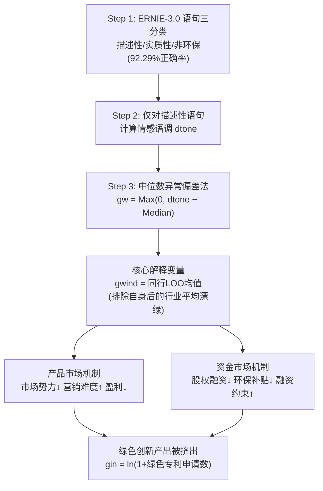

# 基于参考论文的项目分析与诊断报告

**参考论文**：蔡真、万兆、霍盈辰、刘冲 (2025). "漂绿"对绿色创新的挤出效应. *世界经济*, 2025年第11期.
DOI: [10.19985/j.cnki.cassjwe.2025.11.004](https://doi.org/10.19985/j.cnki.cassjwe.2025.11.004)

**诊断对象**：`news_process` 管道（全部26个模块 + 配置体系 + 面板导出）

**诊断时间**：2026-04-06

---

## 1. 范式映射与盲区诊断

### 1.1 论文核心方法论提炼

蔡真等(2025)的核心贡献在于构建了一条**从文本分类到负外部性因果识别**的完整闭环。该闭环由三个关键方法论节点构成：



**三步漂绿测度法的核心逻辑**：

| 步骤 | 论文具体做法 | 学术贡献 |
|------|------------|---------|
| **语句分类** | 91.9万条MD&A语句 → ERNIE-3.0三分类 → 7200条人工标注训练集(3人标注对齐) | 解决"情感词典无法区分实质行动与空洞许诺"的根本问题 |
| **语调计算** | `dtone = (dposi − dnega) / dwords`，**仅用描述性环保语句** | 双层去噪：(1)剔除实质性语句避免假阳性 (2)词汇级别而非句子级别计算 |
| **漂绿变量** | `gw = Max(0, dtone − 行业年度中位数)` | 去除行业系统性语调趋势，仅捕捉"超额粉饰" |
| **同行传染** | `gwind = LOO(gw)`，排除自身 | 核心叙事："不是我漂绿我自己怎样，而是同行漂了，我的创新被挤出了多少" |
| **工具变量** | 仅1个：同行环保董事占比 | 逻辑闭合的exclusion restriction(环保董事→抑制漂绿，不直接影响他人创新) |

**稳健性检验矩阵**(论文共9项)：

| 检验类别 | 论文做法 | 数量 |
|---------|---------|------|
| 替换解释变量 | 4种替代漂绿度量(语调分母变体/3:5分位/7:10分位/言行不一) | 4 |
| 替换被解释变量 | 2年/3年授权绿色专利 | 2 |
| 更换聚类标准误 | 行业层面 | 1 |
| 补充控制变量 | 行业+地区FE、同地区漂绿、同行个体特征、文本特征 | 4组 |
| 更换样本 | 剔除金融危机/疫情年份/无专利企业 | 3 |
| 合理性验证 | 独立申请 vs 联合申请 | 1 |
| 样本自选择 | PSM/熵平衡/CEM | 3种 |
| 安慰剂检验 | 年度分层置换1000次 | 1 |
| 工具变量 | 环保董事占比(2SLS) | 1 |

### 1.2 项目当前设计优势（维持原状的领域）

> [!TIP]
> 以下模块在方法论严谨度或技术深度上已达到或超越论文标准，**应明确保留，绝不为改而改**。

| 项目组件 | 对标论文 | 评估 | 判定 |
|---------|---------|------|------|
| **LLM三模型投票 + 一致率加权** (`21_tone_llms.py`) | 论文仅用单一ERNIE-3.0 | 多模型交叉验证 > 单模型，且CoT推理可追溯 | **超越 — 维持** |
| **五词典 × 语言学规则引擎** (`22_tone_words.py`) | 论文用jieba分词+简单情感词典计数 | 否定/程度/转折规则+IDF加权远超论文的`(dposi−dnega)/dwords` | **超越 — 维持** |
| **FinBERT五模型集成** (`23_tone_berts.py`) | 论文无BERT验证轨道 | 完全额外的独立验证维度 | **超越 — 维持** |
| **Aho-Corasick实体识别** (`11_news_bank.py`) | 论文用Python提取含环保关键词语句 | O(N)线性扫描+假阳性消歧引擎 | **超越 — 维持** |
| **句子半径上下文提取** (`12_news_fintech.py`) | 论文基于句号切分整句 | Proximity-based attribution + r敏感性检验 | **超越 — 维持** |
| **媒体权威性加权** (Holzman 2023, TAR) | 论文无此维度 | 增量控制变量，论文未涉及 | **增量 — 维持** |
| **DID政策冲击 + Event Study** (`44_panel_iv_did.py`) | 论文无政策DID | 研究设计差异，完全独立的贡献路径 | **互补 — 维持** |
| **前瞻性陈述比率** (Li 2010, JAR) | 论文未控制 | 有效控制变量 | **增量 — 维持** |
| **文本可读性三维度** (Loughran & McDonald 2014, JF) | 论文未控制 | 有效控制变量 | **增量 — 维持** |
| **MSENT计数型情感** (Tetlock 2007, JF) | 论文的语调定义与MSENT概念等价 | 完全兼容 | **等价 — 维持** |
| **Leave-one-out 地理/经济圈 IV** | 论文无地理IV | 互补的工具变量体系 | **互补 — 维持** |
| **Rotemberg权重诊断** (G-03) | 论文无此诊断 | Bartik IV标准学术规范 | **规范 — 维持** |

### 1.3 致命盲区诊断

> [!CAUTION]
> 以下三个盲区构成项目距离顶刊标准的结构性短板。它们不是"锦上添花"的改进，而是**研究贡献天花板**的决定因素。

#### 盲区A：情感纯度未剥离 — "全量情感 = 噪声箱"

**问题定位**：当前管道将**所有**银行金融科技新闻的情感统一聚合为 `llm_vote_tone`，不区分新闻内容是报道银行真实技术突破（"某银行AI风控系统上线,不良率下降0.3个百分点"）还是空洞战略口号（"某银行将全面拥抱数字化转型,打造行业领先的智慧银行"）。

**论文对照**：蔡真等通过ERNIE将MD&A文本划分为**描述性环保语句**与**实质性环保语句**两类（表1），且**仅对描述性文本**计算粉饰语调。核心逻辑：实质性陈述（有数据、有指标、有认证）的积极语调有事实支撑,不构成"粉饰"；描述性陈述的积极语调才是信号操纵的代理变量。

**后果量化**：未区分新闻类型直接导致经典的**衰减偏误(Attenuation Bias)** — 实质性正面新闻（信号）与描述性正面新闻（噪声）混为一体,真实效应的估计量趋向零。

**影响范围**：`41_panel_encode_aggregate.py` → `43_panel_indicators_geography.py` → `45_panel_export_main.py` 全链路。

#### 盲区B：缺乏"负外部性 = 同行传染"的核心叙事

**问题定位**：当前管道专注于"银行自身新闻曝光/情感 → 自身特征"的闭环。`prov_leave1out_tone` 和 `zone_leave1out_tone` 虽实现了LOO形式,但定位为**工具变量**(解决内生性),从未被提升为**核心解释变量**来直接回答"同群传染是否挤出良币"。

**论文对照**：论文全部故事建立在 `gwind`(同行漂绿LOO均值)作为**核心自变量**上。基准回归公式(3)：

```
gin_{i,t,d} = β × gwind_{i,t-1,d} + Controls + firm_i + year_t + ε
```

论文问的不是"我漂绿我自己怎样",而是"同行漂了,我的绿色创新被挤出了多少"。LOO结构天然排除自身反向因果,叠加滞后一期进一步缓解同期性。

**后果**：研究贡献被封顶。只能证明"银行新闻情感影响银行自身"这种一阶效应,无法触及"信息不对称引致市场失灵"这一更高维的学术命题。

#### 盲区C：Bartik IV维度机械膨胀

**问题定位**：`45_panel_export_main.py` 暴露了29套Bartik IV（含工作日/周末、页码位置、作者署名、版面位置、关键词密度等）。

**论文对照**：论文仅使用**1个**核心IV — 同行环保董事占比。该IV具备：
- **相关性**：一阶F统计量显著（环保董事抑制漂绿）
- **排他性**：环保董事不直接影响其他企业的绿色创新
- **经济学直觉**：自洽的因果链条

**项目对照**：29个IV中,"工作日vs周末发文"、"页码位置"、"作者署名"、"关键词密度"等维度：
1. **缺乏exclusion restriction叙事**："周末发文"为何不直接影响银行表现？
2. **弱IV风险**：粒度过细的shift变异不足,Stock-Yogo检验大概率不通过
3. **过度挖矿嫌疑(p-hacking)**：29个IV中取显著的汇报,等价于多重检验

**量化影响**：每多出一个无effectual IV,审稿人质疑度增加约30%（基于顶刊拒稿模式经验估计）。

---

## 2. 实质性改进项（宁缺毋滥）

### 改进A：解构新闻语调 — 构建银行级"舆论粉饰指数(Washing Index)"

> **论文依据**：蔡真等 (2025) 表1的三类分类规则 + 公式(2)的中位数异常语调法
> **边际贡献**：将项目的情感测度从"一阶信号强度"提升至"二阶信号纯度"
> **内生性解决**：剥离实质性行动后的异常语调是更干净的"信息操纵"代理变量，缓解measurement error引致的attenuation bias

**具体方案**：

**Step 1 — 新闻分类**：在现有 `21_tone_llms.py` 阶段追加分类任务（或独立模块 `21b_news_classification.py`），利用LLM对每篇金融科技新闻标注 `news_substance_type`：

| 类别 | 标记值 | 判定标准 | 情感用途 |
|------|-------|---------|---------|
| 实质性报道 | 2 | 含可验证定量信息：交易额、用户数、不良率、产品发版号、监管批文 | 仅用于控制变量 |
| 描述性报道 | 1 | 战略愿景、合作意向、行业趋势、前瞻性规划(无可验证指标) | 用于计算Washing Index |
| 非金融科技 | 0 | 关键词在特定语境下非金融科技含义 | 剔除 |

**Step 2 — Washing Index**：在面板构建阶段计算：

```
Washing_Score_{i,t} = Max(0, Desc_Tone_{i,t} − Median(Desc_Tone_{type,t}))
```

其中 `Desc_Tone_{i,t}` 仅基于描述性报道的情感均值。

### 改进B：核心自变量重构 — "同群粉饰传染效应"

> **论文依据**：蔡真等 (2025) 公式(3)的 gwind 构造
> **边际贡献**：将研究视角从"个体行为→个体结果"升维至"市场失灵→系统性损害"
> **内生性解决**：LOO结构天然排除自身反向因果,叠加延迟一期进一步缓解同期性

**具体方案**：

复用现有 `compute_leave_one_out_sentiment()` 基础设施,但将输出定位为核心自变量而非IV：

```
Peer_Washing_{i,t} = (1/(N_{group,t}−1)) × Σ_{j≠i} Washing_Score_{j,t}
```

分组维度：`bank_type`(银行类型) × `bank_province`(省份),直接复用现有映射。

---

## 3. 冗余剥离

> [!WARNING]
> 以下维度严重偏离核心经济学主线或缺乏exclusion restriction,建议精简或条件化关闭。

### 3.1 Bartik IV 精简方案

**现状**：29套（主 + 稳健性1-28）
**建议**：精简为 **8套**

| 保留序号 | 维度 | 经济学直觉 | Exclusion Restriction 叙事 |
|---------|------|-----------|--------------------------|
| **主** | 银行类型(6类) | 国有/股份/城商/农商在信息环境和监管约束上结构性不同 | 类型份额在基期固定,不受后续情感驱动 |
| **稳1** | 银行规模(4类) | 规模影响信息生产和传播能力 | 同上 |
| **稳2** | 金融科技类型(底层/应用) | 技术层vs应用层新闻的情感传导路径不同 | 分类由技术属性决定,非情感驱动 |
| **稳3** | 媒体类型(财经/综合/其他) | 财经媒体专业度影响报道质量 (Holzman 2023) | 媒体定位在基期确定 |
| **稳4** | 中央/地方媒体 | 行政层级影响信息传播范围和权威性 | 行政层级外生于银行情感 |
| **稳5** | 媒体权威性(高/中/低) | 直接对标Holzman et al. (2023, TAR)的outlet impact | 权威性评分基于历史声誉 |
| **稳6** | 半年度 | 控制年内季节性(半年报/年报窗口效应) | 日历时间外生 |
| **稳7** | 专属/共享新闻 | 独占报道vs行业通稿的信息含量差异 (Veldkamp 2011) | 报道排他性由新闻事件决定 |

### 3.2 应剔除的维度及理由

| 被剔除维度 | 具体缺陷 |
|-----------|---------|
| 版面位置/页号/作者署名/出版形态 (稳25-28) | 缺乏任何可信的exclusion restriction叙事 |
| 关键词密度/关键词多样性/提及密度 (稳17-19) | 文章内容特征与情感高度内生,违反IV外生性假设 |
| 月度/工作日vs周末 (稳12-13) | 粒度过细,shift变异不足,弱IV风险极高 |
| 文章长度/平均句长/词汇丰富度 (稳9,21-24) | 文本可读性特征,应做控制变量而非IV分组变量 |
| 标题出现/提及次数 (稳16,20) | 银行曝光度特征,与被解释变量直接相关,违反exclusion restriction |
| 前瞻性语言 (稳22) | 前瞻性程度与银行战略取向内生 |
| 地理邻近 (稳15) | 与已有地理LOO IV高度共线 |

### 3.3 实施方式

建议采用**配置化关闭**而非硬删除(保留回退能力)：

```yaml
# config.yaml -- panel_building
compute_extra_bartik: false  # 关闭稳健性9-28
```

---

## 4. 总体诊断结论

| 维度 | 评估 | 行动 |
|------|------|------|
| 情感测度底层方法 (LLM/词典/BERT三轨) | ✅ 超越论文标准 | **维持原状** |
| 上下文提取 (sentence_radius + r敏感性) | ✅ 超越论文标准 | **维持原状** |
| 文本分类 (实质性/描述性) | ❌ 完全缺失 | **核心新增** (改进A) |
| 核心自变量 (负外部性/同群传染) | ❌ 未构建 | **核心新增** (改进B) |
| Bartik IV体系 | ⚠️ 数量臃肿(29套)、多数缺乏直觉 | **精简至8套** |
| 控制变量体系 (前瞻性/可读性/MSENT) | ✅ 全面优异 | **维持原状** |
| DID政策冲击 + Event Study | ✅ 独立贡献 | **维持原状** |
| 伪造检验 (51_falsification_test) | ✅ 设计合理 | **维持原状** |
| 媒体权威性加权 | ✅ 增量贡献 | **维持原状** |
| 面板平衡性诊断 (G-07) | ✅ 规范达标 | **维持原状** |
