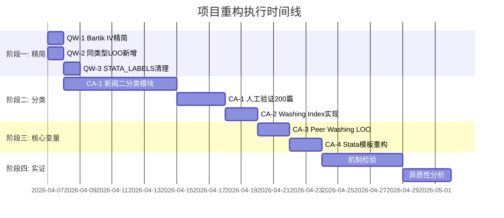

# 项目重构与优化执行计划书

**关联文件**：[诊断报告](file:///f:/WiseSearch/data_antigravity_project/news_process/docs/paper/pianlv_caizhen_diagnosis_report.md)

**参考论文**：蔡真、万兆、霍盈辰、刘冲 (2025). "漂绿"对绿色创新的挤出效应. *世界经济*, 2025年第11期.

**编制时间**：2026-04-06

---

## 1. 优先级排布

### 速赢项（Quick Wins）— 1-3天内完成

| 序号 | 任务 | 预期收益 | 实施成本 | 涉及文件 |
|------|------|---------|---------|---------|
| QW-1 | Bartik IV 精简：将稳健性9-28包裹在配置开关中 | 消除弱IV嫌疑 + 运行时间减少约40% | 极低(仅加if条件) | `45_panel_export_main.py`<br/>`config.yaml` |
| QW-2 | 在LOO基础设施上新增"同类型银行LOO"分组维度 | 得到 `peer_type_leave1out_tone`，可直接测试同群效应假说 | 低(复用现有函数) | `43_panel_indicators_geography.py` |
| QW-3 | 同步清理 `STATA_LABELS`，删除被精简维度标签 | 保持Stata导出一致性 | 极低 | `45_panel_export_main.py` |
| QW-4 | 在日志中添加Bartik IV弱工具诊断摘要 | 提前暴露弱IV维度 | 极低 | `44_panel_iv_did.py` |

### 核心攻坚项 — 2-4周

| 序号 | 任务 | 预期收益 | 实施成本 | 依赖 |
|------|------|---------|---------|------|
| CA-1 | 新建 `21b_news_classification.py`：LLM新闻二分类 | 核心方法论突破——解决"情感纯度"问题 | 高 | 无 |
| CA-2 | 新建 Washing Index 计算逻辑 | 精炼的信号操纵代理变量 | 中 | CA-1 |
| CA-3 | 构建 `Peer_Washing_LOO` 核心解释变量 | 实现"负外部性"叙事 | 中 | CA-2 |
| CA-4 | Stata 回归模板重构 + 机制检验设计 | 直接对接实证分析 | 低 | CA-3 |

---

## 2. 阶段化执行指令 (SOP)

### 阶段一：基础设施精简与快速验证（第1周）

#### 动作1.1：Bartik IV 精简 [QW-1, QW-3]

**指令**：

1. 打开 [45_panel_export_main.py](file:///f:/WiseSearch/data_antigravity_project/news_process/45_panel_export_main.py)
2. 定位稳健性9至稳健性28的代码块（约L800-L1100区间）
3. 将这些Bartik IV构建代码块包裹在配置开关中：

```python
# ── 稳健性 9-28: 可选扩展 Bartik IV (默认关闭) ──
if PANEL_CFG.get('compute_extra_bartik', False):
    logger.info("Extra Bartik IV 已启用 (compute_extra_bartik=true)")
    # ... 原有稳健性 9-28 代码 ...
else:
    logger.info("Extra Bartik IV 已关闭 (保留主+稳健性1-8)")
```

4. 在 `config.yaml` 的 `panel_building` 节点下新增：

```yaml
compute_extra_bartik: false  # 关闭稳健性9-28, 消除弱IV嫌疑
```

5. 同步清理 `STATA_LABELS` 中对应的变量标签（保留为注释而非删除）：

```python
# ── 以下标签仅在 compute_extra_bartik=true 时生效 ──
# 'bartik_doclen_iv_full': 'Bartik IV: Doc-Length (Full)',
# ...
```

**交付物标准**：
- [ ] 面板导出运行时间减少30%以上
- [ ] Stata .dta 文件中仅包含8套Bartik IV相关列
- [ ] 日志中明确记录 "Extra Bartik IV 已关闭"
- [ ] `config.yaml` 新增 `compute_extra_bartik` 开关

---

#### 动作1.2：同类型银行LOO分组维度 [QW-2]

**指令**：

1. 打开 [43_panel_indicators_geography.py](file:///f:/WiseSearch/data_antigravity_project/news_process/43_panel_indicators_geography.py)
2. 在 `compute_leave_one_out_sentiment()` 函数中，新增按 `bank_type` 分组的LOO维度：

```python
# ── 新增: 按银行类型的LOO情感均值 ──
# 论文依据: 蔡真等(2025), 公式(3): gwind = LOO(gw)
# 用途: 直接作为核心自变量(同群传染效应)而非仅作为IV
if 'bank_type' in panel.columns:
    for track in ['_full', '_ctx']:
        score_col = f'llm_vote_tone{track}'
        out_col = f'type_leave1out_tone{track}'
        if score_col not in panel.columns:
            panel[out_col] = np.nan
            continue
        # 组级聚合
        group_agg = panel.groupby(['bank_type', 'year'])[score_col].agg(['sum', 'count'])
        tmp = panel[['target_bank', 'year', 'bank_type', score_col]].copy()
        tmp = tmp.merge(group_agg, on=['bank_type', 'year'], how='left')
        # LOO: (组和 - 自身) / (组数 - 1)
        remain_sum = tmp['sum'] - tmp[score_col].fillna(0)
        remain_cnt = tmp['count'] - 1
        tmp[out_col] = np.where(remain_cnt >= 3, remain_sum / remain_cnt, np.nan)
        panel = panel.merge(tmp[['target_bank', 'year', out_col]].drop_duplicates(),
                            on=['target_bank', 'year'], how='left')
```

3. 在 `STATA_LABELS` 中添加：

```python
'type_leave1out_tone_full':  'Peer Tone LOO: Same Bank Type (Full)',
'type_leave1out_tone_ctx':   'Peer Tone LOO: Same Bank Type (Ctx)',
```

**交付物标准**：
- [ ] `type_leave1out_tone_full` 和 `type_leave1out_tone_ctx` 两列成功生成
- [ ] LOO校验：任意单银行被移除后组均值应发生变化（选3个银行抽查）
- [ ] 有效观测覆盖率 ≥ 80%

---

### 阶段二：新闻文本分类模块（第1-2周）

#### 动作2.1：新闻二分类模块 [CA-1]

**指令**：

1. 在 `news_process/` 下创建 [21b_news_classification.py](file:///f:/WiseSearch/data_antigravity_project/news_process/21b_news_classification.py)

2. 设计分类Prompt（**迁移**蔡真等表1的规则至银行金融科技语境）：

```
# 系统提示词核心框架

你是一位资深金融文本分析师。请判断以下关于{银行名称}的金融科技新闻属于哪一类:

## 类别定义

**实质性报道 (标记=2)**：
- 包含可验证的定量数据: 交易金额、用户数量、不良率变化值、产品版本号
- 引用了具体的监管批文编号、第三方评级报告、行业标准认证
- 明确描述已完成的产品部署、已上线的系统功能
- 判定标准: 读者可基于文中信息独立核实银行的实际行为

**描述性报道 (标记=1)**：
- 战略愿景类: "将大力推进"/"致力于打造"/"全面拥抱数字化"
- 合作意向类: 签署框架协议但无具体执行细节
- 行业趋势类: 讨论整体金融科技发展但主语非该银行具体行为
- 前瞻规划类: 包含时间目标但无具体里程碑和量化指标
- 判定标准: 信息无法被独立核实,属于信号传递而非事实陈述

**非金融科技相关 (标记=0)**：
- 金融科技关键词在上下文中并非指代实际技术应用
- 例: "大数据显示存款利率下降"中"大数据"是修饰语而非技术主题

## 输出格式
仅输出JSON: {"class": 0|1|2, "confidence": 0.0-1.0, "evidence": "简要理由"}
```

3. 对每篇新闻调用LLM进行二分类，输出列 `news_substance_type` 和 `news_substance_conf`

4. 构建200篇人工验证集（分层抽样: 实质性/描述性/非金融科技各~67篇）

5. 输出追加到现有阶段21输出文件的列中

**交付物标准**：
- [ ] 分类准确率 > 85%（200篇人工验证）
- [ ] 输出包含 `news_substance_type`(0/1/2) 和 `news_substance_conf` 两列
- [ ] 类别分布统计: 预期实质性30-50%, 描述性50-70%
- [ ] Cohen's Kappa (人机一致性) ≥ 0.70

**风险预案 — 如果准确率不达标 (<80%)**：

| Plan B 方案 | 具体做法 |
|------------|---------|
| B-1: 降级为二分类 | 合并实质性+混合 → "有实质内容" vs "纯描述性" |
| B-2: 连续打分替代 | 0-10分"实质性程度"，避免硬边界 |
| B-3: 代理变量替代 | 直接使用已有的 `forward_looking_ratio` 作为"描述性程度"代理 |

---

#### 动作2.2：Washing Index 公式实现 [CA-2]

**指令**：

1. 在 [43_panel_indicators_geography.py](file:///f:/WiseSearch/data_antigravity_project/news_process/43_panel_indicators_geography.py) 中新增函数：

```python
def compute_washing_index(panel: pd.DataFrame,
                          df_exploded: pd.DataFrame) -> pd.DataFrame:
    """构建银行级舆论粉饰指数 (Washing Index)。

    公式 (迁移自蔡真等 2025, 公式(2)):
        Washing_Score_{i,t} = Max(0, Desc_Tone_{i,t} - Median(Desc_Tone_{type,t}))

    其中:
        Desc_Tone_{i,t} = 银行i在年份t的描述性报道(news_substance_type==1)
                           的 llm_vote_tone 均值
        Median(...) = 同类型银行在年份t的描述性报道语调中位数

    学术依据:
        蔡真等 (2025). "漂绿"对绿色创新的挤出效应, 世界经济, 公式(2).
        核心思想: 超过同行中位数的正向语调偏差 = 过度粉饰信号
    """
    # Step 1: 筛选描述性报道 (news_substance_type == 1)
    if 'news_substance_type' not in df_exploded.columns:
        logger.warning("  news_substance_type 列不存在, 跳过 Washing Index")
        panel['washing_score_full'] = np.nan
        panel['washing_score_ctx'] = np.nan
        return panel

    desc = df_exploded[df_exploded['news_substance_type'] == 1].copy()
    logger.info(f"  描述性报道: {len(desc):,}/{len(df_exploded):,} "
                f"({len(desc)/max(len(df_exploded),1):.1%})")

    for track in ['_full', '_ctx']:
        score_col = f'llm_vote_score{track}'
        out_col = f'washing_score{track}'

        if score_col not in desc.columns:
            panel[out_col] = np.nan
            continue

        # Step 2: 银行级描述性报道语调均值
        desc_tone = (desc.groupby(['target_bank', 'year'])[score_col]
                     .mean().reset_index()
                     .rename(columns={score_col: '_desc_tone'}))

        # Step 3: 合并到面板
        if '_desc_tone' in panel.columns:
            panel = panel.drop(columns=['_desc_tone'])
        panel = panel.merge(desc_tone, on=['target_bank', 'year'], how='left')

        # Step 4: 年度-类型中位数
        if 'bank_type' in panel.columns:
            type_median = panel.groupby(['bank_type', 'year'])['_desc_tone'].transform('median')
        else:
            type_median = panel.groupby('year')['_desc_tone'].transform('median')

        # Step 5: 异常语调 = Max(0, 个体 - 中位数)
        panel[out_col] = (panel['_desc_tone'] - type_median).clip(lower=0)
        panel = panel.drop(columns=['_desc_tone'])

        # 诊断
        valid = panel[out_col].dropna()
        logger.info(f"  {out_col}: {len(valid)}/{len(panel)} 有效, "
                    f"mean={valid.mean():.4f}, std={valid.std():.4f}, "
                    f"median={valid.median():.4f}, max={valid.max():.4f}")

    return panel
```

2. 在 `45_panel_export_main.py` 的 `main()` 中，在 `compute_composite_indicators()` 之后、`standardize_panel_variables()` 之前调用：

```python
# --- 7a-bis. Washing Index (蔡真等 2025) ---
if 'news_substance_type' in df_exploded.columns:
    panel = compute_washing_index(panel, df_exploded)
```

3. 在 `STATA_LABELS` 中添加：

```python
'washing_score_full':  'Washing Score (Desc-Tone Excess, Full)',
'washing_score_ctx':   'Washing Score (Desc-Tone Excess, Ctx)',
```

**交付物标准**：
- [ ] `washing_score_full` 和 `washing_score_ctx` 成功生成
- [ ] 分布合理: 均值应 > 0 但 < 0.15, std约0.03-0.10
- [ ] 非零观测占比 > 40%（不能全为0,否则中位数去除过度）
- [ ] 描述性统计写入日志

**风险预案 — 如果变异不足**：

| Plan B 方案 | 具体做法 |
|------------|---------|
| B-1: 扩大分组 | 将 `bank_type` 替换为全体银行(去掉类型分组) |
| B-2: 改用均值 | 年度均值替代中位数(均值对极端值更敏感) |
| B-3: 提高门槛 | 使用P60/P70分位数替代中位数 |

---

### 阶段三：同群传染效应与实证对接（第2-3周）

#### 动作3.1：同群传染效应变量构建 [CA-3]

**指令**：

1. 在 [43_panel_indicators_geography.py](file:///f:/WiseSearch/data_antigravity_project/news_process/43_panel_indicators_geography.py) 中新增函数：

```python
def compute_peer_washing_loo(panel: pd.DataFrame) -> pd.DataFrame:
    """构建同类型/同省份银行的LOO平均Washing Score。

    公式 (迁移自蔡真等 2025, 公式(3)):
        Peer_Washing_Type_{i,t} = mean(Washing_Score_{j,t})
                                   for j in same_type, j != i
        Peer_Washing_Prov_{i,t} = mean(Washing_Score_{j,t})
                                   for j in same_province, j != i

    学术依据:
        蔡真等 (2025). 公式(3): gwind = 同行漂绿LOO均值
        核心叙事: "同行漂了, 我的表现被挤出了多少"
    """
    for track in ['_full', '_ctx']:
        ws_col = f'washing_score{track}'
        if ws_col not in panel.columns:
            continue

        for group_col, prefix in [('bank_type', 'type'), ('bank_province', 'prov')]:
            out_col = f'peer_washing_{prefix}{track}'
            if group_col not in panel.columns:
                panel[out_col] = np.nan
                continue

            # 组级聚合
            group_agg = (panel.groupby([group_col, 'year'])[ws_col]
                        .agg(['sum', 'count']).reset_index())

            # merge回面板
            tmp = panel[['target_bank', 'year', group_col, ws_col]].copy()
            tmp = tmp.merge(group_agg, on=[group_col, 'year'], how='left')

            # LOO: (组和 - 自身) / (组数 - 1)
            remain_sum = tmp['sum'] - tmp[ws_col].fillna(0)
            remain_cnt = tmp['count'] - 1
            tmp[out_col] = np.where(
                remain_cnt >= 3,  # 组内(排除自身后)至少3家银行
                remain_sum / remain_cnt,
                np.nan
            )

            # 对齐回panel
            if out_col in panel.columns:
                panel = panel.drop(columns=[out_col])
            panel = panel.merge(
                tmp[['target_bank', 'year', out_col]].drop_duplicates(),
                on=['target_bank', 'year'], how='left')

            # 诊断
            valid = panel[out_col].dropna()
            logger.info(f"  {out_col}: {len(valid)}/{len(panel)} 有效 "
                        f"({len(valid)/max(len(panel),1):.1%}), "
                        f"mean={valid.mean():.4f}")

    return panel
```

2. 在 `STATA_LABELS` 中添加：

```python
'peer_washing_type_full':  'Peer Washing LOO: Same Bank Type (Full)',
'peer_washing_type_ctx':   'Peer Washing LOO: Same Bank Type (Ctx)',
'peer_washing_prov_full':  'Peer Washing LOO: Same Province (Full)',
'peer_washing_prov_ctx':   'Peer Washing LOO: Same Province (Ctx)',
```

**交付物标准**：
- [ ] 四列全部成功生成（2分组 × 2轨道）
- [ ] LOO校验: 任意单银行被移除后,组均值发生变化（选3个银行抽查）
- [ ] 变量间相关系数矩阵写入日志
- [ ] 有效覆盖率(非NaN占比) ≥ 70%

**风险预案 — 如果组内样本过少**：

| Plan B 方案 | 具体做法 |
|------------|---------|
| B-1: 合并稀疏类型 | 民营+外资归入"其他" |
| B-2: 切换分组维度 | 用省份LOO替代类型LOO |
| B-3: 使用Bartik结构 | 通过shift-share增加跨组暴露变异 |

---

#### 动作3.2：Stata 回归模板重构 [CA-4]

**指令**：更新Stata do-file模板,新增以下回归规格：

```stata
* =============================================================
* 核心回归: 同群粉饰传染 -> 自身表现 (蔡真等 2025 公式(3) 迁移版)
* =============================================================

* 基准OLS: 银行类型分组 LOO
reghdfe Y peer_washing_type_full L.washing_score_full Controls, ///
    absorb(target_bank year) vce(cluster target_bank)
est store base_type

* 替换分组维度: 省份 LOO
reghdfe Y peer_washing_prov_full L.washing_score_full Controls, ///
    absorb(target_bank year) vce(cluster bank_province)
est store base_prov

* IV: 使用 Bartik TYPE IV 工具化 peer_washing
ivreghdfe Y (peer_washing_type_full = bartik_type_iv_full) ///
    L.washing_score_full Controls, ///
    absorb(target_bank year) first vce(cluster target_bank)
est store iv_type

* ── 弱IV诊断 ──
* 一阶 F统计量 > 10 (Stock-Yogo threshold)
* Anderson-Rubin 稳健推断 (如果弱IV)

* ── 结果汇总 ──
esttab base_type base_prov iv_type using "peer_washing_results.tex", ///
    star(* 0.10 ** 0.05 *** 0.01) se r2 ///
    title("同群粉饰传染效应") ///
    mtitles("OLS-Type" "OLS-Prov" "IV-Type")
```

**交付物标准**：
- [ ] 一阶F统计量 > 10
- [ ] 核心系数 `peer_washing_type_full` 方向符合理论预期
- [ ] OLS和IV结果方向一致

---

### 阶段四：机制检验与异质性分析（第3-4周）

#### 动作4.1：双渠道机制检验

参照蔡真等(2025)的双渠道机制,设计银行业等价版本：

| 论文机制 | 银行业等价 | 被解释变量候选 |
|---------|-----------|--------------:|
| 产品市场: 市场势力 | 存贷款市场份额 | `deposit_share`, `loan_share` |
| 产品市场: 营销难度 | 获客成本 | `deposit_growth_rate` |
| 产品市场: 盈利能力 | ROA/净息差 | `roa`, `nim` |
| 资金市场: 融资能力 | 同业融资比例 | `interbank_liability_ratio` |
| 资金市场: 监管资源 | 试点资格 | `sandbox_treated`, `dcep_treated` |

#### 动作4.2：三维异质性分析

```stata
* ── 按银行规模分组 ──
reghdfe Y c.peer_washing_type_full##c.ln_total_assets Controls, ///
    absorb(target_bank year) vce(cluster target_bank)

* ── 按信息透明度分组 (分析师覆盖 = 研报数量) ──
reghdfe Y c.peer_washing_type_full##c.analyst_coverage Controls, ///
    absorb(target_bank year) vce(cluster target_bank)

* ── 按数字化转型程度分组 (金融科技投入) ──
reghdfe Y c.peer_washing_type_full##c.ft_attn_yr Controls, ///
    absorb(target_bank year) vce(cluster target_bank)
```

**预期方向**：
- 大银行: `peer_washing` 系数绝对值更大（劣币驱逐良币效应更显著）
- 高透明度银行: 系数减弱（信息透明度缓解逆向选择）
- 高金融科技银行: 系数更显著（更暴露于粉饰竞争）

---

## 3. 全局风险预案矩阵 (Plan B)

| 风险 | 触发条件 | Plan B | Plan C |
|------|---------|--------|--------|
| LLM分类准确率不达标 | < 80% | ~~降级为二分类~~ **已采纳**：当前即为二分类（实质性 vs 描述性） | 用 `forward_looking_ratio` 代理 |
| Washing Index变异不足 | std < 0.02 | 分组扩大至全体银行 | 使用P60分位数替代中位数 |
| Peer LOO组内样本过少 | 多数银行NaN | 合并稀疏银行类型 | 用省份替代类型分组 |
| 一阶F统计量低 | F < 10 | Anderson-Rubin弱IV稳健推断 | LIML替代2SLS |
| 整体IV识别失效 | F < 5 | 放弃IV,转向Oster(2019)有界分析 | 论证OLS下界已足够 |

---

## 4. 执行时间线



---

## 5. 质量验收清单

### 最终交付物

| 交付物 | 验收标准 | 状态 |
|--------|---------|------|
| `21b_news_classification.py` | 准确率>85%, Kappa≥0.70 | 待开发 |
| `compute_washing_index()` | 分布合理, 非零率>40% | 待开发 |
| `compute_peer_washing_loo()` | 四列全生成, 覆盖率≥70% | 待开发 |
| Bartik IV精简 | 从29套→8套, 配置化关闭 | 待开发 |
| Stata回归模板 | F>10, 系数方向正确 | 待开发 |
| 面板Parquet+Stata | 新增列全部导出 | 待开发 |

### 学术完整性检查

- [ ] 所有新增变量均有对应的学术文献引用 (APA 7th Edition)
- [ ] Washing Index 的构造公式与蔡真等(2025)公式(2)的映射关系已在代码注释中明确注明
- [ ] Peer LOO 的构造逻辑与蔡真等(2025)公式(3)的映射关系已在代码注释中明确注明
- [ ] 精简后的8套Bartik IV均有独立的exclusion restriction叙事
- [ ] 所有Plan B方案均有对应的学术依据
