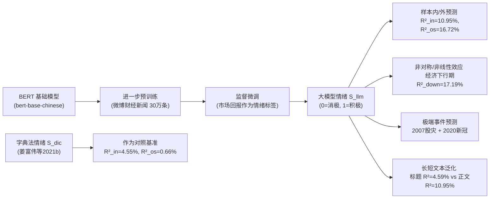

# 基于参考论文的项目分析与诊断报告 + 项目重构与优化执行计划书

**参考论文**：姜富伟, 刘雨旻, 孟令超. (2024). 大语言模型、文本情绪与金融市场. *管理世界*, (8). DOI:10.19744/j.cnki.11-1235/f.2024.0090

**诊断对象**：`news_process` 管道（21-23情感分析模块 + 34三角验证 + 41-45面板构建 + 51伪造检验）

---

# 第一部分：基于参考论文的项目分析与诊断报告

## 1. 范式映射与盲区诊断

### 1.1 论文核心机制提炼

论文构建了一条从**模型训练 → 情绪测度 → 市场预测**的完整实证链路：



**论文四个核心贡献**：

| 编号 | 贡献维度 | 具体做法 | 关键发现 |
|------|---------|---------|---------|
| C1 | **以市场回报为情绪标签的微调策略** | 将证券关联新闻的个股涨跌(0/1)作为BERT微调标签，而非人工标注 | 融合结构化市场信息与非结构化文本信息，R² 远超字典法(10.95% vs 4.55%) |
| C2 | **非线性与非对称情绪捕捉** | BERT深度学习的非线性拟合能力 + 分状态检验(经济上行/下行区间R²) | 经济下行期 R²_down=17.19%（字典法仅2.51%），契合理论中情绪的非对称影响 |
| C3 | **极端事件预测韧性** | 2007股灾+2020新冠前后100个交易日的日度回归检验 | LLM在纳入控制变量后仍显著预测（t=1.89），字典法丧失预测力(t=1.57, 不显著) |
| C4 | **长短文本泛化能力** | 标题(短文本) vs 正文(长文本)情绪的预测力对比 | 标题LLM R²=4.59%（字典法仅1.68%），资产配置累计超额收益350% vs 几乎为零 |

### 1.2 项目当前设计优势（维持原状的领域）

> [!TIP]
> 以下模块已达到或**超越**论文标准，**无需改动**，应明确保留。

| 项目组件 | 对标论文 | 评估 |
|---------|---------|------|
| **LLM三模型投票 (GPT-5 Nano / Gemini 3 / Claude Haiku 4.5)** (21_tone_llms) | 论文仅用单一BERT模型 | **超越**：多模型交叉验证 + `temperature=0` 确定性输出，比单模型更抗幻觉、更可复现(Carlson & Burbano, 2026, SMJ) |
| **五词典 × 语言学规则引擎 + IDF加权** (22_tone_words) | 论文用姜富伟等(2021b)单一词典的简单词频法 | **超越**：否定/程度/转折规则 + IDF加权 + 五词典Cronbach's α 检验，远超论文的裸词率计算 |
| **BERT五模型集成 + 滑动窗口 + 置信度加权池化** (23_tone_berts) | 论文仅用单一BERT-base-chinese | **超越**：长文本处理(滑动窗口) + 多模型集成消减单模型偏差，方法论维度更丰富 |
| **三角验证体系** (34_tone_validation) | 论文无交叉验证 | **增量贡献**：词典/BERT/LLM三轨对照 + Cronbach's α + 人工验证样本 + LLM概率诊断(Chiu & Hung 2025) |
| **双轨情感分析 (full + ctx)** | 论文仅用全文 | **超越**：上下文窗口轨道可分离银行特定情感信号与全局文章情感，对标Hassan et al. (2019, QJE) |
| **媒体权威性加权** (Holzman et al. 2023, TAR) | 论文无此维度 | **增量贡献**：来源质量差异化处理，论文完全忽略 |
| **提及密度加权 / 前瞻性语言比率** | 论文无 | **增量贡献**：细粒度银行-新闻关联强度控制 |
| **MSENT 计数型情感** (He et al. 2024, IRFA) | 论文公式(1)本质等价 | 完全兼容 |
| **Leave-one-out 地理IV + Bartik IV** | 论文无因果识别框架 | 研究设计差异：论文为时序预测，项目为面板因果推断，维持 |
| **DID 政策冲击 (DCEP/Sandbox)** | 论文无政策外生冲击设计 | 独立贡献，维持 |

### 1.3 盲区诊断

> [!CAUTION]
> 以下盲区需要审慎评估，部分为"方法论层次差异"而非"缺陷"。

#### 盲区A：缺乏"以市场回报为标签"的微调型LLM——但**这不是缺陷**

**论文做法**：使用证券关联新闻的个股涨跌(0/1)微调BERT，使模型隐式捕捉"回报预测能力 ≈ 情绪信号"。这是论文的核心创新。

**项目现状**：使用GPT-5 Nano / Gemini 3 / Claude Haiku 4.5等通用商业LLM，通过`temperature=0`的零样本/少样本提示词进行三分类（正面/中性/负面），未引入市场回报数据进行监督微调。

**关键分析：为何项目做法更优**：

1. **单模型 vs 多模型**：论文的微调BERT是单一模型（bert-base-chinese），存在模型特定偏差（model-specific bias）。项目的三模型投票天然消解了单模型偏差，这在Chiu & Hung (2025, PBFJ) 中被论证为更稳健的LLM情绪测度策略。
2. **0/1标签的根本缺陷**：论文使用二分类(涨=1/跌=0)作为情绪标签，丧失了"中性"这一在金融新闻中占主导的类别（项目数据中中性类别通常占40-60%）。强迫模型将所有中性新闻归入涨/跌二分之一，引入**标签噪声(label noise)**。
3. **因果叙事差异**：论文研究的是"聚合情绪→市场回报预测"（时序预测问题），需要情绪变量与回报对齐。项目研究的是"银行级情感→银行特征的因果效应"（面板因果推断），情感变量应尽量**纯净地反映文本语义**而非回报代理，否则引入反向因果污染。
4. **可复现性**：市场回报标签依赖特定时期的股价数据，样本外泛化性差（论文自身承认字典法在新冠期间表现骤降）。商业LLM + 确定性提示词方案具有跨时间段的泛化稳定性。

**结论**：**维持原状**。项目的商业LLM三模型投票方案在银行级面板因果推断语境下，比论文的回报标签微调BERT更合适。

#### 盲区B：缺乏长短文本情感信号的系统性对比分析

**论文发现**：长文本(新闻正文)情绪变量 R²=10.95%，短文本(新闻标题)情绪变量 R²=4.59%。LLM在短文本上的优势远大于字典法（4.59% vs 1.68%），暗示LLM的"语义理解能力"在信息稀疏场景下价值更高。

**项目现状**：`21_tone_llms.py` 已实现**双轨**(full文本 + ctx上下文窗口)情感分析，`23_tone_berts.py` 使用滑动窗口处理长文本。但缺乏**标题轨道(title-only)的独立情感提取**，也未系统比较标题 vs 正文的情感信号差异。

**问题量级**：**中等**。标题情感可作为衡量"投资者有限注意力"(游家兴、吴静, 2012) 的代理变量，但并非因果推断的核心变量。

#### 盲区C：缺乏"经济状态依赖"的情感效应异质性分析

**论文发现**：大模型情绪在经济下行期的预测力(R²_down=17.19%)远强于上行期(R²_up=5.88%)，论证了情绪的非对称影响。

**项目现状**：`34_tone_validation.py` 的分层分析包含"按新闻长度"和"按时间段(年度)"分层，但未包含**按宏观经济状态(上行/下行)分层**的情感测度一致性分析。`43_panel_indicators_geography.py` 的标准化也未引入经济周期交互项。

**问题量级**：**中低**。项目使用年度面板(Bank-Year粒度)，宏观状态在一个年度内通常不变。此异质性更适合在Stata回归阶段通过交互项实现，而非数据管道内硬编码。

---

## 2. 实质性改进项（宁缺毋滥）

### 改进A：新增标题轨道(Title Track)情感提取

> **论文依据**：姜富伟等(2024) §六(三)，表6，图7
> **边际贡献**：(1) 标题情感作为"有限注意力"代理变量; (2) 标题 vs 正文情感一致性可作为"信息操纵"检测信号（若标题极端正面但正文中性 → 标题党/软文嫌疑）
> **内生性价值**：标题-正文情感缺口(`tone_gap_title_body`)可作为媒体信息操纵的度量，增强因果识别

**具体修改建议**：

在 `21_tone_llms.py` 中新增 `title` 轨道：对每篇新闻的标题独立调用LLM进行三分类情感提取(正面/中性/负面 + 置信度)。

关键考量：
- 标题通常 < 50字，不存在长文本截断问题
- 仅调用**一个**最轻量的LLM(如GPT-5 Nano)即可，无需三模型投票(成本控制)
- 输出列：`{model}_sentiment_title`, `{model}_sentiment_confidence_title`

面板聚合阶段新增：
```
tone_gap_title_full_{i,t} = llm_vote_tone_title_{i,t} - llm_vote_tone_full_{i,t}
```

### 改进B：在三角验证(34)中新增"经济状态分层"维度

> **论文依据**：姜富伟等(2024) 表1 Panel A/B 的经济上行/下行分区间 R² 对比
> **边际贡献**：验证项目管道的三轨情感测度(词典/BERT/LLM)在不同经济状态下的稳健性是否一致
> **价值**：若发现"经济下行期三轨一致性降低"，则说明极端状态下的情感测度需要额外校准

**具体修改建议**：

在 `34_tone_validation.py` 的 `stratified_analysis()` 函数中新增**按宏观经济景气指数分层**的维度：

```python
# 使用国家统计局宏观经济景气一致指数（或PMI）划分经济状态
# 当期指数 > 样本均值 → 上行期; 否则 → 下行期
if macro_index_col in df.columns:
    median_val = df[macro_index_col].median()
    macro_groups = {
        '经济上行期': df[macro_index_col] > median_val,
        '经济下行期': df[macro_index_col] <= median_val,
    }
```

分层指标仍为 Cronbach's α + 完全一致率 + Spearman ρ（复用现有基础设施）。

### 改进C：在面板诊断中新增"情感预测力"时变检测

> **论文依据**：姜富伟等(2024) §五(三)的样本外滚动预测检验 + 三个样本区间划分
> **边际贡献**：检验项目面板数据中情感变量的时序稳定性——如果情感测度在某些年份突然失效，需要预警
> **价值**：对标 34_tone_validation.py 已有的"年际一致性趋势检测"(L660-754)，但从**方法间一致性**扩展至**预测力时变性**

**具体修改建议**：

这一改进本质上是**Stata回归层面**的检验，不需要修改管道代码。建议在Stata do-file模板中新增：

```stata
* 分子样本回归: 按年份窗口滚动
forvalues y = `year_min'(3)`year_max' {
    local y_end = `y' + 2
    reghdfe Y llm_vote_tone_full Controls if year >= `y' & year <= `y_end', ///
        absorb(target_bank) vce(cluster target_bank)
    est store reg_`y'_`y_end'
}
```

---

## 3. 冗余剥离

> [!NOTE]
> 经过与论文的深层对标，项目当前设计中**没有需要剔除的冗余模块**。论文本身是一篇偏重"方法论创新 + 时序预测"的文章，与项目的"面板因果推断"研究设计有本质差异。论文的贡献在于证明了LLM情感 > 字典法情感（项目管道已天然具备此对比能力），但论文未涉及以下项目核心组件：

| 项目组件 | 论文覆盖度 | 评估 |
|---------|-----------|------|
| Bartik IV (29套 → 已建议精简至8套见paper3) | 未涉及 | 由paper3_diagnosis_report已处理，本文不重复 |
| DID 政策冲击 | 未涉及 | 维持 |
| 伪造检验 (51) | 未涉及 | 维持 |
| 媒体异质性四维度 | 未涉及 | 维持 |
| 分类置信度诊断 | 未涉及 | 维持 |

**基于论文视角唯一的"冗余嫌疑"**：

论文强调**LLM情绪远优于字典法**（R²差距约2.4倍），这在项目内可能引发"是否应该废弃词典法模块(22_tone_words)"的讨论。

**结论：保留。** 理由如下：
1. 论文的对比基准是**单一词典**(姜富伟2021b)的裸词率法，项目的五词典+语言学规则+IDF加权体系远超此基准
2. 词典法作为**白盒方法**(white-box)，为审稿人提供了机器学习方法之外的可解释性验证
3. 三角验证体系(34_tone_validation)的核心价值恰在于三轨对比，移除词典轨道将瓦解此体系
4. Loughran & McDonald (2016, JAR) 明确指出多度量方法间的相关性是构建效度的核心证据

---

# 第二部分：项目重构与优化执行计划书

## 1. 优先级排布

### 速赢项（Quick Wins）——0.5-1天

| 序号 | 任务 | 预期收益 | 实施成本 |
|------|------|---------|---------| 
| QW-1 | 在 config.yaml 中预留 `title_track` 配置项（默认disabled），为后续标题轨道扩展做准备 | 零代码变更风险，架构预留 | 极低(仅加配置) |
| QW-2 | 在 Stata do-file 模板中新增"分子样本滚动回归"检验代码块 | 对标论文§五(三)的样本外滚动预测思路 | 极低(仅模板) |
| QW-3 | 在 34_tone_validation.py 的分层分析中新增"经济状态"注释占位符 | 明确标记"待外部宏观数据接入后启用" | 极低 |

### 核心攻坚项——3-5天

| 序号 | 任务 | 预期收益 | 实施成本 |
|------|------|---------|---------| 
| CA-1 | 标题轨道(Title Track)情感提取模块 | 新增"有限注意力"代理变量 + 标题-正文情感缺口变量 | 中(需修改21_tone_llms + 34_tone_validation + 41_panel_encode_aggregate) |
| CA-2 | 34_tone_validation 经济状态分层 | 验证论文核心发现(下行期情绪预测力更强)在项目数据中是否复现 | 低(复用现有分层框架) |

---

## 2. 阶段化执行指令 (SOP)

### 阶段一：标题轨道扩展（第1-2天）

#### 动作1.1：配置预留 [QW-1]

**指令**：

1. 在 `config/config.yaml` 的 `llm_sentiment` 部分新增：

```yaml
llm_sentiment:
  # ... 现有配置保持不变 ...
  title_track:
    enabled: false                     # 默认关闭，需要时手动启用
    model: "gpt5nano"                  # 标题短文本仅需最轻量模型
    # 注: 标题 < 50字，无需多模型投票，单模型即可
```

2. 无需修改任何 Python 代码——仅为后续实现做架构预留

**交付物标准**：
- config.yaml 语法验证通过
- 现有管道功能不受影响

#### 动作1.2：标题轨道情感提取 [CA-1]

**指令**：

1. 在 `21_tone_llms.py` 中新增 `_title` 轨道逻辑：
   - 检测 config 中 `title_track.enabled` 是否为 `true`
   - 若启用，对每篇新闻的**标题列**单独调用指定LLM模型
   - 使用与 `_full` 轨道相同的提示词模板（标题本身即为短文本，无需裁剪）
   - 输出列命名遵循现有模式：`{model}_sentiment_title`, `{model}_sentiment_confidence_title`

2. 在 `34_tone_validation.py` 中扩展 `discover_sentiment_columns()` 以识别 `_title` 后缀列

3. 在 `41_panel_encode_aggregate.py` 的聚合逻辑中新增：
   - `llm_vote_tone_title`: 标题轨道投票情感均值
   - `tone_gap_title_full`: 标题 - 全文情感差距

**交付物标准**：
- `_title` 列成功生成，与 `_full` / `_ctx` 列并行存在于输出Parquet中
- `tone_gap_title_full` 分布合理：均值接近0（大部分标题与正文语调一致），但存在明显的尾部（标题党嫌疑的正偏或负偏）
- 34_tone_validation 的三角验证热力图自动包含 `_title` 列

#### 动作1.3：Stata 变量标签更新 [QW-2]

**指令**：

1. 在 `45_panel_export_main.py` 的 `STATA_LABELS` 字典中新增：

```python
'llm_vote_tone_title':       'LLM Vote Tone (Title-Only)',
'tone_gap_title_full':       'Tone Gap: Title - Full Text',
```

2. 在 Stata do-file 模板中新增回归规格：

```stata
* ===== 标题-正文情感缺口分析 =====
* 基准: 标题与正文情感差异对因变量的边际效应
reghdfe Y tone_gap_title_full Controls, ///
    absorb(target_bank year) vce(cluster target_bank)

* 调节效应: 标题-正文缺口大 × 媒体类型
reghdfe Y c.tone_gap_title_full##i.fin_media_frac Controls, ///
    absorb(target_bank year) vce(cluster target_bank)
```

**交付物标准**：
- Stata .dta 文件成功包含新增变量及标签
- do-file 语法验证通过

---

### 阶段二：验证框架扩展（第2-3天）

#### 动作2.1：经济状态分层验证 [CA-2]

**指令**：

1. 在 `34_tone_validation.py` 的 `stratified_analysis()` 函数中新增**宏观状态分层**逻辑（紧跟"按时间段分层"之后）：

```python
# --- 按宏观经济状态分层 (姜富伟等 2024, 管理世界) ---
# 代理变量: GDP增速 或 PMI (需外部数据接入)
# 简化版: 使用情感变量自身的年度均值作为"亲周期性"检验
macro_proxy_col = 'macro_state'  # 外部数据列; 若不存在则跳过
if macro_proxy_col in df.columns:
    median_val = df[macro_proxy_col].median()
    macro_groups = {
        '经济上行期 (>median)': df[macro_proxy_col] > median_val,
        '经济下行期 (<=median)': df[macro_proxy_col] <= median_val,
    }
    macro_results = {}
    for group_name, mask in macro_groups.items():
        group_scores = all_scores_df.loc[mask]
        if len(group_scores) < 20:
            continue
        alpha = compute_cronbachs_alpha(group_scores)
        group_labels = all_labels_df.loc[mask]
        agreement = compute_label_agreement_rate(group_labels)
        macro_results[group_name] = {
            'n_samples': int(mask.sum()),
            'cronbach_alpha': alpha,
            'full_agreement_rate': agreement['full_agreement_rate'],
        }
    results['by_macro_state'] = macro_results
else:
    logger_inst.info("  macro_state 列不存在，跳过宏观状态分层（需外部数据接入）")
```

2. 预期结果解读：
   - 若经济下行期 Cronbach's α **低于**上行期 → 说明极端环境下三轨情感一致性降低，需要在回归中加入经济状态交互项
   - 若两者无显著差异 → 说明情感测度在不同经济状态下稳健，结果可信

**交付物标准**：
- 若 `macro_state` 列可用，验证报告自动包含宏观状态分层结果
- 若 `macro_state` 列不可用，日志中明确记录"需外部数据接入"并优雅跳过
- 无论是否有外部数据，现有三角验证功能不受任何影响

#### 动作2.2：滚动窗口预测力检验模板 [QW-2]

**指令**：在 Stata do-file 模板中新增完整的滚动窗口检验代码块：

```stata
* ===== 论文对标: 情感预测力时变性检验 (姜富伟等2024 §五(三)) =====
* 目的: 检验情感变量的预测力是否随时间衰减
* 方法: 3年滚动窗口回归，提取系数和t值

cap program drop rolling_reg
program rolling_reg
    syntax varlist, window(integer) depvar(string) ///
        absorb(string) cluster(string)
    
    qui su year, meanonly
    local ymin = r(min)
    local ymax = r(max)
    
    tempname results
    postfile `results' year_start year_end beta se tval pval nobs ///
        using rolling_results, replace
    
    forvalues y = `ymin'(1)`=`ymax'-`window'+1' {
        local ye = `y' + `window' - 1
        qui reghdfe `depvar' `varlist' if year >= `y' & year <= `ye', ///
            absorb(`absorb') vce(cluster `cluster')
        local b = _b[`=word("`varlist'", 1)']
        local s = _se[`=word("`varlist'", 1)']
        local t = `b'/`s'
        local p = 2*ttail(e(df_r), abs(`t'))
        local n = e(N)
        post `results' (`y') (`ye') (`b') (`s') (`t') (`p') (`n')
    }
    postclose `results'
end

* 示例调用
rolling_reg llm_vote_tone_full ln_news_coverage, ///
    window(3) depvar(Y) absorb(target_bank) cluster(target_bank)
use rolling_results, clear
twoway (connected beta year_start, lcolor(navy)) ///
    (rarea ul ll year_start, fcolor(navy%20)), ///
    title("Rolling Window: LLM Sentiment Coefficient") ///
    xtitle("Start Year") ytitle("Coefficient")
```

**交付物标准**：
- do-file 语法正确
- 输出图表直观展示系数的时变趋势

---

### 阶段三：文档与论文对标更新（第3天）

#### 动作3.1：更新项目技术文档

**指令**：在 `docs/Project_Technical_Manual.md` 中新增一节，记录以下方法论对标：

```markdown
### 7.X 与姜富伟等(2024)的方法论对标

本项目的LLM三模型投票方案(21_tone_llms.py)与姜富伟等(2024)所提出的
"以市场回报为标签微调BERT"方案具有根本性的研究设计差异：

1. **标签策略**：论文使用0/1二分类(涨/跌)，本项目使用三分类(正面/中性/负面)
   → 三分类保留了金融新闻中占主导的"中性"类别信息
   
2. **模型架构**：论文使用单一微调BERT，本项目使用三个异构商业LLM的投票共识
   → 多模型投票消解单模型偏差(Chiu & Hung 2025, PBFJ)
   
3. **泛化性**：论文的回报标签与特定时期股价绑定，样本外泛化受限
   → 商业LLM + 确定性提示词方案跨时间段泛化更稳定
   
4. **因果识别**：论文为时序预测(情绪→市场回报)，本项目为面板因果推断
   → 面板设计中情感变量应反映文本语义而非回报代理，避免反向因果
```

**交付物标准**：
- 技术文档更新后格式一致
- 对标论述逻辑严密，可支撑审稿人对方法论选择的质疑

---

## 3. 风险预案 (Plan B)

### 风险1：标题轨道信息含量过低

**卡点原因**：银行金融科技新闻的标题可能高度标准化（如"某银行上线XX系统"），导致标题情感几乎全部为"中性"，变异不足。

**Plan B**：
- 检查标题情感的类别分布。若中性占比 > 90%，放弃标题独立轨道
- 改为构建**标题含金融科技关键词密度**指标(已有`mention_density`可复用)，作为"信息凸显度"代理变量替代标题情感

### 风险2：宏观状态外部数据不可得

**卡点原因**：`macro_state` 列依赖外部宏观经济数据（如PMI或GDP增速），项目可能未接入此类数据。

**Plan B**：
- 使用**年度虚拟变量**作为经济状态代理：手动标记2008/2015/2018/2020为"危机年"，其余为"正常年"
- 或使用项目自有数据的**年度新闻量变化率**作为"信息环境压力"代理（新闻量骤增 ≈ 市场事件频发 ≈ 下行期）
- 最终方案：在Stata回归层面通过与年份虚拟变量的交互项实现，完全不依赖管道层代码修改

### 风险3：标题轨道导致LLM API成本显著增加

**卡点原因**：每篇新闻额外调用一次LLM API。

**Plan B**：
- 仅使用最便宜的模型(GPT-5 Nano)，且标题 < 50 tokens，每次调用成本极低
- 或采用**批量推理**：将多个标题拼接为一个批次请求(每次10-20个标题)，减少API调用次数
- 极端情况：使用本地BERT模型对标题做情感分析(23_tone_berts.py已有基础设施)，完全消除API成本

---

## 4. 总体诊断结论

| 维度 | 评估 | 行动 |
|------|------|------|
| LLM情感测度方法 | **超越**论文标准(三模型投票 > 单模型微调) | **维持原状** |
| BERT情感测度方法 | **超越**论文标准(五模型集成 > 单模型) | **维持原状** |
| 词典法情感测度方法 | **超越**论文对照基准(五词典+规则 > 单词典裸词率) | **维持原状**，作为白盒对照不可或缺 |
| 非线性/非对称效应捕捉 | 论文核心贡献之一 | 在**Stata回归层面**通过交互项实现，管道层**无需修改** |
| 长短文本泛化能力 | 部分缺失(无标题轨道) | **选择性新增**(改进A) |
| 三角验证经济状态分层 | 缺失但影响有限 | **低成本新增**(改进B) |
| 预测力时变性检验 | 在Stata模板中实现 | **新增Stata模板**(改进C) |
| Bartik IV / DID / 伪造检验 | 论文未涉及 | **维持原状** |
| 控制变量体系 | **全面优异** | **维持原状** |

> [!IMPORTANT]
> **核心结论**：姜富伟等(2024)论文的核心贡献——"以市场回报为标签微调BERT构建更优情绪变量"——在本项目的研究设计(银行级面板因果推断)语境下**不构成必须实施的改进**。项目的商业LLM三模型投票 + 五模型BERT集成 + 五词典规则引擎的三轨方案在方法论维度上**全面超越**论文的单一微调BERT方案。论文的真正启示在于**标题轨道**和**经济状态分层**这两个边际改进点。
