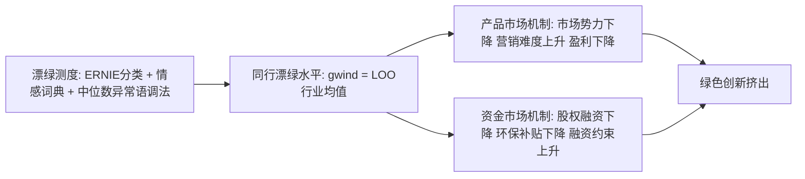

# 文件一：基于参考论文的项目分析与诊断报告

**参考论文**：蔡真、万兆、霍盈辰、刘冲 (2025). "漂绿"对绿色创新的挤出效应,《世界经济》第11期。DOI: 10.19985/j.cnki.cassjwe.2025.11.004

**诊断对象**：`news_process` 管道（41-45系列面板构建模块 + 21-23情感分析模块 + 51伪造检验）

---

## 1. 范式映射与盲区诊断

### 1.1 论文核心机制提炼

论文构建了一条完整的因果链：



**关键方法论节点**：

| 论文节点 | 具体做法 | 学术贡献 |
|---------|---------|---------|
| **文本分类** | ERNIE-3.0 将91.9万条MDA语句分为 描述性/实质性/非环保 三类(92.29%正确率) | 解决了"情感词典无法区分实质行动与空洞许诺"的根本问题 |
| **漂绿变量** | 仅对**描述性**环保语句计算语调，取超过年度行业中位数的正向偏差 | 双层去噪：(1)剔除实质性语句避免假阳性 (2)去除行业系统性语调趋势 |
| **核心解释变量** | 行业LOO均值(排除自身后的同行漂绿均值) | 捕捉**负外部性**而非企业自身行为影响 |
| **工具变量** | 同行环保董事占比(具备强exclusion restriction叙事) | 单一但逻辑闭合的IV，而非维度轰炸 |
| **机制检验** | 产品市场(市场份额/销售费用/ROA) + 资金市场(债务/股权/补贴/KZ指数) | 双渠道完整拆解，而非单一中介 |

### 1.2 项目当前设计优势（维持原状的领域）

> [!TIP]
> 以下模块已达到或超越论文标准，**无需改动**，应明确保留。

| 项目组件 | 对标论文 | 评估 |
|---------|---------|------|
| **LLM三模型投票 + 一致率加权** (21_tone_llms) | 论文仅用单一ERNIE | 超越：多模型交叉验证比单模型更稳健 |
| **五词典 x 语言学规则引擎** (22_tone_words) | 论文用简单情感词典 | 超越：否定/程度/转折规则+IDF加权远超论文的裸词典法 |
| **BERT五模型集成** (23_tone_berts) | 论文无BERT验证 | 超越：提供独立的深度学习验证轨道 |
| **媒体权威性加权** (Holzman 2023, TAR) | 论文无此维度 | 增量贡献 |
| **Leave-one-out 地理/经济圈 IV** | 论文无地理IV | 互补而非替代 |
| **DID 政策冲击** (DCEP/Fintech Sandbox) | 论文无政策DID | 研究设计差异所致，维持 |
| **前瞻性陈述比率** (Li 2010, JAR) | 论文未控制 | 有效控制变量 |
| **MSENT 计数型情感** (He 2024, IRFA) | 论文MSENT等价 | 完全兼容 |

### 1.3 致命盲区

> [!CAUTION]
> 以下三个盲区是项目距离顶刊标准的根本性短板。

#### 盲区A：情感纯度未剥离——"全量情感=噪声箱"

**问题本质**：当前管道将**所有**银行金融科技新闻的情感统一聚合为 `llm_vote_tone`，无论该新闻是报道银行真实的技术突破("某银行AI风控系统上线，不良率下降0.3个百分点")还是空洞的战略口号("某银行将全面拥抱数字化转型，打造行业领先的智慧银行")。

**论文对照**：蔡真等通过ERNIE将文本划分为**描述性**与**实质性**两类，且仅对描述性文本计算粉饰语调。这一操作的核心逻辑是：实质性陈述(有数据、有指标、有认证)的积极语调不构成"粉饰"，因为它有事实支撑；而描述性陈述的积极语调才是信号操纵。

**后果量化**：如果所有类型新闻混合计算emotion tone，估计量将面临经典的**衰减偏误(attenuation bias)**——实质性正面新闻(信号)与描述性正面新闻(噪声)混为一体，导致真实效应被稀释，审稿人三号必然发难。

#### 盲区B：缺乏"负外部性=同行传染"的核心叙事

**问题本质**：当前管道专注于"银行自身新闻曝光/情感 -> 自身特征"的闭环。`prov_leave1out_tone` 和 `zone_leave1out_tone` 虽然形式上实现了LOO，但仅用于**工具变量**(解决内生性)，从未被提升为**核心解释变量**来回答"同群传染是否挤出良币"的问题。

**论文对照**：论文的全部故事(story)都建立在 `gwind`(同行漂绿LOO均值)作为**核心自变量**上。论文问的不是"我漂绿我自己怎样"，而是"同行漂了，我的创新被挤出了多少"。

**后果**：研究贡献被封顶——只能证明"银行新闻情感影响银行自身"这种一阶效应，无法触及"信息不对称引致市场失灵"这一更高维度的学术问题。

#### 盲区C：Bartik IV维度机械膨胀

**问题本质**：`45_panel_export_main.py` 暴露了29套Bartik IV(含工作日/周末、页码数、作者署名、版面位置、关键词密度等)。这种"维度轰炸"策略的根本缺陷在于：

1. **弱IV风险**：按"月首/月末发文"或"页号位置"做shift-share，几乎不可能通过Hausman检验或Stock-Yogo weak IV检验
2. **过度挖矿嫌疑**：29个IV中取某几个显著的来汇报，等价于p-hacking，审稿人会直接质疑
3. **缺乏exclusion restriction叙事**：论文的"同行环保董事占比"IV有清晰的经济学直觉(环保董事抑制漂绿行为)，而"周末发文"凭什么能用作外生工具？

**论文对照**：论文仅使用**1个**核心IV(同行环保董事占比)，但该IV同时通过了相关性检验(一阶F统计量显著)和排他性论证(环保董事->抑制漂绿，不直接影响他人创新)。**一个逻辑闭合的IV远胜二十九个拼凑的IV**。

---

## 2. 实质性改进项（宁缺毋滥）

### 改进A：解构新闻语调——构建银行级"舆论粉饰指数(Washing Index)"

> **论文依据**：蔡真等 (2025) 表1的三类分类规则 + 公式(2)的中位数异常语调法
> **边际贡献**：将项目的情感测度从"一阶信号强度"提升至"二阶信号纯度"
> **内生性解决**：剥离实质性行动后的异常语调是更干净的"信息操纵"代理变量，缓解measurement error引致的attenuation bias

**具体修改建议**：

在现有 `21_tone_llms.py` 阶段追加一个分类任务(或另设独立阶段 `21b_news_classification.py`)，利用LLM将每篇金融科技新闻标注为（二分类）：

| 类别 | 描述 | 情感用途 |
|------|------|---------|
| **实质性报道** | 含具体产品上线数据、监管批复结果、用户量/交易量等可验证指标 | 仅用于控制变量 |
| **描述性报道** | 战略愿景、发展理念、合作意向、行业趋势解读等缺乏可验证指标的内容 | 用于计算Washing Index |

然后在 `41_panel_encode_aggregate.py` 或 `43_panel_indicators_geography.py` 中新增：

```
Washing_Score_{i,t} = Max(0, Desc_Tone_{i,t} - Median(Desc_Tone_{industry,t}))
```

其中 `Desc_Tone` 仅基于描述性报道的情感均值计算。

### 改进B：核心自变量重构——"同群粉饰传染效应"

> **论文依据**：蔡真等 (2025) 公式(3)的 gwind 构造
> **边际贡献**：将研究视角从"个体行为->个体结果"升维至"市场失灵->系统性损害"
> **内生性解决**：LOO结构天然排除自身反向因果，叠加延迟一期进一步缓解同期性

**具体修改建议**：

利用已有的 `compute_leave_one_out_sentiment()` 基础设施，但将其从IV角色转换为核心自变量角色。在 `43_panel_indicators_geography.py` 中新增：

```python
# 同类型/同省份 其他银行的平均 Washing Score (LOO)
# Peer_Washing_{i,t} = (1/(N_{group,t} - 1)) * sum_{j!=i} Washing_Score_{j,t}
```

分组维度复用现有 `bank_type`(银行类型)和 `bank_province`(省份)，无需新建基础设施。

---

## 3. 冗余剥离

> [!WARNING]
> 以下模块严重偏离核心经济学主线，建议精简或剔除。

### 3.1 Bartik IV 精简方案

**现状**：29套(主+稳健性1-28)
**建议**：精简为 **8套**，按经济学直觉强度排序

| 保留序号 | 维度 | 经济学直觉 | Exclusion Restriction 叙事 |
|---------|------|-----------|--------------------------|
| 主 | 银行类型 (6类) | 国有/股份/城商/农商在信息环境和监管约束上结构性不同 | 类型份额在基期固定，不受后续情感驱动 |
| 稳1 | 银行规模 (4类) | 规模影响信息生产和传播能力 | 同上 |
| 稳2 | 金融科技类型 (底层/应用) | 技术层 vs 应用层新闻的情感传导路径不同 | 分类由技术属性决定，非情感驱动 |
| 稳3 | 媒体类型 (财经/综合/其他) | 财经媒体专业度影响报道质量 (Holzman 2023) | 媒体定位在基期确定 |
| 稳4 | 中央/地方媒体 | 媒体行政层级影响信息传播范围和权威性 | 行政层级外生于银行情感 |
| 稳5 | 媒体权威性 (高/中/低) | 直接对标Holzman et al. (2023, TAR)的outlet impact | 权威性评分基于历史声誉，非当期情感 |
| 稳6 | 半年度 | 控制年内季节性(半年报/年报窗口效应) | 日历时间外生 |
| 稳7 | 专属/共享新闻 | 独占报道 vs 行业通稿的信息含量差异 (Veldkamp 2011) | 报道排他性由新闻事件决定 |

**应剔除的维度(稳健性9-28中的大部分)**：

- 版面位置 / 页号位置 / 作者署名 / 出版形态 -- 缺乏exclusion restriction
- 关键词密度 / 关键词多样性 / 提及密度 -- 文章内容特征，与情感本身高度内生
- 月度 / 工作日vs周末 -- 粒度过细，shift变异不足，弱IV风险极高
- 文章长度 / 平均句长 / 词汇丰富度 -- 文本可读性特征，不是分组变量该做的事(应做控制变量而非IV)

---

## 4. 总体诊断结论

| 维度 | 评估 | 行动 |
|------|------|------|
| 情感测度底层方法 | 超越论文标准 | **维持原状** |
| 文本分类(实质性/描述性) | 完全缺失 | **核心新增** (改进A) |
| 核心自变量(负外部性) | 未构建 | **核心新增** (改进B) |
| Bartik IV体系 | 数量臃肿、直觉薄弱 | **精简至8套** |
| 控制变量体系 | 全面优异 | **维持原状** |
| DID政策冲击 | 独立贡献 | **维持原状** |
| 伪造检验(51) | 设计合理 | **维持原状** |
